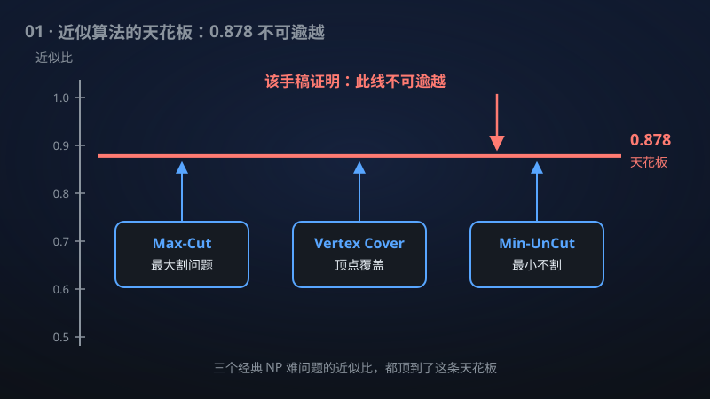

# 01 · 唯一游戏猜想（Unique Games Conjecture）与最优近似阈值

> 一举终结困扰理论计算机科学二十余年的"近似算法天花板"之争，给 Max-Cut 等经典难题画出不可逾越的精确界线。

**领域**：计算机科学、密码学、数学之美 ｜ **数学分支**：理论计算机科学 ｜ **原文**：[openai/math Family 102](https://github.com/openai/math)

---

## 🌱 小白版：这是什么问题？

想象你是班主任，要把全班 50 个同学分成两个春游小队。有些同学互相不对付，你希望"不对付的同学尽量分在不同队"——分得越开越好。这就是著名的 **Max-Cut（最大割）** 问题：给定一堆"矛盾关系"，求一种分组方案，让"被切开的矛盾"数量最多。

1995 年，Goemans 和 Williamson 发明了一种聪明的分组法：先把每个同学想象成高维空间里的一个箭头，再随机"切一刀"分组，保证能切开至少 **87.8%** 的理论最优值。这个 87.8% 像一座高峰——二十多年里，全世界的算法高手轮番冲锋，没人能超越它；但也没人能证明"超越不了"。也许明天就有人发明 90% 的方法呢？谁也说不准。

2002 年，数学家 Subhash Khot 提出一个大胆的猜想（**唯一游戏猜想**，UGC）：如果它成立，那么 87.8% 就是一堵**天花板**——任何算法、任何计算机都永远撞不破。这就像断言"人类百米永远跑不进 9 秒"：惊人，但二十多年无人能证实，也无人能证伪。

这项成果宣称一举证明了这个猜想。更彻底的是，它还**绕开猜想本身**、用已有的经典工具直接证明：Max-Cut 超过 87.8%、顶点覆盖好于 2 倍、Min-UnCut 在任何固定常数因子内——这些统统是不可能的。已有的算法就是最优的，不用再找了。

## 🎓 专业版：数学上到底说了什么？

**唯一游戏（Unique Games）** 是一类二元约束满足问题：每个约束是两个变量之间的一一对应（置换）关系，满足约束当且仅当两个变量的取值恰好符合该置换——"唯一"即指给定一边变量的取值，另一边的取值被唯一确定。记实例的最优值为满足约束的最大比例。

**唯一游戏猜想（Khot 2002）**：对任意 ε, δ > 0，存在字母表大小 q，使得区分唯一游戏实例的最优值 ≥ 1−ε 还是 ≤ δ 是 NP-难的。直观地说，即使实例"几乎完全可满足"，要分辨它是"几乎完美"还是"一塌糊涂"，在计算上都是不可行的。

该手稿宣称证明了 UGC。此外，它给出**独立的直接归约**（不依赖 UGC 本身，基于已建立的 PCP 定理与 Label Cover 难度结果），在**无权图**上证明了以下最优不可近似性：

- **Max-Cut**：近似比超过 Goemans–Williamson 比率 α_GW = min_{0<θ≤π} (2θ/π)/(1−cosθ) ≈ 0.878567 是 NP-难的；
- **Vertex Cover（顶点覆盖）**：近似比优于因子 2 是 NP-难的；
- **Min-UnCut**：在任何固定常数因子内近似是 NP-难的；
- **有向反馈顶点集**：在任何固定常数因子内近似是 NP-难的。

手稿摘要未披露具体的证明路线。

## 🔬 这项成果做了什么？

严格依据官方摘要，该手稿包含以下断言（分点列出）：

1. **证明了 Khot 的唯一游戏猜想**——区分"最优值 ≥ 1−ε"与"最优值 ≤ δ"的唯一游戏实例是 NP-难的；
2. **独立的直接归约**（不经过 UGC）：在无权图上，超过 Goemans–Williamson 比率的 Max-Cut 近似是 NP-难的；
3. 在无权图上，近似比优于因子 2 的 Vertex Cover 是 NP-难的；
4. 在无权图上，任何固定常数因子内的 Min-UnCut 近似是 NP-难的；
5. 在无权图上，任何固定常数因子内的有向反馈顶点集近似是 NP-难的；
6. 上述直接证明使用的是**已建立的** PCP 与 Label Cover 难度结果，而非引入新的未经验证的假设。

## 📜 时间线

- 1995：Goemans–Williamson 发明半定规划舍入算法，Max-Cut 达到 0.878 近似比，震惊学界；
- 2001：Håstad 证明 Max-Cut 在 16/17 + ε ≈ 0.941 内近似是 NP-难的——此后近二十年，无条件难度界再无实质推进；
- 2002：Subhash Khot 在 STOC 上提出唯一游戏猜想；
- 2005：Dinur–Safra 证明 Vertex Cover 在 1.3606 内近似是 NP-难的（无条件）；
- 2007：Khot–Kindler–Mossel–O'Donnell 证明"若 UGC 成立，则 Goemans–Williamson 的 0.878 是最优的"；
- 2008：Prasad Raghavendra 证明"若 UGC 成立，半定规划对一切约束满足问题都是最优算法"——UGC 一举成为近似算法的"万能钥匙"；
- 2010：Arora–Barak–Steurer 给出唯一游戏的次指数时间算法，说明 UGC 若成立，其难度窗口恰在"超多项式但次指数"之间；
- 本手稿：宣称无条件证明 UGC，并直接证明上述四个经典问题的最优不可近似性。

## 💡 核心思想

要理解 UGC 为什么被称为"近似算法的万能钥匙"，得先理解**近似算法**这门学问的逻辑。很多优化问题（如 Max-Cut）是 NP-难的，意味着"精确求解"几乎不可能；退而求其次，人们设计**近似算法**——保证能达到最优值某个比例（如 87.8%）的解。而**不可近似性**理论要回答的是反方向的问题：这个比例能不能再提高？0.88 行不行？0.9 呢？

这里的核心工具是 **PCP 定理**（1992）：NP 问题的证明可以被改写成一种"极难糊弄"的格式——只抽查常数个比特，就能以高概率发现证明中的谎言。PCP 定理把"近似"和"证明验证"连在了一起：一个优化问题难近似，当且仅当存在某种"间隙"（gap）——要么实例几乎完美，要么一塌糊涂，而区分这两者是 NP-难的。

**Label Cover** 是 PCP 的一种组合形态：给二部图的每条边配一个"标签对应关系"，问最多能满足多少条边。**唯一游戏**是 Label Cover 的特殊情形——对应关系退化为一一映射（置换）。Khot 的洞察是：这个"最纯粹"的版本恰好是**最难**的版本，它像一把钥匙，能打开 Max-Cut、Vertex Cover 等一大批问题的最优阈值之门。Raghavendra 2008 年的工作把这推向极致：在 UGC 假设下，半定规划（SDP）对**一切**约束满足问题都是最优的——相当于宣告"近似算法这门手艺，做到 SDP 就到头了"。

该手稿若成立，意味着这把钥匙不是假设，而是定理：近似算法的天花板被焊死了。

## 🧗 难在哪？

UGC 之所以折磨了学界二十多年，有三层难度。

第一，**它"几乎"被证伪过很多次**。2010 年 Arora–Barak–Steurer 的次指数算法说明：唯一游戏没有人们最初想象的那么难——它的难度恰好卡在"多项式时间不够、次指数时间够"的狭窄窗口里。任何证明都必须精确地落在这个窗口里，多一分则假、少一分则弱。UGC 的某些强化版本也确实被证伪或绕开过，真伪之争从未停息。

第二，**无条件的最优阈值极难**。以 Max-Cut 为例：条件性结果（假设 UGC）早在 2007 年就把 0.878 钉死了，但无条件的结果长期停留在 Håstad 2001 年的 16/17 ≈ 0.941——两者之间隔着巨大的鸿沟。Vertex Cover 更典型：无条件只知道 1.3606（Dinur–Safra 2005），而 UGC 下是 2（Khot–Regev 2008）。把"假设 UGC"这四个字拿掉，需要全新的归约思想，而不是在旧框架里修修补补。

第三，**证明必须同时"硬"和"干净"**。该手稿的策略是双管齐下：既证明 UGC 本身，又给出不依赖 UGC 的直接归约——后者只使用"已建立的 PCP 与 Label Cover 难度结果"。这意味着它的新意必须全部藏在归约构造里：如何从经典的 Label Cover 出发，不经过 UGC 的"间隙放大"，直接得到 0.878、2 这些精确常数。手稿摘要未披露具体路线，这也正是学界面对这类宣称时最需要检验的部分。

## 🚀 有什么用？

- **算法设计"止损"**：为 NP-难优化问题的近似算法画出"到此为止"的精确界线。以后再有人想把 Max-Cut 做到 0.88 以上、Vertex Cover 做到 2 倍以内，可以直接判定为不可能——把研究力量引向参数化算法、平均情形、特殊图类等真正有希望的新方向。
- **半定规划的"加冕"**：确认了半定规划在约束满足问题上的最优地位。SDP 求解器（如工业界的优化引擎）的理论根基从"假设最优"变为"确实最优"，这是算法理论的里程碑。
- **密码学基础**：Label Cover / Unique Games 的计算难度是许多密码学归约与安全证明的基础构件。UGC 从猜想变为定理（若成立），强化了基于这些难度的密码方案的可信度——这对格密码之外的若干候选方案有潜在影响。
- **工业优化的"理论证书"**：Max-Cut、Vertex Cover 的求解器广泛用于芯片布局、物流调度、社交网络分析。最优性界线给用户一颗定心丸：你买的求解器已经做到理论极限，不用再等"下一代算法"。
- **复杂性理论的版图**：在 P vs NP 这个终极问题之外，UGC 刻画了"近似"这一维度的精细结构。它的证明（若成立）是 PCP 定理之后，近似难度理论最重要的进展。
- **潜在影响·研究范式**：一旦"SDP 即最优"成为定理，近似算法研究的重心将彻底转向：要么研究 SDP 本身解不好的问题（如需要更高阶 Sum-of-Squares 的问题），要么转向平均情形与实例结构——这可能重塑未来十年的算法研究议程。

## 🔗 相关篇目

- [08 · QAOA 在热力学优先极限下达到 SK 最优](../docs/08-281-qaoa.md)——同样研究 Max-Cut：一边是"经典算法到顶了"，一边是"量子算法追平物理极限"
- [07 · 迹重构的定量界与统一解码器](../docs/07-122-trace-reconstruction.md)——同属理论计算机科学的"上下界"艺术
- [05 · 随机与量子查询复杂度的最优四次方分离](../docs/05-284-query-separation.md)——同样是把某个指数"钉死"的复杂性理论工作

## 📖 延伸阅读

- Khot, "On the power of unique 2-prover 1-round games", STOC 2002（UGC 的原始论文）
- Goemans–Williamson, "Improved approximation algorithms for maximum cut and satisfiability problems using semidefinite programming", JACM 1995
- Raghavendra, "Optimal algorithms and inapproximability results for every CSP?", STOC 2008
- Håstad, "Some optimal inapproximability results", JACM 2001
- Arora–Barak《计算复杂性：现代方法》（有中文译本），第 11、22 章讲 PCP 与近似难度

---

> **内容说明**：本文基于 [openai/math](https://github.com/openai/math)（Family 102）官方摘要的转述与中文解读。原成果由 AI 模型产出，官方标注验证程度不一、部分尚未形式化，此处转述不代表数学界共识；引用请以[原文](https://github.com/openai/math)为准。
