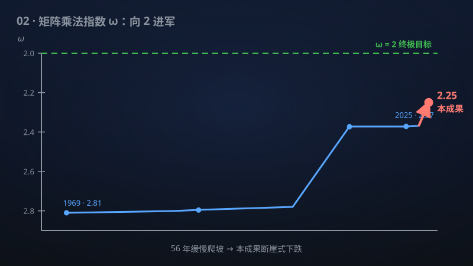

# 02 · 矩阵乘法指数 ≤ 9/4

> 矩阵乘法指数从 2.37 猛降到 2.25——半个世纪来最大的一次飞跃，直接加速一切依赖矩阵运算的 AI 与科学计算。

**领域**：计算机科学、数学之美 ｜ **数学分支**：理论计算机科学 ｜ **原文**：[openai/math Family 107](https://github.com/openai/math)

---

## 🌱 小白版：这是什么问题？

两个很大的数字表格（矩阵）相乘，是 AI 训练、天气预报、搜索引擎背后最常用的计算。中学里学的"逐行乘逐列再求和"方法，对 n×n 的表格大约需要 n³ 次运算——n 是 1000 时就是 10 亿次。

1969 年，德国数学家 Strassen 发现了一个巧妙的"7 次乘法代替 8 次"的技巧，把指数从 3 降到约 2.81，全世界都惊呆了：原来课本方法不是最优的！之后五十多年，数学家们用越来越精妙的"激光法"一点点往下磨：1990 年磨到 2.3755，2012 年到 2.3729，2023 年到 2.3719，2025 年到约 2.3713——**每次进步都只有小数点后第三、四位**，十几年总共才下降 0.0015，像用砂纸打磨钻石。

这项成果宣称直接把指数打到 **9/4 = 2.25**，相当于一次跳过了几十年的渐进式改进。别看只小了 0.12：当 n 很大时，n^2.25 和 n^2.37 的差距是天文数字——n 取一百万时，两者相差约 10^72 倍。打个比方：以前是从北京步行到上海，这次直接换成了高铁。

## 🎓 专业版：数学上到底说了什么？

记 **ω** 为方阵乘法的渐近指数：n×n 矩阵乘法可在 O(n^{ω+ε}) 次算术运算内完成（ε > 0 任意）。ω = 3 对应课本算法，ω = 2 是理论下限（至少要读一遍输入）。

该手稿宣称在复数域 ℂ 上证明 **ω ≤ 9/4**，从而方阵乘法可在 O_ε(n^{9/4+ε}) 次算术运算内完成（下标 ε 是渐近指数定义中的标准写法：常数因子允许依赖于 ε）。进一步的定量结论：

- **矩形乘法**：在特征零的域上，对某个内维 n^a（a > 0.465），可实现 n^{2+o(1)} 的矩形乘法——即"瘦长"矩阵相乘几乎达到理论最优；
- **正特征情形**：在除去有限多个正特征之外的所有特征下，ω < 2.258；
- **固定域上的一致界**：在每个固定域上，ω < 2.371054886006746（注意：这个界比之前最好的 2.371339 还要略优，说明新手稿在"每个固定域"上也有改进）。

手稿摘要未披露具体的证明路线（比如是否沿用激光法框架、张量构造有何创新）。

## 🔬 这项成果做了什么？

严格依据官方摘要，该手稿包含以下断言（分点列出）：

1. 在复数域 ℂ 上证明 ω ≤ 9/4（即 2.25），给出 O_ε(n^{9/4+ε}) 次算术运算的方阵乘法算法；
2. 在特征零的域上：存在 a > 0.465，使得内维为 n^a 的矩形矩阵乘法可在 n^{2+o(1)} 时间内完成；
3. 在除去有限多个正特征之外的所有特征下，ω < 2.258；
4. 在每个固定域上，ω < 2.371054886006746。

注意第 3、4 条是"进一步的平方界"——手稿似乎通过某种"平方"技巧（squaring）从主结果派生出这些跨特征的界。

## 📜 时间线

- 1969：Volker Strassen 发明 Strassen 算法，ω ≤ log₂7 ≈ 2.807——第一次证明 n³ 不是最优的；
- 1978–1987：Pan、Bini 等人发展"近似算法/边界秩"方法，指数缓慢下降到约 2.5；
- 1990：Coppersmith–Winograd 发明**激光法**（laser method），ω ≤ 2.3755——此后三十年所有改进都在这个框架内；
- 2003：Cohn–Umans 提出用群代数构造矩阵乘法算法的群论框架，一度被视为超越激光法的最大希望，但十余年未带来实质突破；
- 2010–2012：Stothers、Vassilevska Williams 优化激光法分析，ω ≈ 2.3729；
- 2014：Le Gall，ω ≤ 2.3728639；
- 2020：Alman–Vassilevska Williams，ω ≤ 2.3728596；
- 2023：Duan–Wu–Zhou 引入组合损失分析，ω ≤ 2.371866；
- 2024–2025：Vassilevska Williams–Xu–Xu–Zhou、Alman–Duan–Vassilevska Williams–Xu–Xu–Zhou 等把界推到约 2.3713——十几年总共下降约 0.0015；
- 本手稿：宣称 ω ≤ 2.25，一步跨越约 0.12。

## 💡 核心思想

矩阵乘法为什么能比 n³ 快？关键在于**张量秩**。两个 n×n 矩阵相乘，本质上是一个"双线性映射"；Strassen 的洞察是：2×2 矩阵乘法这个"小积木"可以用 7 次（而非 8 次）标量乘法完成。然后用**张量幂**的技巧：把小积木"叠"起来，n×n 的大问题分解成大量 2×2 小问题的组合，指数就从 3 降到了 log₂7 ≈ 2.807。一般地，若 k×k 矩阵乘法能用 r 次标量乘法完成，则 ω ≤ log_k(r)。Strassen 的"7 次乘法"对应 r = 7、k = 2，于是 ω ≤ log₂7 ≈ 2.807。此后五十年的所有工作，本质上都是在寻找"更划算的小积木"（r 相对于 k² 越小越好）或"更聪明的拼接方式"——激光法就是把"找小积木"变成了"雕刻大张量"，而雕刻工艺在 2.37 附近撞上了天花板。

**激光法**（Coppersmith–Winograd 1990）是这套思想的集大成者：它不直接构造小积木，而是构造一个"看起来像"矩阵乘法张量的中间张量，再用精巧的组合分析（"激光"般聚焦的零化技巧）把它"雕刻"成真正的矩阵乘法张量的直和。之后三十年的所有改进，本质上都是在优化这块"雕刻"工艺：更好的中间张量、更紧的组合计数、更聪明的递归。

该手稿从 2.371 一步跳到 2.25，幅度之大暗示它**不可能**只是优化雕刻工艺——很可能引入了全新的张量构造或全新的分析框架。但摘要没有披露路线，这里只能存疑待看：如果它真的绕开了激光法，那将是代数复杂性理论的一场革命。

顺带一提，终极猜想是 **ω = 2**（Strassen 的渐近秩猜想可推出它）：矩阵乘法在渐近意义下和"读一遍输入"一样快。本手稿的 2.25 是通往 2 的路上最大的一步。

值得单独说说手稿中那个**矩形乘法**的结果：a > 0.465 意味着，把 n×n^a 的"瘦长"矩阵与 n^a×n 的矩阵相乘，几乎只要 n² 时间——接近理论下限。这在应用上可能比方阵结果更实在：很多实际问题（如全源最短路、动态传递闭包、推荐系统中的低秩近似）天然就是矩形乘法。历史上矩形乘法的指数界一直落后于方阵，这个 n^{2+o(1)} 的结果若成立，相当于把一大类"瘦长"问题的理论复杂度直接打到最优附近。

## 🧗 难在哪？

矩阵乘法指数的难，在于它是一个"**看得见天花板、摸不着**"的问题。下界是平凡的 ω ≥ 2（至少要读写 n² 个数），上界从 1969 年的 2.807 开始被一点点往下压，但每一步都越来越难：

- **激光法的"内卷"**：1990 年之后，所有人都在 Coppersmith–Winograd 的框架里做优化。Ambainis、Filmus、Le Gall 等人甚至证明了：在激光法框架内，**2.37 附近就是极限**——框架本身的天花板到了。这就是为什么 2020–2025 年的改进只能抠小数点后第四位。
- **组合爆炸**：激光法的分析涉及对张量幂的精细组合计数，Duan–Wu–Zhou 2023 年的"组合损失分析"已经把能抠的几乎抠尽。
- **新框架难产**：要突破 2.37，必须跳出激光法。但三十多年来，群论方法（Cohn–Umans 2003 用群代数构造矩阵乘法算法，曾被寄予厚望）、几何方法（边界秩、张量网络）都没有带来实质突破。2010 年代甚至有人怀疑：2.37 附近会不会就是"人类方法的极限"，ω 的真值虽是 2，但我们永远只能证到 2.37？这种悲观情绪在领域内蔓延了十多年。

从 2.371 直接到 2.25，跨越了约 0.12——这相当于过去三十年总进步量的**八十倍**。如果证明成立，它必然包含某种全新的思想；如果证明有误，错误也很可能藏在某种全新的、未经检验的构造里。这正是学界需要仔细审查的地方。

## 🚀 有什么用？

- **人工智能（潜在）**：神经网络训练与推理的核心是矩阵乘法。指数从 2.37 降到 2.25，大幅拉低了大模型训练成本的**理论下界**。注意这是渐近理论结果：实际的 GPU 矩阵乘法（如 Strassen 型算法）因常数因子大、数值稳定性、内存层次等问题，短期内未必直接换用；但它指明了"更快"的方向，长期可能催生新的硬件友好算法。
- **科学计算（潜在）**：有限元分析、天气预报、计算流体力学中的稠密线性代数求解——求解线性方程组、特征值问题都可以归约到矩阵乘法，ω 下降意味着这些求解器的理论复杂度同步下降。
- **图算法（已部分落地）**：传递闭包、全源最短路、三角形计数等图问题都有"矩阵乘法归约"版本。ω = 2.25 会直接刷新一批图算法的理论最优界。
- **密码学与编码（潜在）**：格密码等后量子方案大量使用矩阵运算；快速矩阵乘法可能同时加速"加密"和"攻击"两端，需要重新评估安全参数。
- **量子计算模拟（潜在）**：经典计算机模拟量子线路时的张量网络缩并，本质上是矩阵乘法——更快的矩阵乘法意味着经典模拟的边界外推，量子优越性的"护城河"在理论上变窄一分。
- **理论计算机科学（已落地为"知识"）**：ω 是代数复杂性理论的中心常数之一。从 2.37 到 2.25 的飞跃本身，就是对"激光法已死、矩阵乘法已死"悲观论调的有力回击，会重新点燃整个领域。

## 🔗 相关篇目

- [03 · 低于 n log n 的精确傅里叶变换](../docs/03-130-fourier-transform.md)——同样是"经典算法复杂度丰碑被撼动"的故事，主角是 FFT
- [01 · 唯一游戏猜想与最优近似阈值](../docs/01-102-unique-games.md)——同属理论计算机科学，上下界艺术的另一极
- [07 · 迹重构的定量界与统一解码器](../docs/07-122-trace-reconstruction.md)——同样用精细的组合分析推进指数界

## 📖 延伸阅读

- Strassen, "Gaussian elimination is not optimal", Numerische Mathematik 1969（一切的起点）
- Coppersmith–Winograd, "Matrix multiplication via arithmetic progressions", J. Symbolic Computation 1990（激光法）
- Bürgisser–Clausen–Shokrollahi《Algebraic Complexity Theory》, Springer 1997（标准教材）
- Duan–Wu–Zhou, "Faster matrix multiplication via asymmetric hashing", FOCS 2023（激光法时代的巅峰之一）
- Alman–Vassilevska Williams, "A refined laser method and faster matrix multiplication", SODA 2021

---

> **内容说明**：本文基于 [openai/math](https://github.com/openai/math)（Family 107）官方摘要的转述与中文解读。原成果由 AI 模型产出，官方标注验证程度不一、部分尚未形式化，此处转述不代表数学界共识；引用请以[原文](https://github.com/openai/math)为准。
