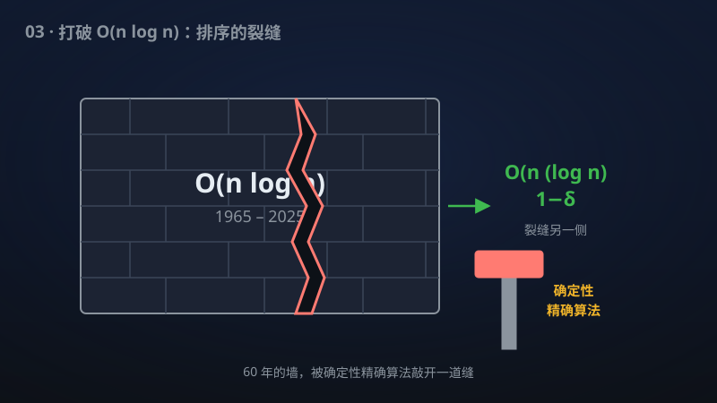

# 03 · 低于 n log n 的精确傅里叶变换

> 1965 年 FFT 树立的 n log n 丰碑首次被撼动——精确离散傅里叶变换可以比"快速"傅里叶变换更快。

**领域**：计算机科学、通信、数学之美 ｜ **数学分支**：理论计算机科学 ｜ **原文**：[openai/math Family 130](https://github.com/openai/math)

---

## 🌱 小白版：这是什么问题？

傅里叶变换是把信号分解成不同频率成分的数学工具，手机里的音乐识别、JPEG 图片压缩、5G 通信都离不开它。直接计算需要 n² 次运算；1965 年 Cooley 和 Tukey 发明的"快速傅里叶变换"（FFT）用分治技巧把它降到 n log n，快得惊人——六十年来全世界都在用它，没人能做得更快，人们甚至怀疑 n log n 就是不可逾越的极限。这项成果宣称：对精确的离散傅里叶变换，存在确定性算法只用 O(n (log n)^{1−δ}) 次运算（δ = 10^{−13}），第一次严格突破了 n log n 这道墙。突破的幅度目前还很小，但它是"从 0 到 1"的存在性突破——证明了这堵墙不是牢不可破的。

## 🎓 专业版：数学上到底说了什么？

长度 n 的离散傅里叶变换（DFT）。该手稿给出确定性算法，对一切 n，用 O(n(log n)^{1−δ}) 次运算计算 DFT，其中 δ = 10^{−13} 为显式常数。计算模型使用精确复数算术、无限制系数、给定的单位根，并计入标量准备与对数词长索引的开销。

## 🔬 这项成果做了什么？

该手稿给出了长度 n 的确定性离散傅里叶变换算法，对一切 n 使用 O(n(log n)^{1−δ}) 次运算，显式常数 δ = 10^{−13}。模型采用精确复数算术、无限制系数和给定的单位根，并计入标量准备与对数词长索引。

## 🧗 难在哪？

1965 年 Cooley–Tukey 的 FFT 把 DFT 从 O(n²) 降到 O(n log n)（其思想可追溯到 Danielson–Lanczos 1942 年的工作），六十年来成为实际计算的标准。在"精确复数算术、确定性、对一切 n"的模型下能否突破 n log n，是傅里叶算法理论中长期悬置的问题；此前所有精确算法都卡在 n log n 量级（稀疏傅里叶变换等结果依赖输入的稀疏性假设，不适用于一般输入）。δ = 10^{−13} 的指数改进虽小，却是存在性上的"从 0 到 1"。[待核实：该问题作为公开猜想的确切表述与最早提出年份]

## 🚀 有什么用？

- **信号处理与通信**：5G/6G、雷达、音频处理中 DFT 是最高频调用的计算核；渐近改进在大规模数据下会转化为实际加速。
- **科学计算**：谱方法求解偏微分方程、快速多项式乘法（进而加速大整数乘法与密码学运算）。
- **图像与视频**：JPEG、视频编码中的变换环节，以及医学成像（MRI 重建大量依赖 FFT）。
- **量子计算**：量子傅里叶变换是 Shor 算法的核心；经典 DFT 复杂度的理论进展有助于理解量子–经典计算边界。

---

> **内容说明**：本文基于 [openai/math](https://github.com/openai/math)（Family 130）官方摘要的转述与中文解读。原成果由 AI 模型产出，官方标注验证程度不一、部分尚未形式化，此处转述不代表数学界共识；引用请以[原文](https://github.com/openai/math)为准。
