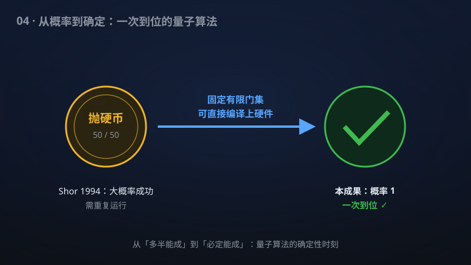

# 04 · 固定有限门集上的精确量子因数分解

> Shor 算法的"确定性"版本：量子计算机以概率 1 完成因数分解，且只需一套固定的有限门集。

**领域**：量子计算、密码学 ｜ **数学分支**：数学物理 ｜ **原文**：[openai/math Family 279](https://github.com/openai/math)

---

## 🌱 小白版：这是什么问题？

把一个大整数分解成素数乘积（比如 15 = 3 × 5），是 RSA 加密安全性的根基：你把两个大素数相乘得到公钥，别人想反推出那两个素数——经典计算机算几百位的大数要算到天荒地老。1994 年，Peter Shor 发现量子计算机可以**大概率**快速分解，RSA 的"末日时钟"从此开始滴答。

但 Shor 算法像抛硬币：每次运行有一定概率失败，需要重复跑很多次、取多数结果来保证正确。这在理论上没问题，可总让人觉得"差了一口气"——能不能一次到位、百分之百成功？

这项成果宣称更进一步：存在一个多项式时间的"**均匀**"量子线路族，对**每个**输入整数都以**概率 1**（百分之百）输出完整的素因数分解；而且门的数量、量子比特数都是输入长度的多项式，**只需要一套固定的有限门集**。最后一句是关键：真实的容错量子计算机只能实现某套固定的基本门（如 Clifford + T），"固定有限门集"意味着这个算法原则上可以直接编译到真实硬件上，不再是纸面上的概率性算法。

打个比方：Shor 是"射击十次、至少中九次"的神枪手；这个成果宣称的是"**只开一枪、必中十环**"，而且用的还是制式配枪。

## 🎓 专业版：数学上到底说了什么？

该手稿宣称给出**多项式时间的均匀量子线路族** {C_n}：

- **精确性**：对每个整数输入（以 n 比特编码），线路 C_n 以**概率 1** 输出该整数的完整素因数分解——不是"以高概率"，而是确定性成功；
- **多项式资源**：门数（gate count）与量子比特数（qubit count）均为输入长度 n 的多项式；
- **固定有限门集**：整个线路族只使用**一个固定的有限**通用门集合——不依赖输入、不随规模增长。

"均匀"（uniform）意味着：给定 n，生成线路 C_n 的经典图灵机本身也是多项式时间的——排除了"把答案硬编码进线路"这种作弊。

手稿摘要未披露具体的线路构造路线（比如如何绕过量子测量固有的概率性、如何实现精确编译）。

## 🔬 这项成果做了什么？

严格依据官方摘要，该手稿包含以下断言（分点列出）：

1. 给出多项式时间的**均匀**量子线路族；
2. 对**每个**整数输入，以**概率 1** 输出其完整素因数分解（输入本身是素数时，分解就是它自身）；
3. 门数与量子比特数均为输入长度的**多项式**；
4. **一个固定的有限门集**即足够（不随输入变化）。

## 📜 时间线

- 1994：Peter Shor 提出多项式时间量子因数分解算法（FOCS 1994，期刊版 1997）——量子计算的"登月时刻"，RSA 遭遇理论上的致命威胁；
- 1995–1996：Shor 进一步发展容错量子计算理论，证明"只要单门错误率低于阈值，量子计算可任意可靠"——为"固定门集上运行算法"奠定理论基础；
- 1999：Solovay–Kitaev 定理成型：任何单比特门都可用固定有限门集**近似**编译（代价是多项式对数开销）——但只是近似，不是精确；
- 2001：IBM 的 7 量子比特核磁共振实验首次演示 Shor 算法分解 15 = 3 × 5；
- 2019：Google 宣布"量子优越性"（随机线路采样），量子硬件进入 NISQ 时代；
- 精确量子算法方面：Deutsch–Jozsa（1992）、Bernstein–Vazirani（1993）等 oracle 算法是精确的，但对因数分解这样的**自然问题**，精确多项式量子算法此前从未出现；
- 本手稿：宣称把"概率 1、多项式资源、固定有限门集"三者同时实现。

## 💡 核心思想

为什么"概率 1"这么难？因为**量子测量天生是概率性的**。量子算法的一般形态是：制备一个叠加态，让"正确答案"对应的分支振幅最大，然后测量——测量的那一刻，宇宙掷骰子，你以大概率得到正确答案，但总有小概率得到错误答案。Shor 算法正是如此：量子傅里叶变换后测量，得到的是"周期"的近似值，需要经典后处理（连分数展开）+ 重复运行来放大成功率。

要做到概率 1，必须让**错误分支的振幅严格为零**——不是"很小"，而是数学上精确的零。这要求算法的每一步干涉都"严丝合缝"：所有通向错误答案的路径必须精确相消。这在有**连续参数**（如旋转角度）的量子线路中极难实现，因为任何微小的角度误差都会留下残余振幅。

"固定有限门集"则难在另一处。Solovay–Kitaev 定理说：用有限门集可以**任意逼近**任何酉操作，但"逼近"不等于"精确"。要精确实现某个特定的酉变换，有限门集必须恰好"够得着"它——这要求被实现的酉矩阵元落在门集生成的**群**的特定代数结构里。把"精确性"和"有限门集"同时满足，意味着构造者找到了某种代数上的"巧合"：因数分解所需的全部操作，恰好落在一个有限生成群的可达范围内。

该手稿若成立，其核心思想很可能是：**把 Shor 算法中的概率性环节（测量+后处理）整体"幺正化"**，用某种精确的振幅放大/相位估计变体，让失败分支严格相消；同时把所有需要的旋转角度选成"有限门集友好"的特殊值。但摘要未披露路线，以上只是基于问题结构的推测。

## 🧗 难在哪？

三层难度叠加：

第一，**概率 1 vs 量子测量的本性**。三十年来，量子算法设计者早已习惯"有界误差"（bounded-error）模型——BQP 这个复杂性类本身就定义为"错误率 ≤ 1/3"。精确量子算法（EQP）是一个远小、远难的类别。对因数分解这样的自然问题，连"EQP 里有没有非平凡问题"都曾是开放问题。

第二，**均匀性**。非均匀线路可以"作弊"：对每个输入长度，偷偷把答案编码进线路结构。"均匀"要求有一个多项式时间的经典算法来**生成**线路——这堵住了作弊的门，但也让构造难得多。

第三，**固定有限门集的编译约束**。真实容错量子计算机（如表面码）只支持某个固定的通用门集（如 Clifford + T 门）。此前的精确量子算法要么需要**无限**门集（连续旋转角），要么需要随输入增长的门集。该手稿宣称"一个固定的有限门集即足够"，意味着它可以直接对应到某种量子纠错码的横向门集——这是从"纸面算法"到"可造机器"的最后一公里。

把三者同时实现，此前无人做到。最大的问号在于：摘要没有给出任何构造线索——而"概率 1"这种强断言，历史上最容易在"某个被忽略的测度零事件"上翻车。

## 🚀 有什么用？

- **密码学（潜在·威胁评估）**：RSA、ECC 等公钥体系的"量子末日时钟"被再次拨快。精确分解消除了概率算法的失败尾巴——虽然对"能不能分解"这个定性结论没有改变（Shor 早已证明），但它让"量子计算机分解 RSA-2048"这件事从"大概率可行"变为"确定性可行"，对迁移时间表的论证更严峻。
- **后量子密码迁移（现实·紧迫性论证）**：NIST 后量子密码标准已在推进中。该成果（若成立）为"加速迁移"提供了新的论据：威胁模型从"概率性量子攻击"升级为"确定性量子攻击"。
- **量子算法设计（潜在·新范式）**：证明"精确量子算法"可以达到与概率算法相同的渐近效率。这可能开辟 EQP（精确量子多项式时间）算法设计的新方向——此前被认为"太难而不值得"的领域。
- **量子硬件与编译（潜在）**：固定有限门集意味着可直接映射到容错量子纠错码支持的横向门集，**降低编译开销**。Solovay–Kitaev 近似编译带来的多项式对数开销，在精确构造下可能被消除——这对资源估算（如"分解 RSA-2048 需要多少物理量子比特"）有实质影响。
- **量子复杂性理论（理论价值）**：EQP vs BQP 的关系是量子复杂性理论的基本问题。一个自然问题的 EQP 算法，为理解"概率性在量子计算中到底有多本质"提供了全新素材——它暗示：量子计算的"概率性"可能更多是技术便利，而非内在必然。

## 🔗 相关篇目

- [05 · 随机与量子查询复杂度的最优四次方分离](../docs/05-284-query-separation.md)——同样刻画量子相对经典的能力边界
- [06 · 奇偶性不在 QAC⁰ 中](../docs/06-274-parity-qac0.md)——同样研究量子线路的能力极限，一正一反相映成趣
- [03 · 低于 n log n 的精确傅里叶变换](../docs/03-130-fourier-transform.md)——Shor 算法的核心正是（量子）傅里叶变换

## 📖 延伸阅读

- Shor, "Polynomial-time algorithms for prime factorization and discrete logarithms on a quantum computer", SIAM J. Computing 1997（量子算法的奠基论文）
- Nielsen–Chuang《量子计算与量子信息》（中文版），第 5 章讲 Shor 算法
- Kitaev–Shen–Vyalyi《Classical and Quantum Computation》, AMS 2002（Solovay–Kitaev 定理的完整证明）
- Mosca, "Quantum algorithms", arXiv:0808.0369（综述，含精确量子算法的讨论）

---

> **内容说明**：本文基于 [openai/math](https://github.com/openai/math)（Family 279）官方摘要的转述与中文解读。原成果由 AI 模型产出，官方标注验证程度不一、部分尚未形式化，此处转述不代表数学界共识；引用请以[原文](https://github.com/openai/math)为准。
