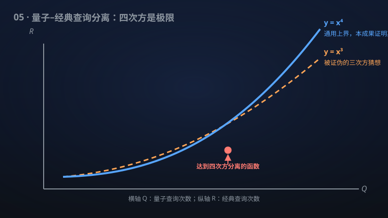

# 05 · 随机与量子查询复杂度的最优四次方分离

> 量子相对经典的查询优势极限被钉死在"四次方"——终结了关于"三次方猜想"的十年争论。

**领域**：量子计算、计算机科学 ｜ **数学分支**：数学物理 ｜ **原文**：[openai/math Family 284](https://github.com/openai/math)

---

## 🌱 小白版：这是什么问题？

计算机解决问题时，"查一次数据"是最基本的操作。量子计算机查数据可以比经典计算机少查几次——比如 Grover 算法把 n 次查找降到 √n 次（平方加速）。但量子最多能快多少？对"全函数"（输入没有任何承诺结构）问题，数学家早就证明：经典查询次数 R 和量子查询次数 Q 满足 R = O(Q⁴)——量子最多快到"四次方根"的程度。可 2020 年 Aaronson 等人猜想：也许三次方就够了（R = O(Q³)），四次方只是证明技术不够强；随后几年，人们真的找到了三次方分离的例子。这项成果宣称：四次方界是紧的——存在函数让量子优势恰好达到四次方，任何更小的指数都不可能，三次方猜想被证伪。

## 🎓 专业版：数学上到底说了什么？

对全布尔函数，随机与量子最坏情形比特查询复杂度（误差 ≤ 1/3，查询之间的计算不受限）满足通用界 R(f) = O((1+Q(f))⁴)。该手稿证明这个界的指数是紧的（sharp）：排除了任何更小的幂，证伪了猜想中的三次方关系。

## 🔬 这项成果做了什么？

该手稿证明全布尔函数的通用界 R(f) = O((1+Q(f))⁴) 在指数上是紧的，排除了每个更小的幂，证伪了猜想的三次方关系。其中 R 与 Q 分别是误差至多 1/3 的随机与量子最坏情形比特查询复杂度，查询之间的计算不受限。

## 🧗 难在哪？

全函数上量子–经典查询分离的研究脉络：Aaronson–Ben-David–Kothari（2016）用 cheat sheet 方法得到 R = Ω̃(Q^{2.5}) 的分离；Bansal–Sinha（2021）等给出三次方分离的例子。Aaronson–Ben-David–Kothari–Tal（2020）猜想 R(f) = O(Q(f)³) 对一切全函数成立，而当时最好的通用上界是四次方（Aaronson 等 2021 年的工作给出 R(f) = O(Q(f)⁴)，对确定性查询亦然；Ambainis 等（2017）的例子说明四次方对确定性情形是紧的）。该成果把随机情形的指数钉死在 4，终结了"3 还是 4"的争论。

## 🚀 有什么用？

- **量子计算理论**：量子查询优势的精确极限——全函数上量子最多带来四次方加速，指导对"量子优势"的现实预期。
- **算法设计**：查询下界是证明量子算法最优性的标准工具；紧的指数让最优性论证更锋利。
- **计算机科学**：经典与量子计算能力边界的精确刻画；与多项式方法、对抗方法等下界技术的相互印证。
- **密码学**：查询复杂度分离是预言机（oracle）分离（如 BQP vs PH）构造的基础构件。

---

> **内容说明**：本文基于 [openai/math](https://github.com/openai/math)（Family 284）官方摘要的转述与中文解读。原成果由 AI 模型产出，官方标注验证程度不一、部分尚未形式化，此处转述不代表数学界共识；引用请以[原文](https://github.com/openai/math)为准。
