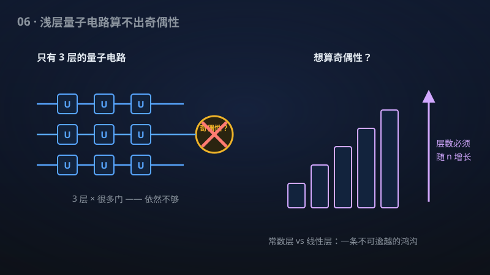

# 06 · 奇偶性不在 QAC⁰ 中

> 悬置 26 年的量子电路猜想终获解决：常数深度量子电路算不出"奇偶性"，量子并行能力有了第一条硬边界。

**领域**：量子计算、计算机科学 ｜ **数学分支**：数学物理 ｜ **原文**：[openai/math Family 274](https://github.com/openai/math)

---

## 🌱 小白版：这是什么问题？

想象你有一排 n 个开关，要判断"开着的开关是奇数个还是偶数个"——这就是"**奇偶性**"（parity）问题。听起来简单，但它有个神奇的性质：**它对每个输入比特都"敏感"**——翻转任意一个开关，答案都会翻转。没有"偷懒"的办法，必须把每个开关都"看"一眼。

经典计算机里，人们在 1980 年代就证明了：如果只允许电路的"**层数**"固定（比如永远不超过 5 层），无论每层多宽，都算不出奇偶性。直觉是：层数固定意味着"信息最多传播固定步"，而奇偶性需要把 n 个比特的信息"汇聚"到一处——层数不够，信息汇聚不过来。

量子计算机更强大：量子门可以产生**纠缠**与**干涉**，也许能"绕过"这个障碍？1999 年，Cristopher Moore 定义了量子版的常数深度电路 **QAC⁰**，并猜想"量子版也算不出奇偶性"。二十六年来，这个猜想只被推进了一小步一小步。

这项成果宣称彻底解决了它：在"测量输出"模型下，由**任意单比特门**、**无限多输入的 Toffoli 门**组成、量子比特总数为**多项式**的常数深度量子电路，**不可能以任何固定的正优势**算出奇偶性——连"比瞎猜好一点点"都做不到。

## 🎓 专业版：数学上到底说了什么？

**QAC⁰**：常数深度的量子电路类，允许任意单量子比特门和**无界扇入**（unbounded fan-in）的 Toffoli 门（经典对应物是 AC⁰ 中的无界扇入 AND/OR 门），量子比特总数为输入规模的多项式。

该手稿宣称在**测量输出模型**（measured-output model）下解决 **Moore 的奇偶性猜想**：

- 任何常数深度的量子电路（任意单比特门 + 无界元数 Toffoli 门 + 多项式个总量子比特）；
- **不能以任何固定的正最坏情形优势**（fixed positive worst-case advantage）计算奇偶函数——即成功概率不能超过 1/2 + ε（ε > 0 固定，与 n 无关）；
- 模型细节：辅助量子比特初态为 |0⟩，最后**测量一个**输出量子比特，其余寄存器可丢弃。

作为推论：经 **Xu–Li 归约**，同样的有界误差障碍对**严格多数函数**（strict majority，即判断 1 的个数是否超过 n/2）成立。

手稿摘要未披露下界证明的具体技术路线。

## 🔬 这项成果做了什么？

严格依据官方摘要，该手稿包含以下断言（分点列出）：

1. 在**测量输出模型**下**解决 Moore 的奇偶性猜想**；
2. 具有任意单比特门、无界元数 Toffoli 门和多项式个总量子比特的**常数深度**量子电路，不能以任何**固定正的最坏情形优势**计算奇偶性；
3. 模型设定：辅助量子比特从零开始，测量一个输出量子比特，其余寄存器可丢弃；
4. 经 Xu–Li 的归约，同样的有界误差障碍对**严格多数函数**成立。

## 📜 时间线

- 1983–1984：Ajtai、Furst–Saxe–Sipser 分别证明**奇偶性不在（经典）AC⁰ 中**——用随机限制（random restrictions）与切换引理（switching lemma），电路复杂性的开山之作；
- 1986：Håstad 证明更强的切换引理，给出 AC⁰ 下界的指数级定量形式；
- 1999：Cristopher Moore 在论文《Quantum Circuits: Fanout, Parity, and Counting》（quant-ph/9903046）中定义 **QAC⁰** 并提出奇偶性猜想；
- 2000s–2010s：经典 AC⁰ 的下界技术（切换引理、多项式方法）被反复尝试移植到量子情形，均因纠缠与干涉而失效；
- 2020：Rosenthal 给出（近似）奇偶性的量子电路**尺寸**下界——但"尺寸"不等于"深度"，猜想仍未解决；
- 2024 起：Anshu 等人给出要求**超线性辅助比特**的下界——向"多项式辅助比特"的完整猜想逼近，但仍有距离；
- 本手稿：宣称在多项式辅助比特 + 常数深度 + 固定正优势的**完整设定**下解决猜想，并把障碍推广到严格多数函数。

## 💡 核心思想

为什么经典下界技术在量子面前会失效？先看经典证明的精髓——**随机限制法**。思路是：随机地把大部分输入比特固定为常数，看电路会发生什么。对 AC⁰ 电路（常数深度、无界扇入 AND/OR），**切换引理**说：随机限制后，底层的宽 AND/OR 门有很大概率变成常数，整个电路的"有效深度"减一。归纳下去，电路坍缩成一个只依赖少数变量的简单函数——而奇偶性限制后**仍然是**奇偶性（或它的否定），不可能这么简单。矛盾。

量子情形难在哪？**量子门不"坍缩"**。经典 AND 门在输入被固定后可能变成常数；但量子 Toffoli 门作用在叠加态上，随机限制（对应于"测量部分量子比特"）会引入**纠缠与坍缩的微妙 interplay**：测量本身是概率性的，限制后的电路不再是原电路的"简化版"，而是一个随机电路系综。切换引理的整个归纳框架就此瓦解。

更深层的原因是**干涉**：量子电路可以让不同的计算路径"相消"，这种全局性的相消是经典电路不具备的。任何下界证明都必须论证：常数深度的干涉**不足以**汇聚 n 个比特的奇偶信息——这需要一种全新的"量子信息瓶颈"论证，而不是经典组合方法的平移。

该手稿的结论之强（"任何固定正优势都不行"，而不仅仅是"有界误差不行"）暗示其下界技术可能控制了**输出量子比特的整个分布**，而不仅仅是成功概率。但摘要未披露路线，具体技术有待检验。

最后解释一下"**测量输出模型**"这个限定词的含义——它既是诚实，也是严谨。量子电路的"输出"有两种定义：**幺正输出**（把答案编码在末态的某个量子比特上，不测量）和**测量输出**（实际测量一个量子比特，得到经典比特）。前者更强：它允许后续的量子操作继续利用相干性。Moore 的原始猜想针对的就是测量输出模型——即"连最弱的输出方式都做不到"。该手稿在这个模型下解决问题，恰好对应猜想的原始表述；至于幺正输出模型下的奇偶性，仍是开放问题——这也说明，量子下界理论的版图上还有未点亮的区域。

## 🧗 难在哪？

Moore 猜想悬置 26 年，有三重障碍：

第一，**经典技术的量子失效**。1980 年代的 AC⁰ 下界是电路复杂性最漂亮的成果之一，但它的每一块基石——随机限制、切换引理、"宽门变常数"——在量子世界里都不成立。二十多年来，人们尝试了"量子切换引理""量子随机限制"等各种移植，无一成功。

第二，**模型的慷慨**。QAC⁰ 的模型非常"大方"：允许**任意**单比特门（连续无穷多种）、**无界扇入** Toffoli 门（一个门可以同时看任意多个比特）、**多项式**个辅助比特。要在这个模型下证明不可能性，下界必须"以柔克刚"——模型越强，越难证它不行。此前的部分进展（Rosenthal 2020 的尺寸下界、Anshu 等的超线性辅助比特下界）都是通过**削弱模型**（限制辅助比特数、或只证尺寸不证深度）绕开困难的。

第三，**"固定正优势"的强度**。很多下界只能排除"高成功概率"（如 ≥ 2/3），但允许"比瞎猜好一点点"（如 1/2 + 1/n）。该手稿宣称连**任何固定正优势**都不行——即成功概率被死死钉在 1/2 + o(1)。这种"彻底"的下界比"有界误差"下界难得多，它要求对输出分布的精细控制。

## 🚀 有什么用？

- **量子并行能力的硬边界（理论价值）**：这是量子浅层电路的**第一条**"算不出某某"的硬边界。它告诉我们：量子并行不是万能的——有些任务**必须**加深电路。任何"量子优势"的论证，都必须先过这一关。
- **NISQ 硬件评估（潜在）**：含噪声中等规模量子（NISQ）时代的硬件，恰恰只能跑浅层线路。这个下界为"浅层量子线路能做什么"提供了理论天花板，指导硬件基准测试（benchmark）的设计：别拿奇偶性这类任务去考浅层量子计算机。
- **量子复杂性理论（理论价值）**：QAC⁰ vs 经典 AC⁰ 的关系、量子电路层级结构的精细刻画，都以这类下界为基石。它是量子版"电路复杂性"大厦的第一块砖。
- **量子纠错与容错（潜在）**：对浅层量子电路表达能力的理解，影响量子纠错码的设计直觉——如果浅层线路连奇偶性都算不出，那么"用浅层线路做纠错"这类想法需要更谨慎的论证。
- **教学价值（已落地为"知识"）**：从 Furst–Saxe–Sipser（1984）到 Moore（1999）再到本手稿，这条 40 年的"奇偶性 vs 常数深度"战线，是讲授"下界技术"的完美历史脉络。

## 🔗 相关篇目

- [04 · 固定有限门集上的精确量子因数分解](../docs/04-279-quantum-factoring.md)——同样研究量子线路的能力，一正（能精确分解）一反（算不出奇偶）
- [05 · 随机与量子查询复杂度的最优四次方分离](../docs/05-284-query-separation.md)——同样刻画量子相对经典的能力边界
- [08 · QAOA 在热力学优先极限下达到 SK 最优](../docs/08-281-qaoa.md)——同样研究浅层量子线路（QAOA 也是常数深度）的能力极限

## 📖 延伸阅读

- Moore, "Quantum circuits: fanout, parity, and counting", quant-ph/9903046（QAC⁰ 与猜想的原始论文）
- Furst–Saxe–Sipser, "Parity, circuits, and the polynomial-time hierarchy", Math. Systems Theory 1984（经典 AC⁰ 下界）
- Håstad, "Almost optimal lower bounds for small depth circuits", STOC 1986（切换引理）
- Arora–Barak《计算复杂性：现代方法》第 14 章（电路下界）
- Bera–Chakrabarti–Ghosh 等关于 QAC⁰ 的近期综述（arXiv 相关主题页）

---

> **内容说明**：本文基于 [openai/math](https://github.com/openai/math)（Family 274）官方摘要的转述与中文解读。原成果由 AI 模型产出，官方标注验证程度不一、部分尚未形式化，此处转述不代表数学界共识；引用请以[原文](https://github.com/openai/math)为准。
