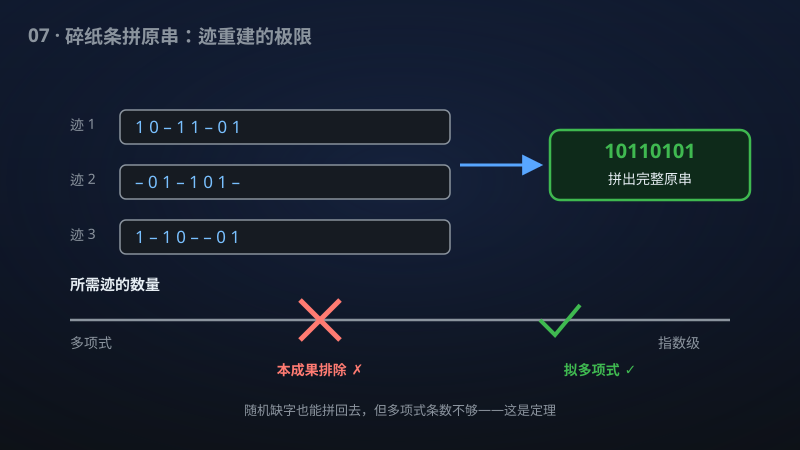

# 07 · 迹重构的定量界与统一解码器

> 给 DNA 测序式的"碎纸复原"问题画出第一条"不可能更少"的硬下界，并给出统一解码器的拟多项式上界。

**领域**：计算机科学、通信 ｜ **数学分支**：理论计算机科学 ｜ **原文**：[openai/math Family 122](https://github.com/openai/math)

---

## 🌱 小白版：这是什么问题？

想象有人把一张写满 0 和 1 的纸条**随机撕掉一些字**（每个字有固定概率被删掉），然后把剩下的碎片复印很多份交给你——你能拼出原纸条吗？

这正是 **DNA 测序**的数学模型：测序仪读出的，就是原 DNA 链随机丢失一些碱基后的"**迹**"（trace）。你拿到很多条残缺的读段（reads），要拼出完整的基因组。2004 年，Batu 等人把这个问题抽象成理论模型后，二十年来大家只知道"大概需要指数级数量的碎片"，但没人知道**最少**需要多少——"多项式条迹够不够？"这个核心问题一直悬着。

这项成果宣称两面开花：**下界**方面，证明在固定删除概率下，任何方法都至少需要 n^{Ω(log log n)} 条迹——**第一次排除了"多项式条迹就够"的可能性**；**上界**方面，给出了一个"**统一解码器**"，在已知的固定有理保留概率下达到拟多项式的样本量和运行时间。一边是"不可能更少"，一边是"这样做够了"——上下夹击，包围圈大幅收紧。

打个比方：以前只知道"拼图至少需要几块、至多需要几块"之间隔着天文数字；现在下限第一次超过了"多项式"这条线，上限也被统一成一套通用方法。

## 🎓 专业版：数学上到底说了什么？

**删除信道**：以固定概率 δ ∈ (0,1) **独立**删除二元串 x ∈ {0,1}ⁿ 的每一位，把剩下的位拼接起来，得到一条**迹**。问题：给定 T 条独立同分布的迹，重构 x 需要多大的 T（**样本复杂度**）？

该手稿宣称：

- **下界**：对**每个**固定的删除概率 δ ∈ (0,1)，重构任意长度 n 的二元串需要 **n^{Ω(log log n)}** 条独立迹——从而**排除了多项式样本重构**的可能性；
- **上界（统一解码器）**：存在一个**统一**（uniform）的解码器，对**已知的固定有理保留概率**（retention probability p = 1−δ 为有理数且已知），达到**拟多项式**（quasipolynomial，即 n^{polylog n} 量级）的样本量与运行时间；
- **小删除概率情形**：当删除概率至多为 n^{−ε}（ε > 0 固定，即删除概率随 n 衰减）时，样本与时间两界都成为关于**输入和参数编码**的多项式——问题变得容易。

手稿摘要未披露下界证明与统一解码器的具体构造路线。

## 🔬 这项成果做了什么？

严格依据官方摘要，该手稿包含以下断言（分点列出）：

1. 在**每个**固定删除概率 δ ∈ (0,1) 下，重构任意长度 n 的二元串需要 **n^{Ω(log log n)}** 条独立迹；
2. 从而**排除了多项式样本重构**的可能性（n^{Ω(log log n)} 增长快于任何多项式 n^c）；
3. 一个**统一解码器**对**已知的固定有理保留概率**达到**拟多项式**的样本量和运行时间上界；
4. 当删除概率至多为 **n^{−ε}**（ε > 0 固定）时，样本与时间两界都成为关于输入和参数编码的**多项式**。

## 📜 时间线

- 2004：Batu–Kannan–Khanna–McGregor 系统提出迹重构问题（动机是计算生物学：从随机删除后的相似序列中寻找共同祖先序列）；
- 2008：Holenstein–Mitzenmacher–Panigrahy–Wieder 给出上界 2^{Õ(√n)} 条迹——第一个次指数上界；
- 2017：Nazarov–Peres 与 De–O'Donnell–Servedio **同时**把上界改进到 2^{O(n^{1/3})}（基于复分析的均值方法）；
- 2020：Holden–Lyons 把下界从平凡的 Ω(n) 推进到 Ω̃(n^{5/4})；
- 2021：Chase 把上界推进到 **exp(Õ(n^{1/5}))**，同时把下界推进到 **Ω̃(n^{3/2})**——上下界之间的"指数鸿沟"依然巨大；
- 2021–2025：平均情形（随机串）下界推进到 Ω̃(log^{5/2} n)、上界到 exp(O(log^{1/3} n))；出现树迹重构、环形迹重构、编码迹重构等变体；
- 本手稿：下界首次达到 **n^{Ω(log log n)}**（超越任何多项式），并给出统一解码器的拟多项式上界。

## 💡 核心思想

迹重构难在哪？直觉上，每条迹都是原串的一个**随机子序列**——删除是独立的，所以"第 i 个 surviving 的比特原来在哪个位置"是**未知**的。这带来了**对齐**（alignment）的根本困难：你拿到两条迹 "0101" 和 "0011"，它们对应原串的哪些位置？位置信息在删除中丢失了。

此前的上界技术（Nazarov–Peres、De 等）走的是"**均值+复分析**"路线：对每条迹计算某种多项式统计量（如生成函数），取平均后用复分析工具（如 Littlewood 型估计、Jensen 公式）反解出原串的比特。这套方法的瓶颈在于：**相近的串产生几乎不可区分的迹分布**——比如 0ⁿ1ⁿ 和 0^{n−1}101^{n−1}，它们的迹分布距离极小，需要指数级样本才能区分。

下界 n^{Ω(log log n)} 的突破，关键在于构造一族"** pairwise 难区分**"的串：它们两两之间的迹分布距离小到需要超多项式样本才能分辨。这比之前的 Ω̃(n^{3/2}) 下界强得多——后者只说明"线性不够"，前者说明"**任何多项式都不够**"。这是从"量"到"质"的飞跃：它终结的不是某个具体数字，而是一整类可能性（多项式算法）。

"统一解码器"的思想则相反：此前的上界算法往往**依赖删除概率的具体值**（不同的 δ 需要不同的调参）；"统一"意味着**一套算法通吃**所有已知的固定有理保留概率——这在方法论上是重要进步，说明解码技术从"手工作坊"走向"通用工具"。

## 🧗 难在哪？

迹重构被称为"信息论中最顽固的开放问题之一"，难在三个层面：

第一，**上下界的"指数鸿沟"**。上界是 exp(Õ(n^{1/5}))（指数级），下界长期只有 Ω̃(n^{3/2})（多项式级）——两者之间隔着"指数 vs 多项式"的天堑。二十年里，上界从 2^{√n} 一路打到 2^{n^{1/5}}，下界从 n 打到 n^{3/2}，但鸿沟的**性质**从未改变：没人知道真相靠近哪一侧。

第二，**删除信道的"非对称性"**。与"比特翻转"信道（每个比特以概率 p 被翻转）不同，删除信道**丢失位置信息**——这让它比翻转信道难得多。翻转信道的重构（其实就是纠错）有多项式算法；删除信道连"多项式样本够不够"都不知道。这种不对称性让标准的信息论工具（Fano 不等式、互信息界）只能给出很弱的下界。

第三，**"统一"的难度**。为**每个**固定的 δ 设计算法相对容易（可以针对 δ 调参）；但要一个解码器**同时**对所有有理保留概率达到拟多项式界，需要算法内部"自适应"地处理不同的删除率——这要求对删除信道的结构有远超以往的理解。

该手稿的下界 n^{Ω(log log n)} 第一次让下界"**跨过**"了多项式的门槛——虽然离上界的指数级还很远，但它证明了"多项式样本"的梦想彻底破灭。这是一个"**定性**"的胜利：在它之前，人们还抱有一丝希望——也许存在聪明的、只用 n³ 条迹的算法；在此之后，这个希望被数学埋葬了。

## 🚀 有什么用？

- **DNA 测序与基因组学（现实·理论指导）**：测序仪的读段就是"迹"。下界 n^{Ω(log log n)} 告诉我们：对**最坏情形**的序列，多项式条读段**不可能**保证重构——这为测序深度（coverage depth）的设计提供了理论底线，避免在"减少读段数"上做无用功。
- **DNA 存储（潜在）**：DNA 作为高密度存储介质时，读写过程伴随随机删除。样本复杂度的上下界直接指导纠删码的设计：码率与冗余度的权衡有了更紧的理论依据。
- **通信与信道编码（现实）**：删除信道是经典信道模型之一（比高斯信道更难）。统一解码器的构造技术可迁移到其它噪声信道模型，影响纠删码与重传协议的效率评估。
- **分布式存储（潜在）**：分布式存储节点随机失效 ≈ 删除信道。"最少需要多少个节点的数据才能恢复原文件"是系统设计的核心参数，紧的界意味着更少的冗余开销。
- **理论计算机科学（理论价值）**："多项式 vs 超多项式"的定性分界，是复杂性理论最关心的那种结果。它还深化了**平均情形与最坏情形**的分野：平均情形（随机串）下多项式迹可能够用，最坏情形下不够——这种"相变"本身就有理论美感。
- **生物信息学算法（潜在）**：统一解码器的"一套算法通吃多种删除率"思想，可启发设计对测序错误率**鲁棒**的组装算法——实际测序中错误率是未知且变化的。
- **理论计算机科学的方法论（理论价值）**：下界 n^{Ω(log log n)} 的证明必然构造了一族"迹分布两两难区分"的串——这种**极值组合构造**本身就是技术贡献。历史上，迹重构的下界构造（如 Chase 的工作）曾反哺编码理论与伪随机性研究；新的构造很可能在其它"从噪声观测中恢复信号"的问题里找到用武之地。

## 🔗 相关篇目

- [03 · 低于 n log n 的精确傅里叶变换](../docs/03-130-fourier-transform.md)——同样研究"从残缺/变换后的信号中提取信息"的极限
- [01 · 唯一游戏猜想与最优近似阈值](../docs/01-102-unique-games.md)——同属理论计算机科学的上下界艺术
- [02 · 矩阵乘法指数 ≤ 9/4](../docs/02-107-matrix-multiplication.md)——同样用精细的组合分析推进指数界

## 📖 延伸阅读

- Batu–Kannan–Khanna–McGregor, "Reconstructing strings from random traces", SODA 2004（问题的原始论文）
- Chase, "New lower bounds for trace reconstruction", Annals of Applied Probability 2021（下界 Ω̃(n^{3/2})）
- Chase, "New upper bounds for trace reconstruction", arXiv:2009.03296（上界 exp(Õ(n^{1/5}))）
- Nazarov–Peres, "Trace reconstruction with exp(O(n^{1/3})) samples", STOC 2017
- De–O'Donnell–Servedio, "Optimal mean-based algorithms for trace reconstruction", STOC 2017（均值方法的集大成）

---

> **内容说明**：本文基于 [openai/math](https://github.com/openai/math)（Family 122）官方摘要的转述与中文解读。原成果由 AI 模型产出，官方标注验证程度不一、部分尚未形式化，此处转述不代表数学界共识；引用请以[原文](https://github.com/openai/math)为准。
