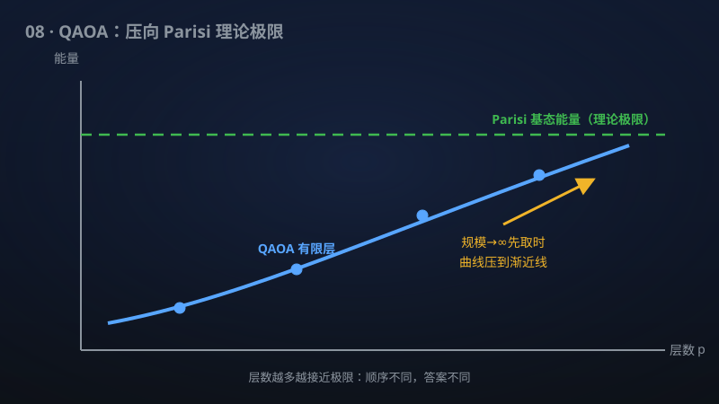

# 08 · QAOA 在热力学优先极限下达到 SK 最优

> 量子近似优化算法 QAOA 被证明能达到自旋玻璃模型的理论最优——量子优化第一次"追平"物理极限。

**领域**：量子计算、量子物理 ｜ **数学分支**：数学物理 ｜ **原文**：[openai/math Family 281](https://github.com/openai/math)

---

## 🌱 小白版：这是什么问题？

想象有 n 块小磁铁，每两块之间随机地"喜欢"同向或反向，你要找出让整体能量最低的排列——这就是 Sherrington–Kirkpatrick（SK）自旋玻璃模型，物理学家研究了五十年，Parisi 还因此拿了 2021 年诺贝尔物理学奖。2014 年 Farhi 等人提出 QAOA：一种"层数固定"的浅层量子算法，专门用来求这类组合优化问题的近似最优解。但 QAOA 到底能有多好？能不能达到理论极限？这项成果宣称证明了：当系统规模先趋于无穷（热力学极限先取），QAOA 在有限层数、与规模无关的确定性角度下，能逼近 SK 模型零场高斯情形的基态能量——也就是达到了物理学家算出的理论最优值，量子算法第一次严格"追平"了物理极限。

## 🎓 专业版：数学上到底说了什么？

证明当系统规模 n → ∞ 先于线路深度 p → ∞（thermodynamic-first 极限）时，QAOA 趋近高斯零场 Sherrington–Kirkpatrick 模型的基态能量。对每个精度要求，存在与规模和无序都无关的有限深度与确定性角度，达到所需的极限单自旋期望能量。作为推论，在大度数随机正则图上得到首阶最优的期望 MaxCut 值（规模先于度数趋于无穷）。

## 🔬 这项成果做了什么？

该手稿证明当系统规模先于线路深度趋于无穷时，QAOA 趋近高斯零场 SK 模型的基态能量。对每个精度，有限深度和与规模、无序无关的确定性角度达到所需的极限单自旋期望能量。这也给出大度数随机正则图上首阶最优的期望 MaxCut 值（规模先于度数趋于无穷）。

## 🧗 难在哪？

QAOA 由 Farhi–Goldstone–Gutmann 于 2014 年提出，是 NISQ 时代最重要的变分量子算法之一。SK 模型由 Sherrington–Kirkpatrick 于 1975 年提出，其基态能量由 Parisi 公式给出（Talagrand 于 2006 年严格证明），Parisi 因此获 2021 年诺贝尔物理学奖。QAOA 的性能分析长期停留在小规模数值实验与 p = 1 等浅层解析结果上；"有限深度 QAOA 能否达到无序系统热力学极限的最优能量"此前没有严格证明。该成果把量子算法的性能与统计物理的精确可解极限直接挂钩。

## 🚀 有什么用？

- **量子计算**：第一次严格证明一类变分量子算法能达到无序优化问题的理论最优，为 QAOA 的"量子优势"主张提供了数学背书。
- **组合优化**：MaxCut 等 NP-难问题的近似算法新标杆；大度数随机图上的首阶最优期望值。
- **量子物理/统计物理**：量子线路与自旋玻璃理论的交叉——变分量子态逼近复杂无序系统基态的能力边界。
- **能源与材料**：自旋玻璃模型是优化、神经网络、材料设计的原型问题；基态求解能力的提升有广泛的建模意义。

---

> **内容说明**：本文基于 [openai/math](https://github.com/openai/math)（Family 281）官方摘要的转述与中文解读。原成果由 AI 模型产出，官方标注验证程度不一、部分尚未形式化，此处转述不代表数学界共识；引用请以[原文](https://github.com/openai/math)为准。
