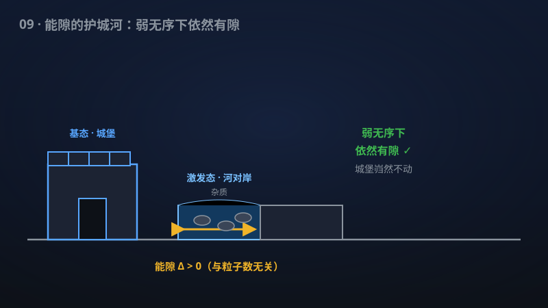

# 09 · 一致 Laughlin 能隙及其在有界标量无序下的稳定性

> 分数量子霍尔效应的"护城河"有多深？该手稿证明Laughlin态的能隙一致为正且抗无序。

**领域**：量子计算、量子物理、物理学 ｜ **数学分支**：数学物理 ｜ **原文**：[openai/math Family 269](https://github.com/openai/math)

---

## 🌱 小白版：这是什么问题？

1982年，人们发现强磁场中的二维电子会跳起一种"集体舞"：霍尔电阻的平台精确对应 1/3、1/5 这样的分数，这就是分数量子霍尔效应（1998年诺贝尔奖）。1983年，Laughlin 写出了描述这种"量子液体"的波函数，并预言基态和激发态之间隔着一道"护城河"——能隙，正是它保护着分数电荷等奇异现象不被扰动冲垮。但这道护城河到底有多深？真实材料里布满杂质，它会不会被填平？几十年没有严格答案。该手稿宣称：在球面上、填充因子 1/3、完整 V1 相互作用下，Laughlin 态的能隙一致为正——与粒子数无关；即使加上不太强的杂质势，护城河依然存在。

## 🎓 专业版：数学上到底说了什么？

对圆球面上填充因子 1/3 的完整 V1 相互作用，该手稿证明费米子 Laughlin 谱能隙猜想：在投影到最低朗道能级的充分弱有界实标量单体势下，唯一基态保持一致有隙；能隙与无序阈值对一切充分大粒子数和一切归一化势形一致（uniform）。

## 🔬 这项成果做了什么？

该手稿证明了圆球面上填充 1/3 的完整 V1 相互作用的费米子 Laughlin 谱能隙猜想。在投影到最低朗道能级的充分弱有界实标量单体势下，唯一基态保持一致有隙；能隙与无序阈值对一切充分大粒子数和一切归一化势形都是一致的。

## 🧗 难在哪？

分数量子霍尔效应 1982年由 Tsui、Störmer（与 Gossard）实验发现；Laughlin 1983年在贝尔实验室提出波函数解释；三人分享1998年诺贝尔物理学奖。Haldane 1983年引入赝势（pseudopotential）框架。Laughlin 态作为赝势哈密顿量唯一有隙基态的猜想自1980年代起悬置：数值支持充分，但严格证明长期开放；"能隙关于粒子数一致"与"抗无序稳定性"更是此前无人触及的定量版本。

## 🚀 有什么用？

- 量子计算：分数量子霍尔体系是拓扑量子计算（任意子编织）的主要候选平台；能隙的均匀性与抗无序性正是拓扑保护"容错"能力的数学根基。
- 量子物理：拓扑序理论的严格基石之一。
- 能源与材料：低维强关联电子材料的设计原理；新型量子器件的材料基础。

---

> **内容说明**：本文基于 [openai/math](https://github.com/openai/math)（Family 269）官方摘要的转述与中文解读。原成果由 AI 模型产出，官方标注验证程度不一、部分尚未形式化，此处转述不代表数学界共识；引用请以[原文](https://github.com/openai/math)为准。
