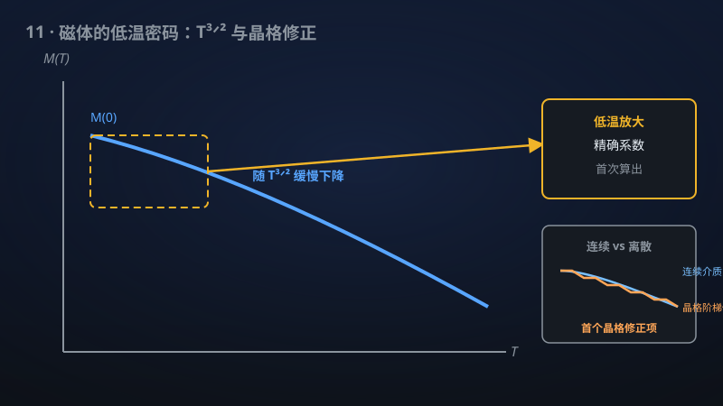

# 11 · Bloch 定律、晶格修正与球面磁化律

> 1930年的磁学定律第一次有了带精确系数的严格证明，还算出了晶格修正项。

**领域**：物理学、能源、量子物理 ｜ **数学分支**：数学物理 ｜ **原文**：[openai/math Family 271](https://github.com/openai/math)

---

## 🌱 小白版：这是什么问题？

把一块磁铁慢慢加热，它的磁性会一点点"退掉"，就像冰块在室温下慢慢融化。1930 年，Bloch 用"自旋波"理论算出：三维铁磁体的磁化强度随温度满足 M(0) − M(T) ∝ T^{3/2}——温度越低，退磁越慢，而且指数精确等于 3/2，不多不少。这条定律写进了每一本固体物理教材，物理学家用了近一个世纪。

但"大家都信"不等于"有人证出来"。对量子海森堡模型——描述磁性的标准量子模型——这条定律的严格数学证明，特别是那个比例系数到底是多少，一直没有完整拿下。更微妙的是：真实晶体是离散的原子格子，不是连续果冻，"格子"本身会给 T^{3/2} 律带来修正项，而这个修正项此前无人算过——就像用渔网捞水，网眼本身会影响水流。该手稿宣称：对一切正量子自旋的三维量子海森堡铁磁体，带精确系数证明了 Bloch T^{3/2} 律，还第一次算出了最近邻耦合的晶格修正项，顺带证明了 d ≥ 3 最近邻模型的自发磁化。

生活里类比：就像牛顿时代人人都知道苹果落地，但"引力常数 G 到底是多少"需要卡文迪许扭秤实验来钉死。Bloch 定律的指数 3/2 人人会背，但系数和格子修正的"扭秤实验"（数学版），等了 96 年——这篇手稿就是来做这个实验的，顺手还证明了三维以上磁铁在不太热时一定有磁性（自发磁化）。

## 🎓 专业版：数学上到底说了什么？

考虑三维格点 Z^3 上的量子海森堡铁磁体，哈密顿量

H_Λ = −∑_{x,y ∈ Λ} J_{x−y} **S**_x · **S**_y，

其中自旋量子数 S 取一切正值（S = 1/2, 1, 3/2, …），耦合 J ≥ 0 对称、有限程，且其支撑生成整个 Z^3（保证真正的三维连通性，而非退化成低维）。

记 M(T, h) 为温度 T、外场 h 下的单位体积磁化强度。该手稿证明了带精确系数的 Bloch 定律：

M(0, 0⁺) − M(T, 0⁺) = C(S, J) · T^{3/2} + o(T^{3/2})，T → 0⁺，

其中常数 C(S, J) 被精确确定（依赖于自旋 S 与耦合细节）。关键的技术点是**极限顺序**：先取热力学极限（Λ ↗ Z^3），再取零场导数（h → 0⁺），最后取低温极限（T → 0⁺）——顺序不可交换，这是此前所有非严格推导都含糊带过的地方。

同一 family 还证明：最近邻模型在一切维数 d ≥ 3 存在自发磁化（有限温度铁磁相变），并确定了三维最近邻耦合的首个晶格修正项（即超出连续介质自旋波理论的、由格点离散性贡献的下一阶项系数）。

## 🔬 这项成果做了什么？

根据官方摘要，该手稿（family 共 4 篇手稿）：

- 对三维量子海森堡铁磁体、在**一切正量子自旋**下，证明了带**精确系数**的 Bloch T^{3/2} 律；
- 允许**非负对称有限程耦合**，其支撑生成 Z^3；
- 严格规定了极限顺序：**热力学极限先于零场导数与低温极限**；
- 证明了最近邻模型在**一切维数 d ≥ 3** 的自发磁化；
- 确定了**三维最近邻耦合的首个晶格修正**项。

手稿摘要未披露具体证明路线。

## 📜 时间线

- 1930：Bloch 基于自旋波（磁振子）理论导出 T^{3/2} 律（Z. Phys. 61, 206）。
- 1956：Dyson 建立自旋波相互作用的严格运动学理论，指出最低阶修正为 T^4，并纠正了此前无规相近似（RPA）预言的 T^3 修正。
- 1966：Mermin–Wagner 定理证明 d ≤ 2 时有限温度下不存在自发磁化，确立三维是铁磁长程序的关键情形。
- 1978：Dyson–Lieb–Simon 用反射正定性证明 d ≥ 3 海森堡铁磁体存在有限温度相变（自发磁化存在性，但无定量低温行为）。
- 2026（手稿宣称）：openai/math Family 271 给出带精确系数的 T^{3/2} 律完整证明、d ≥ 3 自发磁化与首个晶格修正。

## 💡 核心思想

Bloch 定律的 3/2 指数其实是一次漂亮的"量纲游戏"。在铁磁体里，最低的激发是自旋波（磁振子）：一个自旋稍微偏离整齐排列，这个"涟漪"传遍整条链。长波磁振子的能量色散是二次的，ω(k) ∝ k²（注意区别于声子的线性色散）。有限温度下，被热激发的磁振子数正比于对玻色分布的积分 ∫ d³k / (e^{βk²} − 1)，做变量替换立刻得到 ∝ T^{3/2}。每个磁振子带走一份磁化强度，于是 M(0) − M(T) ∝ T^{3/2}。指数 3/2 = 维度 3 除以色散幂次 2——这是三维与二次色散共同谱写的"指纹"。

那么为什么严格证明等了近百年？魔鬼藏在三个地方。第一，**磁振子不是自由粒子**：它们之间有相互作用，Dyson 1956 年的伟大之处正是建立了自旋波相互作用的严格运动学，但把相互作用真正"算完"得到精确系数，需要控制无穷多体散射过程——这在数学上是硬骨头。第二，**极限顺序**：物理推导里"先让系统无穷大、再撤掉外场、再降温"是想当然的，但数学上这三个极限一般不可交换；顺序错了，算出的系数可能对应一个完全不同的物理量（比如有限系统的赝系数）。该手稿把顺序写进定理陈述，意味着证明必须直面热力学极限下的一致估计。第三，**晶格修正**：连续介质近似下磁振子色散是完美的 k²，但真实格子上色散在布里渊区边界会偏离抛物线，这种偏离贡献了 T^{3/2} 之后的下一阶项。要算出它，必须把"格子"从头到尾留在计算里，不能像教科书那样早早换成连续积分——此前无人做到。

顺带一提 Dyson 的 T^4 修正：它说的是"相互作用导致的修正从 T^4 才开始"，这意味着 T^{3/2} 主项是"自由磁振子"的贡献，相互作用只影响更高阶。这既是好消息（主项干净），也是坏消息（要证明主项系数精确，必须证明相互作用确实不污染 T^{3/2} 阶）。

关于"精确系数"还可以多说一层。教科书里的 Bloch 定律通常只写 M(0) − M(T) ∝ T^{3/2}，比例系数含糊地记作"某个常数"。但这个常数其实携带了全部微观信息：它依赖于自旋量子数 S（量子涨落的强度）和交换耦合 J 的具体数值与程。把系数精确钉死，等于把"微观模型 → 宏观可观测量"这条链路彻底打通——以后只要用第一性原理算出某种材料的 J，就能直接预言它在低温下每降温一度磁化强度回升多少，而不必再做拟合。这也是"首个晶格修正"的价值所在：它告诉你连续介质近似在第几位小数上开始失效。

## 🧗 难在哪？

此前最好的结果是"拼图式"的：Bloch 1930 给了指数和物理图像但无数学严格性；Dyson 1956 给了自旋波相互作用的运动学框架和 T^4 修正的断言，但止步于形式理论；Dyson–Lieb–Simon 1978 用反射正定性证明了 d ≥ 3 有限温度铁磁相变的存在性，却是纯粹存在性结果，对"低温下磁化强度怎么衰减"只字未提。也就是说，**存在性有了，定量行为没有；指数人人会背，系数无人算出；连续介质近似人人会用，格子修正无人触及**。

深层困难在于这是一个"多尺度"问题：要同时控制热力学极限（红外）、低温（T → 0 的奇异性）、零场（对称性恢复的奇异性）三个互相纠缠的极限。统计力学里能同时驯服三者的严格方法屈指可数。此外结论对"一切正量子自旋"成立——S = 1/2 的强量子涨落和 S → ∞ 的经典极限行为迥异，一个统一的证明必须找到与 S 无关的稳健机制，这本身就不寻常。

## 🚀 有什么用？

- **永磁体与磁制冷（潜在）**：钕铁硼等永磁体的低温剩磁、磁制冷材料的磁熵变，都依赖磁化强度的低温行为。带精确系数的定律有望为这类材料的低温性能提供第一性原理的定量标尺，而此前工程师只能靠经验拟合。
- **磁存储（潜在）**：热辅助磁记录（HAMR）把磁颗粒加热到居里点附近再写入，其温度窗口的设计依赖 M(T) 曲线的精确形状。精确的低温展开系数是微磁学模拟的理论输入之一。
- **自旋电子学与磁振子学（潜在）**：以磁振子为信息载体的器件（磁振子晶体管、磁振子逻辑）工作在低温区，磁振子数 ∝ T^{3/2} 直接决定信号强度与热噪声 baseline。精确系数有助于器件建模从定性走向定量。
- **量子磁性理论（已部分落地）**：自发对称性破缺是凝聚态的基石概念之一。该结果把"三维海森堡铁磁体低温行为"从物理图像升级为数学定理，夯实了教科书内容。
- **数学物理方法（潜在）**：同时控制"热力学极限—零场—低温"三重极限的技术，有望迁移到反铁磁体、阻挫磁体等更难的模型。
- **计算材料学（潜在）**：第一性原理算出的交换耦合 J 若能代入精确系数公式，可直接预言真实材料的低温退磁曲线，为高通量材料筛选提供廉价判据——当然，这需要把模型映射到真实材料，仍是开放环节。
- **统计物理严格方法（潜在）**：d ≥ 3 自发磁化的证明延续了 Dyson–Lieb–Simon 反射正定性方法的生命力。若该 family 的技术被公开验证，反射正定性与多尺度分析的结合有望成为处理量子自旋系统低温定量行为的通用范式。

## 🔗 相关篇目

- [10 · 自旋-1 的 Haldane 能隙](10-268-haldane-gap.md)——海森堡模型的另一面：一维反铁磁链的能隙
- [18 · 含微扰与无序的 Ising 模型的共形普适性](18-218-ising-universality.md)——临界现象的严格理论，可对照"相变"主题
- [20 · XY 模型的 BKT 相变：临界标度与普适性的严格证明](20-216-bkt-universality.md)——二维磁性相变的严格结果，可对照维度的作用

## 📖 延伸阅读

- F. Bloch, "Zur Theorie des Ferromagnetismus," Z. Phys. 61, 206 (1930)——T^{3/2} 律的原始论文。
- F. J. Dyson, "General Theory of Spin-Wave Interactions," Phys. Rev. 102, 1217 & 1230 (1956)——自旋波相互作用的严格理论，T^4 修正。
- N. D. Mermin, H. Wagner, "Absence of Ferromagnetism or Antiferromagnetism in One- or Two-Dimensional Isotropic Heisenberg Models," Phys. Rev. Lett. 17, 1133 (1966)——Mermin–Wagner 定理。
- F. J. Dyson, E. H. Lieb, B. Simon, "Phase Transitions in Quantum Spin Systems with Isotropic and Nonisotropic Interactions," J. Stat. Phys. 18, 335 (1978)——d ≥ 3 铁磁相变的存在性证明。

---

> **内容说明**：本文基于 [openai/math](https://github.com/openai/math)（Family 271）官方摘要的转述与中文解读。原成果由 AI 模型产出，官方标注验证程度不一、部分尚未形式化，此处转述不代表数学界共识；引用请以[原文](https://github.com/openai/math)为准。
