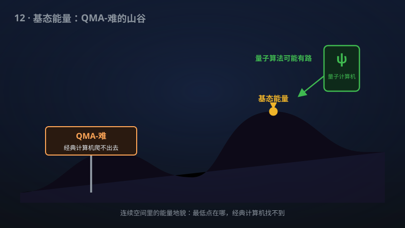

# 12 · 连续库仑能量的 QMA-难

> 算清分子的基态能量有多难？该手稿证明：即使在连续空间里，这个问题也是QMA-难的。

**领域**：量子计算、计算机科学、能源 ｜ **数学分支**：数学物理 ｜ **原文**：[openai/math Family 275](https://github.com/openai/math)

---

## 🌱 小白版：这是什么问题？

设计新药或新电池，第一步往往是算出分子中电子的最低能量（基态能量）——能量最低的结构就是最稳定的结构，好比找山谷里最低的那个洼地。但电子在连续空间里飞来飞去、互相排斥，精确求解难如登天。复杂性理论里有个"量子版 NP"叫 QMA：你可以把它理解成"量子计算机容易验证、却难求解"的问题集合，是"难"的黄金标准之一。

2007 年，Schuch 与 Verstraete 证明：把电子放到离散格子上，电子结构问题是 QMA-难的。但真实世界是连续的——会不会连续版本反而容易一些？毕竟连续空间给了电子"更多腾挪的余地"，好比从格子间搬到大开间，活动空间大了，说不定问题就变简单了呢？该手稿说：不。即使在完整的连续空间里，库仑能量的近似问题同样是 QMA-难的，而且归约用的原子核简单得惊人：单位电荷、放在互不相同的有理点上、电子数只是多项式量级——"作案工具"极简，难度却一点没打折。

打个比方：数独题"验证答案容易、求解难"（NP）；而这里的问题是"连量子计算机都只能验证、不能高效求解"（QMA-难）。该手稿等于宣告：真实分子（连续空间）的基态能量问题，和格子上的玩具版本一样难，谁也别想绕过去——想靠经典计算机精确算清分子能量，这条路在理论上就被堵死了。

## 🎓 专业版：数学上到底说了什么？

考虑三维空间中 n 个电子与 m 个原子核的库仑哈密顿量（原子单位制）：

H = −∑_{i=1}^{n} ∇²_i/2 − ∑_{i,a} Z_a/|r_i − R_a| + ∑_{i<j} 1/|r_i − r_j|，

极小化取遍**完整自旋费米子连续空间**：电子波函数定义在连续构型空间 R^{3n} 上，反对称（费米统计），含自旋自由度——不做任何格点离散化或基组截断。

判定问题：给定能量阈值 a < b，b − a ≥ 1，判断基态能量下确界 inf spec(H) ≤ a 还是 ≥ b（承诺其中之一成立）。该手稿证明这个问题是 **QMA-难** 的。

归约的强度体现在其"吝啬"的条件上：**确定性多项式时间**归约，只需**单位电荷**原子核（Z_a = 1，即全是氢核）、原子核位于**互不相同的有理点** R_a ∈ Q^3、电子数为问题规模的**多项式**，能量阈值间隔至少为 1（即近似精度要求是常数级的，不随规模变苛刻）。换句话说，即使把物理设定简化到这种程度，问题依然保持 QMA-难——难度是内禀的，不是人为调参数调出来的。

## 🔬 这项成果做了什么？

根据官方摘要，该手稿：

- 证明了三维中**近似电子库仑能量下确界**是 QMA-难的；
- 极小化取遍**完整自旋费米子连续空间**（连续变量、无离散化）；
- 归约是**确定性多项式时间**的；
- 归约仅需**单位电荷原子核**，位于**互不相同的有理点**上；
- 电子数为**多项式**量级，能量阈值间隔**至少为 1**。

手稿摘要未披露具体证明路线。

## 📜 时间线

- 1971：Cook–Levin 定理确立 NP 完全性，SAT 成为"难"的基准。
- 1998：Kohn 因密度泛函理论（DFT）分享诺贝尔化学奖——经典量子化学的主力近似方法，但其精度极限始终缺乏复杂性理论解释。
- 1999：Kitaev 提出 QMA（量子 Merlin–Arthur），并证明局域哈密顿量问题 QMA-完全——"难"的量子基准就此确立。
- 2007：Schuch–Verstraete（arXiv:0712.0483）证明格点上相互作用电子体系 QMA-难，并得 Hubbard 模型 QMA-完全——但归约依赖离散格点。
- 2026（手稿宣称）：openai/math Family 275 把 QMA-难性推进到**连续空间**的库仑能量问题，归约条件极简（单位电荷、有理点、多项式电子、阈值间隔 ≥ 1）。

## 💡 核心思想

先理解 QMA 是什么。NP 的经典图景是：Merlin（全能的证明者）给 Arthur（多项式时间的验证者）一个证书，Arthur 能快速验证"答案正确"。QMA 把证书换成**量子态**、验证者换成**量子多项式电路**：如果答案是"是"，存在一个量子态让验证者以高概率接受；如果答案是"否"，任何量子态都只能让验证者以低概率接受。Kitaev 证明的"局域哈密顿量问题 QMA-完全"是量子版的 Cook–Levin 定理：判断一个局域哈密顿量的基态能量低于某阈值，是 QMA 中最难的问题之一。

这类 QMA-难性证明的通用范式是 Feynman–Kitaev 时钟构造：把一个 QMA 验证电路的"计算历史"编码成某个多体哈密顿量的基态，让"电路是否接受"对应"基态能量是否低于阈值"。Schuch–Verstraete 2007 年的突破在于把这套编码搬进了电子体系——但他们的电子住在离散格点上，每个格点是一个"量子比特位"，编码相对直接。

连续空间的真正困难在于：电子没有天然的"格子"可供编码。波函数活在 R^{3n} 里，动能项 −∇²/2 是无界算符，库仑势 1/|r| 在重合点有奇点——想把离散的计算历史"写"进连续电子的基态，必须设计精巧的势阱几何，让电子的局域化位置扮演比特的角色，同时保证动能代价、库仑排斥都不破坏编码的保真度。更苛刻的是，该手稿的归约只允许**单位电荷氢核放在有理点上**：编码用的"硬件"极其简陋，没有高电荷、没有精细调参的余地——难度恰恰在这里：用最简陋的物理设定，依然能嵌入任意 QMA 验证。这说明"难"是库仑多体问题内禀的，不是靠复杂参数堆出来的。（注：以上为该类归约的一般思想；手稿摘要未披露其具体证明路线，此处不作断言。）

阈值间隔 ≥ 1 的意义也值得品味：它说明即便只要求**常数精度**的近似（而非指数精度），问题依然 QMA-难。这直接回应了实践者的侥幸心理——"我不要精确解，只要近似到小数点后几位就行"——答案是：连常数精度都不行。

还有一个细节值得展开：这是一个**承诺问题**（promise problem）。输入承诺基态能量要么 ≤ a、要么 ≥ b，不存在"卡在中间"的实例。承诺问题的 hardness 往往更难证明，因为归约必须保证"所有合法输入都被承诺覆盖"——构造出的哈密顿量不允许出现能量落在 (a, b) 区间内的"灰色实例"。该手稿在阈值间隔 ≥ 1 的承诺下依然得到 QMA-难，说明其归约的能量分辨能力足够干净：接受/拒绝两种情形的能量被一条宽度为 1 的鸿沟隔开，没有模糊地带。这对后续把该结果用作其他 hardness 证明的"零件"至关重要——后续归约可以直接引用这个干净的能量鸿沟。

## 🧗 难在哪？

此前最佳结果是 Schuch–Verstraete 2007：格点电子体系 QMA-难、Fermi–Hubbard 模型 QMA-完全。但从格点到连续，隔着三道坎。第一，**无界算符**：格点模型的哈密顿量是有限维矩阵，谱分析工具齐全；连续库仑哈密顿量的动能项无界，定义域、自伴性、谱的下确界本身就需要泛函分析的精细处理，归约的每一步都要在无穷维空间里站稳。第二，**库仑奇点**：1/|r_i − r_j| 在电子重合时发散，编码设计必须让"计算态"避开奇点灾难，同时不引入指数级的能量代价。第三，**连续变量的编码效率**：用连续电子的位置/动量编码离散比特，需要势阱把电子"钉"在有理点附近，而测不准原理决定了钉得越牢动能代价越大——必须在编码保真度与能量预算之间走钢丝。

正因如此，"连续库仑能量的复杂性"作为更贴近真实量子化学的版本，长期处于开放状态：它问的不是玩具模型，而是化学家每天面对的那个方程。该手稿宣称的归约条件之简（单位电荷、有理点、多项式电子数）恰恰说明，作者声称找到了绕过上述三道坎的干净方案。

## 🚀 有什么用？

- **量子计算（潜在）**：电子结构计算（量子化学）是量子计算机最被看好的"杀手级应用"（VQE、量子相位估计都瞄准它）。QMA-难性为"经典算法本质受限、量子算法或有优势"提供了复杂性理论背书——该结果把背书从格点模型延伸到了真实连续分子，有望成为量子化学量子优势论证的理论地基之一。
- **经典量子化学（已部分落地的方法论价值）**：DFT、耦合簇（CC）等经典近似方法每天都在"近似求解"这个问题。QMA-难性解释了为什么这些方法时灵时不灵：问题内禀地难，任何多项式经典算法必然在某些实例上失效——这为"近似算法的失败"提供了理论上的免责与定位。
- **新药与新材料设计（潜在）**：药物分子对接、电池电解质筛选、催化剂设计的核心瓶颈都是基态能量计算。理解"难在哪、难到什么程度"，有助于把研发资源投向"量子算法 + 启发式近似"的务实路线，而非幻想经典精确求解。
- **哈密顿量复杂性理论（潜在）**：这是量子复杂性理论的核心分支，与量子 PCP 猜想等前沿直接相关。连续库仑问题的 QMA-难性为该领域补上了一块"连续变量"的拼图。
- **算法设计（潜在）**：知道"常数精度近似都已 QMA-难"，算法研究者可以停止寻找通用多项式算法，转而研究"哪些分子实例是容易的"（如弱关联体系）—— hardness 结果的价值往往在于告诉人们"别往哪走"。

## 🔗 相关篇目

- [01 · 唯一游戏猜想（Unique Games Conjecture）与最优近似阈值](01-102-unique-games.md)——经典复杂性理论的"近似难度"基准，可对照 QMA 的量子版本
- [04 · 固定有限门集上的精确量子因数分解](04-279-quantum-factoring.md)——量子算法的上界（能做什么），与 QMA-难的下界（不能做什么）互补
- [08 · QAOA 在热力学优先极限下达到 SK 最优](08-281-qaoa.md)——量子优化算法的理论极限，同属"量子计算能力边界"主题

## 📖 延伸阅读

- A. Yu. Kitaev, A. H. Shen, M. N. Vyalyi, *Classical and Quantum Computation* (AMS, 2002)——QMA 定义与局域哈密顿量 QMA-完全的教材级讲解。
- M. A. Nielsen, I. L. Chuang, *Quantum Computation and Quantum Information* (Cambridge University Press)——量子复杂性类的标准入门。
- N. Schuch, F. Verstraete, "Computational Complexity of Interacting Electrons and Fundamental Limitations of Density Functional Theory," arXiv:0712.0483 (2007)——格点电子体系 QMA-难的原始论文。
- J. Watrous 的量子复杂性理论讲义（大学公开课程讲义）——QMA、QMA-完全问题的系统梳理。

---

> **内容说明**：本文基于 [openai/math](https://github.com/openai/math)（Family 275）官方摘要的转述与中文解读。原成果由 AI 模型产出，官方标注验证程度不一、部分尚未形式化，此处转述不代表数学界共识；引用请以[原文](https://github.com/openai/math)为准。
