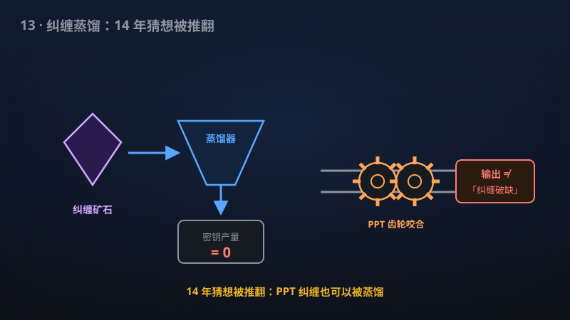

# 13 · 有纠缠但蒸馏不出密钥／PPT平方猜想的证否

> 纠缠≠能用来加密：该手稿造出"有纠缠却榨不出密钥"的量子态，并推翻了一个14年猜想。

**领域**：密码学、量子计算、通信 ｜ **数学分支**：数学物理 ｜ **原文**：[openai/math Family 272](https://github.com/openai/math)

---

## 🌱 小白版：这是什么问题？

量子纠缠像一对"心灵感应"的骰子：相隔万里，掷出的点数永远关联，好比双胞胎的心灵感应。它是量子密码的燃料——人们直觉上以为：只要有纠缠，总能从中"蒸馏"出绝对安全的密钥，就像有甘蔗总能榨出糖。但 1998 年人们发现了"束缚纠缠"：纠缠明明在那儿，却怎么也提纯不出来，好比甘蔗冻成了冰雕，糖分锁死在里面。

更进一步的问题是：纠缠一定能用来产生**密钥**吗？注意密钥比"纯纠缠"要求更高：它不仅要 Alice 和 Bob 关联，还要窃听者 Eve 一无所知——就像两个人用方言聊天，既要彼此听懂，还要保证旁听的人一句也听不懂。该手稿构造了一个 10×10 维度的纠缠态，证明在最一般的局域操作加公开讨论协议下，它能蒸馏出的密钥严格为零——纠缠不等于密钥，甘蔗里可能根本就没有糖。顺带，该手稿还推翻了 Christandl 在 2012 年提出的"PPT 平方猜想"：两个 PPT 信道复合起来，未必是纠缠破缺的——一个悬置 14 年的猜想就此终结。

生活里类比：银行保险箱里锁着一沓"外币"，你看得见、数得清（纠缠确实存在），但这家银行倒闭了，货币作废，你一分钱也取不出来（蒸馏不出密钥）。资产≠现金，纠缠≠密钥——这篇手稿就是那个拿着"作废货币鉴定书"的人，顺手还撕掉了一张 14 年的旧船票（PPT 平方猜想）。

## 🎓 专业版：数学上到底说了什么？

**结果一（纠缠但无可蒸馏密钥）。** 该手稿在 C^{10} ⊗ C^{10} 上显式构造了一个纠缠态 ρ。考虑如下最一般的密钥蒸馏场景：Alice 与 Bob 可执行**指定的、几乎必然完成的局域仪器协议**（local instrument protocols that complete almost surely），允许联合局域处理（joint local processing）与**认证双向公开通信**（authenticated two-way public communication），双方除此之外**无其他共享私有资源**；窃听者 Eve 持有输入态的纯化（purification）与全部公开通信记录。在此设定下，ρ 的**可蒸馏密钥率**（distillable secret key）为零。也就是说：态是纠缠的（非可分），但任何允许的协议都榨不出一比特渐近安全的密钥。

**结果二（PPT 平方猜想的证否）。** 设 Φ: M_d(C) → M_d(C) 为量子信道。若 Φ 与其部分转置 Φ^Γ 皆完全正，则称 Φ 为 **PPT 信道**；若 Φ 把任何输入都映为可分态（等价于其 Choi 态可分），则称 Φ 为**纠缠破缺**（entanglement-breaking, EB）信道。Christandl 猜想：任何 PPT 信道的平方 Φ∘Φ 必为纠缠破缺信道。该手稿在 M_{21}(C) 上构造了一个**保迹 PPT 信道**，其平方**不是**纠缠破缺的——从而证否了该猜想。注意维度 21 是该反例的维度，不是猜想成立的阈值：n = 3 的情形此前已被证明成立，n ≥ 4 长期开放，而该反例直接说明"对一切 n 成立"的版本为假。

## 🔬 这项成果做了什么？

根据官方摘要，该手稿：

- 在 **C^{10} ⊗ C^{10}** 上构造了一个**纠缠态**；
- 对**指定的、几乎必然完成的局域仪器协议**（允许联合局域处理与认证双向公开通信、无其他共享私有资源、窃听者持有输入纯化与公开记录），该态的**可蒸馏密钥为零**；
- 构造了 **M_{21}(C) 上的保迹 PPT 信道**，其**平方不是纠缠破缺**的；
- 从而**证否了 Christandl 的 PPT 平方猜想**（2012 年提出，悬置约 14 年）。

手稿摘要未披露具体证明路线。

## 📜 时间线

- 1996：Peres 与 Horodecki 家族提出 PPT（正部分转置）判据，成为纠缠判定的核心工具。
- 1998：Horodecki 家族发现**束缚纠缠**（bound entanglement）：PPT 纠缠态存在，且无法蒸馏出纯纠缠——"有纠缠但提纯不出"的第一例。
- 2005：Horodecki 等证明束缚纠缠仍可蒸馏出**安全密钥**（private states）：纠缠、密钥、提纯三者的关系比想象中更微妙——束缚纠缠无用但有密钥，本手稿则反向构造"有纠缠但无密钥"。
- 2012：Christandl 在 Banff 研讨会上提出 **PPT 平方猜想**：两个 PPT 信道复合必为纠缠破缺信道。
- 2018：Chen–Yang–Tang 证明 n = 3 情形猜想成立；n ≥ 4 长期开放。
- 2026（手稿宣称）：openai/math Family 272 构造 10×10 纠缠无密钥态，并以 M_{21}(C) 上的保迹 PPT 信道证否 PPT 平方猜想。

## 💡 核心思想

要理解"纠缠≠密钥"，先分清三个经常被混为一谈的概念：**纠缠**（entanglement）、**可蒸馏纠缠**（distillable entanglement）、**可蒸馏密钥**（distillable key）。纠缠是"态不可分"；可蒸馏纠缠是"能用 LOCC 提纯出 Bell 对"；可蒸馏密钥是"能用 LOCC 加公开讨论生成 Eve 一无所知的密钥"。三者的要求逐级苛刻：密钥不仅要求 Alice–Bob 强关联，还要求这种关联对 Eve **私密**——Eve 手握纯化和公开记录，却推断不出密钥比特。

1998 年的束缚纠缠打破了"纠缠 ⇒ 可提纯"；2005 年的 private states 说明"不可提纯 ⇏ 无密钥"（束缚纠缠里藏着私密关联）；本手稿则补上了最后一块反直觉拼图："纠缠 ⇏ 有密钥"。三者合在一起，纠缠作为"资源"的层级结构才算完整：**纠缠是最弱的非局域资源，密钥是最强的私密资源，中间隔着提纯这道坎**。该手稿的 10×10 态恰好卡在"有纠缠、零密钥"这个此前空缺的格子里。

再看 PPT 平方猜想为什么"看起来该对"。PPT 信道是"几乎纠缠破缺"的信道：它的 Choi 态部分转置为正，意味着它至多携带"束缚"级别的纠缠。直觉上，把两个"几乎无用"的信道串起来（Φ∘Φ），纠缠应该被洗得更干净——就像把水过滤两遍应该更纯。n = 3 时这个直觉被证明成立，于是人们猜它对一切维度成立。该手稿的反例（21 维保迹 PPT 信道，平方后仍非纠缠破缺）说明：**PPT 纠缠在复合下可以"幸存"**，过滤两遍并不能保证滤净。这个否定结果的价值在于划界：它告诉信道理论，"PPT"与"纠缠破缺"之间隔着本质的鸿沟，复合操作弥合不了。

关于维度选择的直觉也值得一提。结果一用 10×10，结果二用 21 维——这些数字不是随手挑的。在量子信息里，低维系统往往有"特殊刚性"：比如 2×2 和 2×3 系统中 PPT 等价于可分（Horodecki 定理），PPT 平方猜想在 n = 3 时成立也与此相关。构造反例必须逃离低维刚性的"舒适区"，进入足够高维、约束矩阵有腾挪空间的区域；但维度太高又会让"平方后仍纠缠"的验证失控。10 和 21 很可能就是"刚好够用"的临界点——这也是此类存在性/构造性证明的典型风味：维度本身就是证明的一部分。

## 🧗 难在哪？

"纠缠但无可蒸馏密钥"的态，其存在性是量子密码基础理论中的精细问题。难点在于**证零**：要证明"任何允许协议都蒸馏不出密钥"，不能靠举例（举一个协议失败不算数），必须证明**可蒸馏密钥率这个泛函恒为零**——这需要在一切 LOCC + 公开讨论协议上取上确界并说明上确界为零，通常要借助密钥率的上界（如相对熵纠缠度量的变体、私密容量的上界估计）并构造出让上界归零的态。维度 10×10 的选择本身就暗示了构造的精巧：维度太小可能放不下所需的结构，太大则难以控制。

PPT 平方猜想的难处则在于它的"不上不下"：n = 3 成立（2018）的证明用到了低维的特殊结构，无法推广；n ≥ 4 既无证明也无反例，卡了十多年。构造反例需要在高维空间里同时满足三个互相打架的条件——**保迹**（物理合法性）、**PPT**（部分转置为正）、**平方后仍纠缠**（Choi 态不可分）——每一个都是精细的矩阵不等式约束。该手稿在 21 维找到同时满足三者的信道，相当于在高维矩阵空间里命中了一个此前无人知晓的狭窄区域。

## 🚀 有什么用？

- **量子密钥分发（QKD）安全理论（已部分落地）**：QKD 的安全性证明必须严格区分"纠缠"与"可用密钥"。该结果为"纠缠是密钥的必要条件而非充分条件"提供了又一个精确实例，有望帮助完善设备无关 QKD（DI-QKD）等协议的安全性边界分析。
- **量子通信与纠缠蒸馏（潜在）**：纠缠蒸馏、量子中继协议的设计长期以"纠缠量"为优化目标。该结果提醒协议设计者：若最终目标是密钥而非纠缠，优化目标函数可能需要修正——"无用纠缠"的存在意味着基于纠缠度量的协议评估可能高估实际密码学价值。
- **量子信道结构理论（潜在）**：PPT 与纠缠破缺信道的关系是量子 Shannon 理论的基础课题之一。证否 PPT 平方猜想迫使理论家重新审视"PPT 信道复合"的分类学，可能催生新的信道不变量或修正版猜想（如加额外条件后的平方猜想）。
- **量子资源理论（潜在）**：纠缠、密钥、非局域性各自形成资源理论，该结果厘清了纠缠资源理论与私密资源理论之间的严格分离，为统一的"量子资源层级"图景添上一块拼图。
- **密码学基础（潜在）**：经典密码学里"单向函数存在吗"至今开放；量子世界里"纠缠蕴含密钥吗"的答案现在是否定的。这种否定性基础结果的长远价值在于：它们划定了"什么不可能"，从而把研究力量引向"什么可能"。

## 🔗 相关篇目

- [14 · 广义振幅阻尼信道的经典容量](14-276-channel-capacity.md)——量子信道容量理论的另一块拼图，同属"信道能传多少信息"主题
- [01 · 唯一游戏猜想（Unique Games Conjecture）与最优近似阈值](01-102-unique-games.md)——"证明不可能性/划定边界"的经典复杂性版本
- [06 · 奇偶性不在 QAC⁰ 中](06-274-parity-qac0.md)——量子计算能力的硬边界，同属"否定性基础结果"

## 📖 延伸阅读

- M. Horodecki, P. Horodecki, R. Horodecki, "Mixed-State Entanglement and Distillation: Is there a 'Bound' Entanglement in Nature?" Phys. Rev. Lett. 80, 5239 (1998)——束缚纠缠的发现。
- A. Peres, "Separability Criterion for Density Matrices," Phys. Rev. Lett. 77, 1413 (1996)——PPT 判据的起点。
- K. Horodecki et al., "Secure Key from Bound Entanglement," Phys. Rev. Lett. 94, 200501 (2005)——束缚纠缠可蒸馏出密钥。
- M. M. Wilde, *Quantum Information Theory* (Cambridge University Press)——量子信道、纠缠破缺信道的教材级讲解。
- M. A. Nielsen, I. L. Chuang, *Quantum Computation and Quantum Information*——LOCC、纠缠度量的标准入门。

---

> **内容说明**：本文基于 [openai/math](https://github.com/openai/math)（Family 272）官方摘要的转述与中文解读。原成果由 AI 模型产出，官方标注验证程度不一、部分尚未形式化，此处转述不代表数学界共识；引用请以[原文](https://github.com/openai/math)为准。
