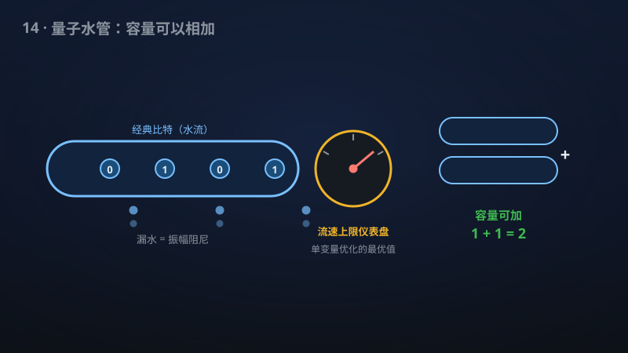

# 14 · 广义振幅阻尼信道的经典容量

> 量子通信的"网速上限"：一切参数下的广义振幅阻尼信道容量被一次算清。

**领域**：通信、量子计算、计算机科学 ｜ **数学分支**：数学物理 ｜ **原文**：[openai/math Family 276](https://github.com/openai/math)

---

## 🌱 小白版：这是什么问题？

想象一条"漏水的水管"：你往里倒水（发送信号），管壁有裂缝，水会漏出去一部分（振幅阻尼——量子比特"飞行"久了会漏能量），而且夏天管子被晒得发烫，还会凭空多出一些热水汽来捣乱（热噪声）。量子通信里，光纤、量子存储器就是这样一条"又漏又烫"的水管。一个最基本的问题是：**这条水管每秒最多能送多少桶"干净的水"？** 换成通信语言：一个量子信道每次使用最多能传多少经典比特？这叫"经典容量"，是量子互联网的"网速上限"。

故事要从 1997–1998 年说起。Holevo、Schumacher 和 Westmoreland 给出了容量公式，但公式里藏着一个"取极限"：你要考虑把信道用 1 次、2 次、……、无穷多次，把纠缠横跨在所有这些使用之间做编码，再取平均的最优值。这好比快递公司算运力时，不光要算"一辆车能拉多少"，还要算"一万辆车以任意队形编队、车与车之间还能'心灵感应'配合"的极限——算不完。更糟的是，2009 年 Hastings 证明：这种"编队+心灵感应"（纠缠编码）有时**真的**能突破单次使用的上限，所以这个极限省不掉。于是，"振幅阻尼信道的真实容量到底是多少"悬了二十多年，被称为"单量子比特量子香农理论中最大的谜"。

该手稿宣称把这个谜底揭开了：**对一切阻尼参数和温度参数，容量就是一个单变量优化问题的解**——相当于把"一万辆车的无穷队形"压缩成"调一个旋钮"；而且最优方案出奇地简单：发送端只用两种信号态、每次独立发送（乘积码字），接收端把多次输出放在一起联合测量（集体解码）。更进一步，它宣称这个信道跟**任何**其他信道并用时，总容量就是两者相加——纠缠跨信道也榨不出一滴额外的油水。

**生活例子**：① 你家宽带的"理论最高速率"（比如光猫上标的 1000 Mbps）就是香农公式算出的经典容量，运营商据此设计编码、你据此判断"我家网速有没有被偷工减料"——量子版的容量公式扮演完全相同的角色。② 快递分仓：最优策略不是把所有包裹胡乱混装，而是把货物拆成两种标准小包裹（双态信号系综）、每辆车独立装货（乘积编码），到了分拣中心再统一按目的地分拣（集体解码）——简单、可执行，却达到了理论上限。

## 🎓 专业版：数学上到底说了什么？

**广义振幅阻尼信道（GADC）** 是一族双参数量子比特信道 $\mathcal{A}_{\gamma,N}$，$\gamma\in[0,1]$ 为阻尼（损耗）参数，$N\in[0,1]$ 为热噪声参数（环境热态的激发布居）。其 Kraus 表示为 $\mathcal{A}_{\gamma,N}(\rho)=\sum_{i=1}^4 A_i\rho A_i^\dagger$，其中
$$A_1=\sqrt{1-N}\begin{pmatrix}1&0\\0&\sqrt{1-\gamma}\end{pmatrix},\quad A_2=\sqrt{\gamma(1-N)}\begin{pmatrix}0&1\\0&0\end{pmatrix},$$
$$A_3=\sqrt{N}\begin{pmatrix}\sqrt{1-\gamma}&0\\0&1\end{pmatrix},\quad A_4=\sqrt{\gamma N}\begin{pmatrix}0&0\\1&0\end{pmatrix}.$$
$N=0$ 时退化为普通振幅阻尼信道（零温能量弛豫）；$N=1/2$ 时信道是保单位元的（unital）。在 Bloch 球上，它把 Bloch 矢量 $\mathbf{r}=(x,y,z)$ 映为 $(\sqrt{1-\gamma}\,x,\sqrt{1-\gamma}\,y,(1-\gamma)z+\gamma(1-2N))$：横向收缩、纵向平移——"漏水又受热"的几何写照。

**经典容量**的 HSW 公式为 $C(\mathcal{N})=\lim_{n\to\infty}\frac1n\chi(\mathcal{N}^{\otimes n})$，其中单次 Holevo 量 $\chi(\mathcal{N})=\max_{\{p_i,\rho_i\}}\big[S(\sum_i p_i\mathcal{N}(\rho_i))-\sum_i p_i S(\mathcal{N}(\rho_i))\big]$，$S$ 为 von Neumann 熵。正则化极限正是 Hastings 反例所攻击的要害。

该手稿的数学断言有三层：

1. **单字母公式**：对一切 $(\gamma,N)$，$C(\mathcal{A}_{\gamma,N})$ 等于一个显式**单实变量**优化问题的最优值（把无穷维系综优化压到一维）；
2. **可达方案**：最优值由"独立双态信号系综"（两个纯信号态、等概率、乘积码字）配合**集体解码**（对 $n$ 次输出的联合测量）达到；
3. **强可加性**：Holevo 容量 $\chi$、最小输出熵 $S_{\min}(\mathcal{N})=\min_\rho S(\mathcal{N}(\rho))$、正则化经典容量 $C$ 在与**任意**有限维量子信道 $\mathcal{M}$ 做张量积时都可加，即 $\chi(\mathcal{N}\otimes\mathcal{M})=\chi(\mathcal{N})+\chi(\mathcal{M})$ 等恒成立——纠缠横跨两个信道不能带来任何超额增益。

## 🔬 这项成果做了什么？

该手稿宣称完成以下结论（以下转述官方摘要，不添加新手稿断言）：

- **确定了每个量子比特广义振幅阻尼信道的无辅助经典容量**，覆盖一切阻尼参数与一切热参数；
- **一个显式单变量优化给出容量**：容量的数值就等于某个只含一个实优化变量的显式最大化问题的解；
- **容量由独立双态信号系综与集体解码达到**：发送端用两种信号态做独立乘积编码，接收端做联合（集体）测量解码，即可达到容量；
- **可加性**：Holevo 容量、最小输出熵与正则化经典容量在与**任意有限维量子信道**做张量积时都可加。

手稿摘要未披露具体证明路线。

## 📜 时间线

- 1948：Shannon 发表《通信的数学理论》，信道容量概念诞生，经典情形的单字母公式 $C=\max I(X;Y)$ 问世。
- 1973：Holevo 证明 Holevo 界——$n$ 个量子比特至多取出 $n$ 比特经典信息，量子信道的"天花板"第一次被钉死。
- 1997–1998：Holevo（1998）与 Schumacher–Westmoreland（1997）各自证明 HSW 定理，给出经典容量的正则化公式，但留下了"取极限"的尾巴。
- 2002–2005：Bennett–Shor–Smolin–Thapliyal（2002）与 Giovannetti–Fazio（2005）算出振幅阻尼信道的**单次** Holevo 量，但它等不等于真实容量无人能答。
- 2009：Hastings 构造反例证否可加性猜想——纠缠编码确实能突破单次上限，"极限省不掉"被坐实。
- 2021：对称 GADC（$N=1/2$）的精确经典容量被求出（"Queue-Channel Capacities with Generalized Amplitude Damping"），还附带一个量子排队信道的容量结果。
- 2026年9月：Tang–Zhu–Bai–Wang 的 arXiv 预印本证明"容许纯输出"的量子比特信道的容量等于单次 Holevo 量，但**明确把有限温度的 GADC 列为不满足假设、未解决的情形**。
- 该手稿：宣称把一切阻尼与热参数的情形一次解决，并给出与任意有限维信道的可加性。

## 💡 核心思想

要理解这项工作为什么难，先理解**可加性问题**在量子香农理论中的位置。经典香农理论里，信道容量是"单字母"的：算一次 $I(X;Y)$ 的最大值就够了，用 $n$ 次信道就是 $n$ 倍，不多不少。量子世界里，发送端可以把纠缠"横跨"在 $n$ 次信道使用之间——第 1 次和第 10000 次发送的量子态可以是纠缠的。这就产生了一个幽灵般的可能性：**整体大于部分之和**。Hastings 2009 年证明这个幽灵是真的：存在信道，纠缠编码的渐近速率严格超过单次 Holevo 量。从那以后，"这个信道的容量到底是多少"就成了一个原则上需要无穷极限才能回答的问题——除非你能找到**结构性理由**，证明对"这个"信道而言，幽灵不存在。

该手稿宣称找到的结构性结论有两层。第一层是**可加性本身**：对 GADC，$\chi(\mathcal{A}\otimes\mathcal{M})=\chi(\mathcal{A})+\chi(\mathcal{M})$ 对任意有限维 $\mathcal{M}$ 成立。这意味着纠缠无论横跨在多次使用之间，还是横跨在 GADC 与另一个任意信道之间，都榨不出额外容量——HSW 公式里的极限可以直接去掉，$C=\chi$。历史上，已知可加的信道类屈指可数：纠缠破缺信道（Shor）、单量子比特 unital 信道（King）、退极化信道等；GADC 在一般参数下既非纠缠破缺也非 unital，此前是"最大谜团"。

第二层是**单变量优化**：即使知道 $C=\chi$，$\chi$ 本身仍是对"一切输入系综"的无穷维优化。该手稿宣称 GADC 的对称性（绕 $z$ 轴的旋转协变性等）把这个优化压到**一个实参数**——好比在一个无边的大厅里找最高点，结果发现最高点一定落在一条指定的绳子上。配套的可达方案同样简洁：两个纯态、等概率、乘积码字、集体解码。这呼应了 2026 年 9 月 Tang 等人工作的精神（纯输出信道的二元系综最优），但把适用范围推进到了有限温度——而那正是 Tang 等人明确承认其方法覆盖不了的区域。

一个值得玩味的细节是**最小输出熵的可加性**也被一并宣称。最小输出熵 $S_{\min}$ 正是 Hastings 用来证否可加性猜想的量（他证明了它可以**超**可加）。该手稿宣称：对 GADC 而言，这个"最调皮"的量也变得乖巧了——与任意有限维信道张量积时都可加。如果成立，这不仅是算出一个容量，更是给可加性这座"幽灵出没"的迷宫又点亮了一大片区域。

## 🧗 难在哪？

难在三个叠加的层次。**第一层是概念性的**：HSW 定理 1997–1998 年问世后，人们一度猜测 Holevo 量总是可加的（可加性猜想），那样容量就是单字母的、好算的。Hastings 2009 年的反例用高维随机信道和精巧的概率方法证明猜想为假——从此"算容量"原则上是个无穷问题，只能逐个信道"-case by case"地找结构性论证，而这类论证极其稀缺。

**第二层是 GADC 自身的"两头不靠"**：零温振幅阻尼（$N=0$）的量子容量早就由 Giovannetti–Fazio 等人用可降解性（degradability）拿下，但**经典**容量反而悬着；对称情形（$N=1/2$，unital）2021 年被拿下；纠缠破缺参数区（$2(\sqrt2-1)\le p\le 1$ 附近）由 Shor 的一般定理覆盖。剩下的"中间地带"——既非 unital、也非纠缠破缺、也无纯输出的有限温度一般参数——正是 2026 年 9 月 Tang 等人论文中那句"Generalized amplitude damping at finite temperature does not in general satisfy the hypothesis"的所指，也是此前所有方法的盲区。

**第三层是优化的维度灾难**：即使猜对了"容量等于单次 Holevo 量"，把 $\chi$ 算出来仍需在无穷维系综空间上优化。该手稿宣称的"单变量优化"意味着证明了最优系综必取某种极简形式——这类"最优系综结构定理"在量子信息中向来是硬骨头（历史上 Bennett 等人 2002 年对振幅阻尼单次量的计算就依赖精细的对称性约化）。

## 🚀 有什么用？

- **量子通信链路的速率基准**：GADC 是光纤量子通信、自由空间量子链路和量子存储器的标准噪声模型——光子在光纤中既会丢失（阻尼）又会受到热噪声污染。若手稿成立，工程师第一次拥有该模型在一切参数下的**精确**理论速率上限，可据此判断现有编码方案距离最优还有多远。
- **最优编码的"施工图"**：容量由"双态系综 + 集体解码"达到——这给实验物理学家指了一条具体、可实现的路线：不需要跨多次使用的纠缠编码（那在实验上极难），独立发送两种信号态、接收端做联合测量就够了。
- **量子密钥分发（QKD）与安全分析**：实际 QKD 系统的信道常被建模为 GADC 族成员；精确的经典容量界限有望为密钥率上界、窃听者信息量的估计提供更紧的基准。
- **量子中继与量子互联网规划**：长距离量子通信依赖中继链，每段链路的精确容量是全网资源分配、纠错开销预算的输入参数；单变量公式"算得快"的特点使其有望嵌入网络优化软件。
- **量子纠错与错误缓解设计**：精确刻画噪声信道的可达速率，有助于为"振幅阻尼型"噪声定制纠错码，而不是套用为退极化噪声设计的通用码。
- **可加性理论的实质进展**：把"幽灵出没区"缩小了一块——GADC 与**任意**有限维信道的可加性，是可加性问题近二十年少有的"大块"进展，可能启发其他非 unital 信道类的可加性证明。
- **教学与方法论意义**："把无穷维优化压到单变量"的对称性约化技巧若被验证，有望成为量子香农理论研究生课程中的典范案例。

## 🔗 相关篇目

- [13 · 有纠缠但蒸馏不出密钥／PPT平方猜想的证否](13-272-entanglement-no-key.md)：同样深耕量子香农理论——纠缠作为资源何时"有用"、何时"无用"的边界问题。
- [06 · 奇偶性不在 QAC⁰ 中](06-274-parity-qac0.md)：量子计算能力的硬边界；与本篇同属"给量子信息处理能力画精确界线"的主题。
- [03 · 低于 n log n 的精确傅里叶变换](03-130-fourier-transform.md)：经典通信与信号处理的算法基础；容量公式中的编码/解码最终都要落到经典后处理算法上。

## 📖 延伸阅读

- Holevo, "The capacity of the quantum channel with general signal states," *IEEE Trans. Inf. Theory* 44 (1998)：HSW 定理的 Holevo 一半，经典容量的正则化公式源头。
- Schumacher–Westmoreland, "Sending classical information via noisy quantum channels," *Phys. Rev. A* 56 (1997)：HSW 定理的另一半。
- Hastings, "Superadditivity of communication capacity using entangled inputs," *Nature Physics* 5 (2009)：证否可加性猜想的里程碑，理解本篇难度的必读背景。
- Wilde《Quantum Information Theory》(Cambridge University Press)：GADC 被称为"单量子比特最大谜团"的出处语境，量子香农理论的标准教材。

---

> **内容说明**：本文基于 [openai/math](https://github.com/openai/math)（Family 276）官方摘要的转述与中文解读。原成果由 AI 模型产出，官方标注验证程度不一、部分尚未形式化，此处转述不代表数学界共识；引用请以[原文](https://github.com/openai/math)为准。
