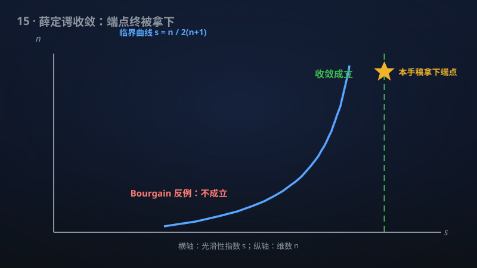

# 15 · 薛定谔收敛的索伯列夫端点

> 46年悬案的最后一块拼图：薛定谔方程解逐点收敛的最佳光滑性门槛被AI拿下。

**领域**：量子物理、数学之美、计算机科学 ｜ **数学分支**：实分析与复分析 ｜ **原文**：[openai/math Family 080](https://github.com/openai/math)

---

## 🌱 小白版：这是什么问题？

想象往池塘里扔一颗石子，涟漪会扩散开去；现在把录像**倒放**，问：能不能逐滴水珠、逐帧画面地精确回到"石子刚入水"的那一刻？薛定谔方程描述的正是量子世界里"波"的扩散：给定最初一刻的波形 $f$，它能算出之后任意时刻 $t$ 的样子，记作 $e^{it\Delta}f$。1980 年，数学家 Carleson 问了一个看似简单的问题：如果最初的波形有点"毛糙"（数学上叫光滑性不够高——好比一张布满噪点的老照片），演化一小会儿之后（$t\to 0$），波形还能不能**处处**精确地回到当初的样子？

一维情形在 1980 年代初就解决了：光滑性指数 $s\ge 1/4$ 够用，低于 $1/4$ 则不行——门槛被钉得死死的。但高维情形折腾了 40 多年：人们把门槛从 $s>1/2$ 一路下探，2017 年和 2019 年，Du–Guth–Li、Du–Zhang 用"解耦"等新工具把它降到了 $n/(2(n+1))$（二维就是 $1/3$）。可"等号能不能取"——也就是**端点本身**——始终悬而未决：门槛值 $s=n/(2(n+1))$ 处，收敛到底成不成立？这好比跳高比赛，所有人都跳过了 2.39 米，没人知道 2.40 米这根横杆是纸糊的还是钢筋的。该手稿宣称：这根横杆是纸糊的——端点成立，包括最受关注的二维 $H^{1/3}$ 情形。这等于给这场 46 年的马拉松画上了句号：门槛值被**精确**锁定，再无缝隙。

**生活例子**：① 老照片修复：扫描一张有划痕噪点的老照片（"毛糙"的初值），修复算法相当于让图像做某种"波动演化"再取极限——Carleson 问题问的正是"算法在极限下能否逐像素还原原图"，光滑性门槛就是"照片最多能有多糙、修复才 guaranteed 成功"。② 音乐厅里刚敲下定音鼓的那一刻：鼓面各点的位移分布是"毛糙"的初值，声波演化一小会儿后，各点气压能否精确回到敲击瞬间？这正是 $e^{it\Delta}f\to f$ 逐点成立的物理画面。

为什么"几乎处处"而不是"处处"？因为毛糙函数的"坏点"（比如尖峰、断裂处）是不可避免的——数学家退而求其次：允许在一个测度为零的"坏点集"上失败，但其他所有点都必须精确还原。端点定理的厉害之处在于：即使初值糙到门槛值本身（$s$ 取等号，一点富余都不留），这个"几乎处处还原"依然成立——好比杂技演员走钢丝，以往的证明都要求"钢丝下面有安全网"（$s$ 严格大于门槛），这次是第一次有人证明"撤掉安全网也一样能走过去"。

## 🎓 专业版：数学上到底说了什么？

考虑自由薛定谔方程 $iu_t-\Delta u=0$（符号约定不影响结论），初值 $u(x,0)=f(x)$，解由酉演化群给出：$u(x,t)=e^{it\Delta}f(x)$，即 $\widehat{u}(\xi,t)=e^{-it|\xi|^2}\widehat{f}(\xi)$。Sobolev 空间 $H^s(\mathbb{R}^n)$ 由范数 $\|f\|_{H^s}^2=\int (1+|\xi|^2)^s|\widehat{f}(\xi)|^2\,d\xi$ 定义，$s$ 越大函数越光滑。

**Carleson 问题**：求最小的 $s$，使得对一切 $f\in H^s(\mathbb{R}^n)$ 都有 $\lim_{t\downarrow 0}e^{it\Delta}f(x)=f(x)$ 对几乎所有 $x$ 成立。此前格局是"三明治"：Du–Guth–Li（2017，$n=2$）与 Du–Zhang（2019，$n\ge 3$）证明 $s>n/(2(n+1))$ 充分；Bourgain（2016）的反例证明 $s<n/(2(n+1))$ 时存在 $f$ 使收敛失败——指数**不能再低**。唯一剩下的就是等号：$s=n/(2(n+1))$ 本身。

该手稿断言：**端点对一切 $n\ge 2$ 成立**。特别地，$n=2$ 时 $H^{1/3}$ 的逐点收敛成立——这正是 2017 年 Du–Guth–Li 工作之后最受瞩目的开放端点。

标准归约（Stein 极大原理）：几乎处处收敛等价于极大估计 $\big\|\sup_{0<t<1}|e^{it\Delta}f|\big\|_{L^2(B)}\lesssim \|f\|_{H^s}$。因此端点问题本质上是证明**端点处的极大函数估计**——而端点估计在调和分析中向来是最硬的骨头（$\varepsilon$-removal 等软技巧在端点处统统失效）。

## 🔬 这项成果做了什么？

该手稿宣称证明（以下转述官方摘要，不添加新手稿断言）：

- **对一切维数 $n\ge 2$、一切初值 $f\in H^{n/(2(n+1))}(\mathbb{R}^n)$，$e^{it\Delta}f\to f$（$t\downarrow 0$）几乎处处成立**；
- **这达到了 Carleson 薛定谔收敛问题的最优 Sobolev 等号情形**：结合 Bourgain 2016 年的反例（指数不能再低），门槛 $s=n/(2(n+1))$ 被证明是**精确最优**的，再无改进余地；
- 结论**包括平面端点 $H^{1/3}$**（$n=2$ 的情形）。

手稿摘要未披露具体证明路线。

## 📜 时间线

- 1980：Carleson 提出该问题（论文标题与统计力学相关），并证明一维 $s\ge 1/4$ 时收敛成立。
- 1982：Dahlberg–Kenig 证明一维 $1/4$ 是最优的——一维情形彻底终结。
- 1987–1988：Sjölin、Vega 得到高维 $s>1/2$ 的充分条件——此后近三十年进展缓慢。
- 2000 年前后：Bourgain、Moyua–Vargas–Vega、Tao–Vargas、Lee 等人用 restriction 理论、波包分解等工具不断下探指数。
- 2015：Bourgain–Demeter 证明 $\ell^2$ 解耦猜想，为后续突破提供了全新的"重型武器"。
- 2016：Bourgain 构造反例，证明指数**不能**低于 $n/(2(n+1))$——"地板"被钉死，只剩"天花板"（端点）问题。
- 2017：Du–Guth–Li 用多项式划分 + 解耦，得到 $n=2$ 时 $s>1/3$。
- 2019：Du–Zhang 得到 $n\ge 3$ 时 $s>n/(2(n+1))$——"三明治"只差等号这一层。
- 该手稿：宣称端点 $s=n/(2(n+1))$ 对一切 $n\ge 2$ 成立，46 年问题闭环。

## 💡 核心思想

先理解这个指数 $n/(2(n+1))$ 是从哪儿冒出来的。直觉来自**波包**：取一个在频率空间集中在 $|\xi|\sim R$、方向集中在很窄锥内的波包，它在物理空间里是一条又长又细的"光束"，以群速度 $\sim R$ 传播。在时间 $t\sim 1/R$ 内，这条光束扫过一个拉长的区域。Bourgain 的反例正是把许多这样的波包精心叠加，让它们在某点" constructive 干涉"出一个尖峰——计算表明，当 $s<n/(2(n+1))$ 时，这个尖峰可以压过 $H^s$ 范数的控制，导致逐点收敛失败。所以 $n/(2(n+1))$ 是**波包几何**决定的硬门槛，不是人为的估计瑕疵。

那为什么"严格大于"好证、"等号"难证？2017/2019 年的证明走的是"$\varepsilon$-removal"路线：先证明带一点损失（$R^\varepsilon$）的估计，再用软技巧把 $\varepsilon$ 去掉，得到 $s>n/(2(n+1))+\delta$ 对一切 $\delta>0$ 成立。但这套把戏在**端点**处必然卡住——$\varepsilon$-removal 只能逼近端点，永远够不着它。要够到端点，必须直面那些让估计"临界"的极端波包构型，证明即使在最坏的叠加下，极大函数仍然可控。这通常需要比"充分性"精细得多的论证：更紧的波包计数、端点处的精细几何，或者全新的函数空间框架。

还有一个深层视角：Carleson 问题是**色散方程逐点行为**的试金石。$e^{it\Delta}$ 是酉算子，$L^2$ 范数守恒是免费的；难的是"逐点"——无穷多个 $x$ 同时成立。这要求对解的**振荡**有定量控制：高频成分 $e^{-it|\xi|^2}$ 振荡极快，不同频率的干涉必须被精确估计。解耦（decoupling）理论的威力正在于此：它把"不同频率块之间的干涉"转化为"各频率块 $L^p$ 范数的几何平均"，从而可以用归纳法处理。而端点情形下，这种转化的常数必须被控制到**临界**精度——差之毫厘，谬以千里。

## 🧗 难在哪？

难在"最后一毫米"。从 1980 到 2016，高维 Carleson 问题经历了三代技术：第一代（Sjölin、Vega，$s>1/2$）用的是经典的 Sobolev 嵌入 + 固定时间估计，粗糙但稳健；第二代（Bourgain、Tao–Vargas 等）引入 restriction 猜想的 machinery，把指数一路压到接近 $n/(2(n+1))$，但始终差一口气；第三代（Du–Guth–Li 2017、Du–Zhang 2019）祭出**多项式划分**（polynomial partitioning）+ **解耦**（decoupling）这对组合拳，终于把"严格大于"拿下。

但端点是另一头野兽。调和分析里有个不成文的规律：**端点估计的难度常常超过整个开区间**。原因在于，开区间估计允许你在证明中"浪费"一点（一个 $R^\varepsilon$ 因子、一次不紧的插值），而端点处没有任何浪费的余地——每一个常数、每一次计数都必须是最优的。历史上，restriction 猜想、Bochner–Riesz 猜想的端点至今仍是开放问题，足见端点之难。Carleson 问题的端点之所以被认为"可能可及"，是因为 Bourgain 的反例已经把"地板"钉死，且 2017/2019 年的技术离端点只有 $\varepsilon$ 之遥——但这 $\varepsilon$ 是调和分析里最贵的 $\varepsilon$。

## 🚀 有什么用？

- **46 年问题的最终闭环**：Carleson 问题是调和分析与色散方程交叉领域最著名的开放问题之一；端点的解决意味着"最佳光滑性门槛"被**精确**锁定，教科书里的 "$s>$" 可以改写为 "$s\ge$"。
- **量子力学的数学基础**：$e^{it\Delta}f\to f$ 逐点成立，是"量子波包在初始时刻附近行为良好"的严格表述，关乎薛定谔方程初值问题解的逐点诠释的严密性。
- **调和分析工具的溢出效应**：证明中必然发展的端点解耦/极大估计技术，有望应用于 restriction 猜想、Bochner–Riesz 等邻近的端点难题——历史上 Carleson 问题的每一次突破都带动了一批相关问题的进展。
- **解析数论与信号处理**：解耦理论在指数和估计（解析数论）、稀疏信号恢复中有应用；端点精度的提升可能转化为这些领域中更紧的界。
- **色散方程数值计算的理论保证**：逐点收敛的 sharp 门槛为薛定谔方程数值格式的收敛性分析提供了"光滑性假设不能再弱"的基准线。
- **一场马拉松的终点线**：从 Carleson 1980 到端点解决，横跨 46 年、三代数学家——这类"最终拼图"本身就是数学共同体的标志性事件。

## 🔗 相关篇目

- [03 · 低于 n log n 的精确傅里叶变换](03-130-fourier-transform.md)：傅里叶分析是本篇的根基——$e^{it\Delta}$ 本质上是傅里叶乘子，$H^s$ 范数用傅里叶变换定义。
- [22 · 相对论 Vlasov–Maxwell 的整体光滑性](22-362-vlasov-maxwell.md)：同属"色散/双曲型方程的正则性"主题，都是问"解在长时间/极限下是否保持良好行为"。
- [23 · 受迫 Navier–Stokes 流中的通用计算](23-376-fluid-computation.md)：偏微分方程前沿的另一极——本篇问"解是否收敛"，那篇问"解能多复杂"，一收一放对照着看很有味道。

## 📖 延伸阅读

- Carleson, "Some analytic problems related to statistical mechanics" (1980)：问题的源头，一维 $s\ge 1/4$ 的原始证明。
- Stein《Harmonic Analysis》(Princeton University Press)：极大函数、Stein 极大原理的系统阐述，理解"a.e. 收敛 ⟺ 极大估计"归约的必读。
- Tao《Nonlinear Dispersive Equations》(CBMS)：色散方程的现代视角，波包、Strichartz 估计的入门圣经。
- Bourgain–Demeter, "The proof of the $\ell^2$ decoupling conjecture," *Annals of Mathematics* (2015)：2017/2019 年突破所依赖的重型武器，解耦理论的奠基之作。

---

> **内容说明**：本文基于 [openai/math](https://github.com/openai/math)（Family 080）官方摘要的转述与中文解读。原成果由 AI 模型产出，官方标注验证程度不一、部分尚未形式化，此处转述不代表数学界共识；引用请以[原文](https://github.com/openai/math)为准。
