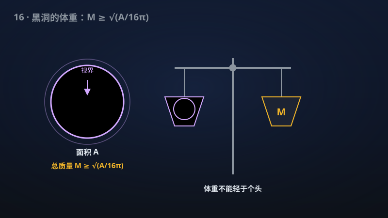

# 16 · 时空 Penrose 不等式：包围面积、电荷、旋转与反德西特推广

> 黑洞的质量不能小于它的"个头"：Penrose 1973年猜想的时空版本被推进到任意高维。

**领域**：物理学、量子物理、数学之美 ｜ **数学分支**：数学物理 ｜ **原文**：[openai/math Family 260](https://github.com/openai/math)

---

## 🌱 小白版：这是什么问题？

吹气球时，气球越大，里面装的东西通常越重——"个头"和"体重"得匹配。1973 年，Penrose 提出了黑洞版的"称重"猜想：一个时空的总质量 $M$，绝不能小于黑洞视界面积 $A$ 决定的下限 $\sqrt{A/16\pi}$。换句话说，**黑洞不能"太轻"**：给定这么大的"个头"，体重必须达标，否则广义相对论连同黑洞热力学都会自相矛盾（比如可能造出"裸奇点"，或者让黑洞面积定理破产）。

2001 年，人们证出了"时间对称"的简化版本（黎曼情形，由 Huisken–Ilmanen 与 Bray 分别独立证明）——好比只称了"静止不动"的气球。但真正的**时空版本**（允许时空切片弯曲、有动量、有旋转）50 多年无人拿下：视界在一般的时空切片里极难定位，经典的证明工具（逆平均曲率流、共形流）都严重依赖时间对称。该手稿宣称证明了"**包围面积**"版本的时空 Penrose 不等式：用"最小包围面积"代替难找的视界面积，适用于**一切空间维数** $n\ge 3$，还把电荷（甚至同时带电荷与磁荷的 dyonic 情形）也纳入进来，并给出了等号成立时的刚性刻画（等号成立 ⇒ 必为标准黑洞）。

**生活例子**：① 买西瓜：老瓜农一掂就知道"这么大的瓜，少于这个分量肯定是空心/没熟"——Penrose 不等式就是时空的"掂瓜"公式：面积摆在那里，质量不能低于下限，否则这个"时空瓜"是坏的。② 快递"抛货"计费：快递公司规定，体积大而轻的包裹按体积重收费——"个头"决定了你**至少**要付多少运费；Penrose 不等式反过来规定：给定"个头"（面积），质量**至少**有多大，"轻飘飘的大黑洞"在广义相对论里是不许存在的。

## 🎓 专业版：数学上到底说了什么？

设 $(M^n,g,K)$ 为满足 Einstein 约束方程的初值数据，$g$ 为黎曼度量，$K$ 为第二基本形式。**主能量条件**（dominant energy condition）要求局部能量密度不小于动量密度；**ADM 质量** $m$ 是在渐近无穷远处定义的、坐标不变的总质量。**弱未来俘获面**是外发光线汇聚的闭曲面（表观视界的数学替身）。

经典 Penrose 猜想（三维）：$m\ge\sqrt{A/16\pi}$，$A$ 为视界面积。**包围面积**（enclosing area）版本用"包住俘获区域的最小面积"代替视界面积——在一般时空切片中，真正的事件视界依赖于整个时空的未来演化，无法从初值数据读出，而包围面积是**初值层面**可定义的量，因此是时空版本的可行表述。

该手稿的数学断言：

1. **最优包围面积时空 Penrose 不等式**：在主能量条件、弱未来俘获、包围面积为正及给定衰减假设下，对光滑单端渐近平直初值、**一切空间维数** $n\ge 3$，不变 ADM 质量 $m$ 有以最小包围面积为下界的 sharp 估计（三维即 $m\ge\sqrt{A_{\min}/16\pi}$ 的形式，高维为相应的幂律形式）；
2. **等号刚性**：在附加视界假设下，等号成立当且仅当数据为标准黑洞（Schwarzschild 型）——"最轻的黑洞只能是标准形状"；
3. **带电推广**：三维 dyonic（同时带电荷与磁荷）数据的**面积上界**；高维纯电情形通过"相匹配的中性定理"得到推广。

注：经典的 Schoen–Yau 正质量定理证明用 **Jang 方程**把一般初值约化到时间对称（$K=0$）情形；时空 Penrose 不等式的全部难度正在于 Jang 方程方法在 Penrose 设定下会遇到奇点失控——这是 50 年僵局的技术根源。

## 🔬 这项成果做了什么？

该手稿宣称证明（以下转述官方摘要，不添加新手稿断言）：

- **最优包围面积时空 Penrose 不等式**：在主能量条件、弱未来俘获、包围面积为正及所述衰减假设下，光滑单端渐近平直初值在**一切空间维数** $n\ge 3$ 满足该不等式；
- **质量下界**：用**最小包围面积**给出不变 ADM 质量的下界；
- **等号刚性**：在附加视界假设下，等号成立的情形被刚性刻画；
- **带电上界**：处理了三维 **dyonic**（电荷 + 磁荷）数据的带电面积上界；
- **高维纯电推广**：高维纯电情形的推广使用了与之相匹配的中性定理。

手稿摘要未披露具体证明路线。

## 📜 时间线

- 1973：Penrose 提出该猜想（论文 "Naked singularities"），形式为 $m\ge\sqrt{A/16\pi}$——与宇宙监督思想同年诞生、血脉相连。
- 1979–1981：正质量定理（Schoen–Yau 1979；Witten 1981 用旋量方法另证）——Penrose 不等式的"零面积"特例与精神先驱。
- 1997/2001：Huisken–Ilmanen 用**逆平均曲率流**证明黎曼 Penrose 不等式（单个黑洞情形）。
- 1999/2001：Bray 用**共形流**证明黎曼 Penrose 不等式（一般多黑洞情形）——时间对称版本就此终结。
- 2009：Bray–Lee 把黎曼 Penrose 不等式推广到一切高维 $n\ge 3$。
- 2011–2013：Bray–Khuri（2011）、Han–Khuri（2013）给出时空情形的**部分结果**——50 年僵局中仅有的几块拼图。
- 2020：Penrose 因黑洞理论方面的贡献与 Genzel、Ghez 分享诺贝尔物理学奖——猜想提出 47 年后，提出者封圣，猜想本身仍开放。
- 该手稿：宣称包围面积版本的时空不等式对一切 $n\ge 3$ 成立，并纳入电荷（dyonic）与等号刚性。

## 💡 核心思想

为什么"黑洞不能太轻"？直觉来自**引力坍缩的不可逆性**。想象一团物质坍缩成黑洞：视界面积在经典广义相对论中只增不减（Hawking 面积定理——黑洞热力学的几何版本），而总质量 $m$ 是守恒的（ADM 质量）。Penrose 的论证链条是：如果 $m<\sqrt{A/16\pi}$，那么这个初值数据**不可能**通过正常的引力坍缩形成——否则要么宇宙监督被破坏（冒出裸奇点），要么面积定理被破坏。换句话说，Penrose 不等式是"**坍缩必须自洽**"的定量表达：它把"时空不能无中生有地变出大视界"这句定性话，变成了一个硬邦邦的不等式。

那为什么时空版本比黎曼版本难这么多？关键在"**视界找不着**"。黎曼情形（时间对称，$K=0$）下，最小曲面就是视界的替身，Huisken–Ilmanen 的逆平均曲率流、Bray 的共形流都是冲着最小曲面去的。但在一般时空切片中，事件视界是**全局**概念——它取决于时空的整个未来，你拿着一张"现在"的快照（初值数据）根本看不见它。该手稿采用的"**包围面积**"表述正是绕过这个困难的策略：不去找真正的视界，而是用"包住俘获区域的最小面积"——一个**纯初值**可定义的量——来给出质量下界。弱未来俘获面（光线汇聚的闭曲面）扮演了"视界的局部替身"：在物理上合理的坍缩场景里，俘获面出现之处，视界必在其外。

电荷的加入则让故事更丰富：带电黑洞（Reissner–Nordström，dyonic 则还带磁荷）的质量下界必须**计入电磁场的能量**——电荷本身"有分量"。三维 dyonic 的面积上界与高维纯电推广，意味着这套"称重公式"连"带电的气球"也能称。而**等号刚性**（等号成立 ⇒ 必为 Schwarzschild 标准黑洞）是这类几何不等式的"皇冠"：它断言"最轻"的黑洞没有任何个性——质量取到下界时，时空只能是教科书里的标准形状。

## 🧗 难在哪？

难在"时间对称"这根拐杖被抽掉了。Huisken–Ilmanen（1997/2001）与 Bray（1999/2001）的证明，本质上都是**单调量**的艺术：构造一个沿着某种几何流单调的量，它在无穷远处给出 ADM 质量、在视界处给出面积，从而把 $m\ge\sqrt{A/16\pi}$ 变成单调性的推论。这套艺术严重依赖 $K=0$——一旦第二基本形式 $K\neq 0$，流方程与单调量全部失控。

Schoen–Yau 证明正质量定理时发明的 **Jang 方程**曾被寄予厚望：它能把一般初值"变形"到时间对称情形。但在 Penrose 设定下，Jang 方程的解会在俘获面附近**爆破**（blow-up）——而俘获面恰恰是 Penrose 不等式的主角。这就形成了一个死循环：你想用的工具，恰好在你最需要它的地方失效。Bray–Khuri（2011）、Han–Khuri（2013）的部分结果都是在这个死循环边缘小心翼翼地推进，每一步都要处理 Jang 爆破带来的奇点。

高维与电荷则是另外两重难关：高维下共形流、逆平均曲率流的奇点结构更复杂（Bray–Lee 2009 解决黎曼高维情形已属不易）；电荷引入后，约束方程多出 Maxwell 部分，主能量条件与"质量下界"的形式都要重新校准。该手稿宣称"一次解决"包围面积版本 + 一切 $n\ge 3$ + dyonic 电荷 + 等号刚性——如果成立，相当于把 50 年僵局中散落的几块拼图一次性拼完。

## 🚀 有什么用？

- **广义相对论的基石性检验**：Penrose 不等式与正质量定理、宇宙监督假设并列为经典广义相对论的三大支柱性猜想/定理；时空版本的解决将补上"引力坍缩自洽性"这块最核心的拼图。
- **黑洞热力学的几何保障**：不等式 $m\ge\sqrt{A/16\pi}$ 正是"黑洞不能太轻"的定量形式，与 Hawking 面积定理、黑洞力学四定律血脉相连——它是黑洞热力学第二定律在初值层面的"守门人"。
- **引力波天文学的参数约束**：LIGO/Virgo 从波形反推黑洞质量与自旋；Penrose 型不等式有望为参数估计提供**理论先验约束**（间接意义——直接工程应用有限，但可作为贝叶斯反演的物理合理性检验）。
- **量子引力的经典对应**：黑洞信息悖论、火墙争论都发生在"经典背景 + 量子修正"的框架下；经典层面质量—面积关系的精确化，是任何量子引力理论必须还原的经典极限。
- **数值相对论的校验基准**：双黑洞并合的数值模拟产生海量初值数据；Penrose 不等式可作为检验数值初值"物理合理性"的解析判据（违反不等式的初值必定哪里出错了）。
- **几何分析的里程碑**：从 Huisken–Ilmanen 的逆平均曲率流到 Bray 的共形流，Penrose 不等式史就是一部几何流方法的进化史；时空版本的解决有望催生新一代处理 $K\neq 0$ 的几何分析工具。

## 🔗 相关篇目

- [17 · 双端 Kerr 数据附近的强宇宙监督](17-264-cosmic-censorship.md)：Penrose 1969 年宇宙监督猜想与 1973 年 Penrose 不等式是"一母同胞"——都源于"引力坍缩必须自洽"的信念。
- [22 · 相对论 Vlasov–Maxwell 的整体光滑性](22-362-vlasov-maxwell.md)：同属数学物理/偏微分方程前沿，都是关于 Einstein 相关系统整体行为的深刻结果。

## 📖 延伸阅读

- Penrose, "Naked singularities," *Ann. N.Y. Acad. Sci.* 224 (1973)：猜想的原始出处，与宇宙监督思想同源。
- Wald《General Relativity》(University of Chicago Press, 1984)：ADM 质量、能量条件、黑洞热力学的标准教材表述。
- Hawking–Ellis《The Large Scale Structure of Space-Time》(Cambridge, 1973)：面积定理、俘获面的经典文献，理解本篇物理背景的源头。
- Huisken–Ilmanen, "The Riemannian Penrose inequality," *Int. Math. Res. Not.* (2001)：时间对称版本的逆平均曲率流证明，时空版本的"前传"。

---

> **内容说明**：本文基于 [openai/math](https://github.com/openai/math)（Family 260）官方摘要的转述与中文解读。原成果由 AI 模型产出，官方标注验证程度不一、部分尚未形式化，此处转述不代表数学界共识；引用请以[原文](https://github.com/openai/math)为准。
