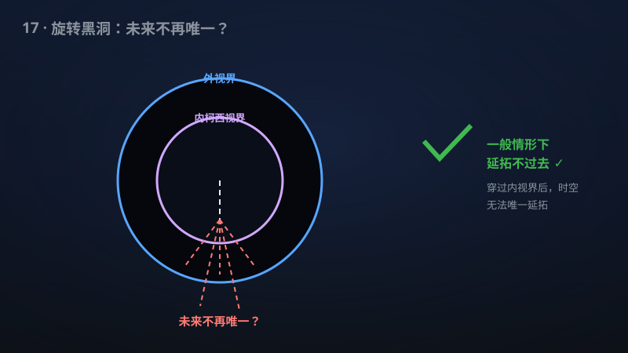

# 17 · 双端 Kerr 数据附近的强宇宙监督

> 爱因斯坦方程还保得住"未来可预测"吗？该手稿在旋转黑洞附近给出了肯定答案。

**领域**：物理学、量子物理、数学之美 ｜ **数学分支**：数学物理 ｜ **原文**：[openai/math Family 264](https://github.com/openai/math)

---

## 🌱 小白版：这是什么问题？

广义相对论有个深层信念叫"**决定论**"：只要知道现在全宇宙的样子（初值数据），爱因斯坦方程就能唯一算出未来——过去决定未来，没有"剧本分叉"。但旋转黑洞（Kerr 黑洞）内部藏着一道"**柯西视界**"：穿过它之后，方程可能同时算出好多个未来，决定论就崩了——好比导航把你带进一条隧道，出隧道时它同时给你指了三条路，还都"符合"此前的路况。

1969 年，Penrose 猜想：这种"耍赖"的情形在"一般"情况下不会发生——大自然会用某种机制（比如视界处的剧烈蓝移不稳定性）把柯西视界"焊死"，让决定论保住。这就是**强宇宙监督假设**。剧情在 2017 年反转：Dafermos 与 Luk 证明，**最强版本**（$C^0$ 版本：只要求连续）是**错**的——柯西视界可以在仅仅连续的意义下被穿过，决定论在那个粗糙的层面上真的崩了。于是全世界退而求其次：证明"**稍微要求光滑一点，就延拓不过去**"——只要对穿过视界的时空要求比"连续"高一点点（比如一阶导数平方可积），"一般"的初值就注定撞墙。该手稿宣称，在旋转的 Kerr 黑洞附近，这个弱化版本成立，而且**不需要任何对称性假设**（此前的 $C^2$ 版本只在球对称模型里证出来过）。

**生活例子**：① 天气预报就是决定论的日常版：气象卫星拍下此刻全球的大气状态（初值），方程算出三天后的天气——我们每天都在"赌"决定论成立；强宇宙监督问的是：这套"初值定未来"的游戏规则，在黑洞内部会不会被掀桌？② 隧道里的导航：GPS 信号丢失那一段（柯西视界内），导航软件可以"脑补"出好几条都符合进出口位置的路线（多个未来）；$C^0$ 版本被证否相当于说"只要求路线连续，脑补确实可能成功"；而该手稿的方向是证明"只要要求路线稍微光滑一点（别出现无限抖动），脑补注定失败"——蓝移不稳定性会把任何光滑的脑补撕碎。

## 🎓 专业版：数学上到底说了什么？

**Kerr 度量**（$0<|a|<M$ 为亚极端旋转情形）描述旋转黑洞，内视界 $r=r_-$ 是**柯西视界**：初值问题的未来发展在此处失去唯一性。"**双端 Kerr 数据**"指具有两个渐近平直端、拓扑上穿过黑洞的完备真空初值（Einstein–Rosen 桥式的"虫洞"切片）。

给定光滑初值，爱因斯坦方程有**极大全局双曲发展**（MGHD）——满足方程的"最大"时空。**强宇宙监督**断言：对"一般"初值，MGHD 是**不可延拓**的（作为足够正则的流形）。"一般"在数学上常取为**稠密 $G_\delta$ 集**（Baire 纲意义下的"几乎所有"）。

正则性层级是关键：$C^0$（连续）< $H^1_{\mathrm{loc}}$（一阶弱导数局部平方可积，即"弱联络局部平方可积"）< $C^2$。Dafermos–Luk（2017）证否的是 $C^0$ 版本；Luk–Oh（2017/2019）在球对称 Einstein–Maxwell–标量场模型中证明了 $C^2$ 版本。

该手稿的数学断言：**在每个固定的旋转亚极端 Kerr 桥附近**，光滑完备双端渐近平直真空数据的**加权光滑邻域**中，存在一个**稠密 $G_\delta$ 子集**，其成员的 MGHD 是**完备**的，且**不存在**未来连续非退化解延拓——只要该延拓的弱联络局部平方可积（$H^1_{\mathrm{loc}}$ 正则性）。**不设对称性假设**；且延拓**不必满足真空方程**（结论更强：连"耍赖"不满足方程的延拓都不存在）。

## 🔬 这项成果做了什么？

该手稿宣称证明（以下转述官方摘要，不添加新手稿断言）：

- **局部强宇宙监督**：在**每个固定的旋转亚极端 Kerr 桥附近**成立；
- **一般性**：光滑完备双端渐近平直真空数据的**加权光滑邻域**中，存在一个**稠密 $G_\delta$ 子集**，其成员具有**完备的**极大全局双曲发展；
- **不可延拓**：这些发展的**未来连续非退化解延拓不存在**——只要延拓的**弱联络局部平方可积**（$H^1_{\mathrm{loc}}$ 层级）；
- **不施加对称性假设**；
- **延拓不需要满足真空方程**（即便允许延拓"不守"爱因斯坦方程，也延拓不过去）。

手稿摘要未披露具体证明路线。

## 📜 时间线

- 1915：爱因斯坦场方程发表——"初值决定未来"的决定论框架就此奠基。
- 1963：Kerr 发现旋转黑洞精确解；其内部的柯西视界（$r=r_-$）成为决定论的"阿喀琉斯之踵"。
- 1969：Penrose 提出宇宙监督假设，分弱、强两个版本——"大自然憎恶裸奇点，也憎恶剧本分叉"。
- 1990s–2000s：Christodoulou 关于引力坍缩的一系列工作（标量场坍缩、弱宇宙监督的反例构造）为该领域奠定方法基础。
- 2017：Dafermos–Luk 证明 Kerr 柯西视界的 **$C^0$ 版本强宇宙监督是错的**——视界在连续意义下稳定、可穿过；决定论在最粗糙的层面上真的失效。
- 2017/2019：Luk–Oh 在**球对称** Einstein–Maxwell–标量场模型中证明 **$C^2$ 版本**：一般初值在 $C^2$ 意义下未来不可延拓——"退而求其次"的路线第一次走通，但被对称性束缚。
- 该手稿：宣称把类似结论推进到**无对称性**的 Kerr 黑洞附近，正则性要求为 $H^1_{\mathrm{loc}}$（弱于 $C^2$、强于 $C^0$）。

## 💡 核心思想

理解强宇宙监督，先理解**蓝移不稳定性**——这是大自然"焊死"柯西视界的物理机制。想象你站在黑洞外，向内视界发射一串光脉冲；由于内视界处的无穷引力红移/蓝移效应，后续落入的观察者会在**有限**的固有时间内看到**无限**多个脉冲迎面砸来——所有外部宇宙的整个未来历史，被压缩成一道无限蓝移的"能量墙"拍在视界上。任何进入的扰动都会被这道墙放大到无穷：这就是为什么物理学家直觉上相信"柯西视界不稳定、穿不过去"。

但 Dafermos–Luk 2017 年的惊人发现是：**这种放大在 $C^0$ 层面上"不够狠"**。度规本身可以保持连续地穿过视界——无限蓝移的能量墙只摧毁了**导数**（曲率），摧毁不了连续性。好比一面墙，墙面本身是完整的（连续），但墙皮的"光滑度"碎了（导数爆破）。于是决定论在"只要求连续"的意义下失效：你可以连续地脑补出视界之后的时空，只是那个脑补的时空在视界处"不光滑"。

这就把问题推到了一个极其微妙的位置：**$C^0$ 和 $C^2$ 之间，真相到底在哪一层？** 物理上，一个"合理"的时空至少应该让爱因斯坦方程有意义——而方程含有度规的二阶导数，$C^0$ 的延拓上方程根本写不出来。$H^1_{\mathrm{loc}}$（弱联络平方可积）恰好是"方程能以弱意义成立"的门槛正则性。该手稿宣称：在 Kerr 附近，对 Baire 意义下"一般"的初值，连 $H^1_{\mathrm{loc}}$ 的延拓都不存在——蓝移不稳定性足以撕碎任何"方程还有意义"的脑补。这一定位非常精准：它比 $C^2$ 要求更弱（结论更强、更难证），又比 $C^0$ 要求更强（绕开了 Dafermos–Luk 的反例）。

"**稠密 $G_\delta$"** 则是"一般性"的数学化身：它不是说"所有"初值都如此（那太强，可能是假的），而是说"具有这种性质的初值构成一个稠密 $G_\delta$ 集"——在 Baire 纲的意义下是"几乎所有"，且任何初值都可被它任意逼近。这是绕开"个别反例"、保住"物理一般性"的标准策略。

而"**无对称性**"是本篇最硬的底气：Luk–Oh 的 $C^2$ 结果困在球对称模型里——而真实的 Kerr 黑洞**恰恰没有**球对称（只有轴对称）。把结论推进到无对称性的 Kerr 附近，意味着第一次触及了**真实旋转黑洞**的决定论问题，而不再是玩具模型。

## 🧗 难在哪？

难在三重夹击。**第一重是 Dafermos–Luk 2017 的"天花板"**：$C^0$ 版本已死，任何证明必须精确地落在"比连续强、又不能太强"的正则性窗口里。窗口太宽（如 $C^2$）结论变弱，窗口太窄则可能撞上反例——$H^1_{\mathrm{loc}}$ 这个"方程恰好有意义"的临界层，是刀锋上的定位。

**第二重是无对称性的分析地狱**：球对称下，爱因斯坦方程约化为 1+1 维，Luk–Oh 可以用双零坐标精细追踪蓝移放大的每一分能量。去掉对称性后，方程是 3+1 维的 fully nonlinear 双曲系统，扰动有无穷多个角动量模式，每个模式的蓝移放大率都不同，必须**一致地**控制所有模式——这需要的不是技巧的改进，而是整套分析框架的重建（Kerr 背景上的线性/非线性稳定性理论本身就是近十年才成熟的领域）。

**第三重是"一般性"的构造**：证明"稠密 $G_\delta$ 集"的成员都不可延拓，通常需要一种"扰动论证"——说明可延拓的初值集是"贫乏"的（第一纲集）。在无穷维初值空间里做 Baire 纲论证，同时保持对蓝移不稳定性的定量控制，是双曲型 PDE 中最精细的活计之一。

## 🚀 有什么用？

- **广义相对论决定论的数学根基**："初值决定未来"是整个广义相对论作为物理理论的合法性来源；强宇宙监督的每一步进展，都是在回答"爱因斯坦方程到底靠不靠谱"这个根本问题。
- **黑洞内部的严格图像**：Kerr 内视界之后是什么——数学上第一次在无对称性假设下给出"一般初值下，任何 reasonable 的延拓都不存在"的答案，为"黑洞内部终结于奇点"的物理直觉提供了严格支撑。
- **黑洞信息悖论的背景约束**：信息悖论争论"落入黑洞的信息去哪了"，其经典舞台正是黑洞内部时空；经典层面"视界之后不可延拓"的严格结论，是任何量子引力回答都必须自洽面对的经典极限。
- **数值相对论的边界认知**：数值模拟黑洞内部时，代码在柯西视界附近的行为一直是个谜；"一般初值下 $H^1$ 延拓不存在"为数值结果的解释（看到的"穿过"很可能是数值耗散抹平了爆破）提供了理论参照。
- **双曲型 PDE 的最前沿**：无对称性 Kerr 背景上的非线性分析，是偏微分方程与微分几何交叉领域皇冠上的明珠之一；其方法有望溢出到其他黑洞稳定性问题。

## 🔗 相关篇目

- [16 · 时空 Penrose 不等式：包围面积、电荷、旋转与反德西特推广](16-260-penrose-inequality.md)：Penrose 1969 年宇宙监督与 1973 年 Penrose 不等式同源——都是"引力坍缩必须自洽"的不同面相。
- [22 · 相对论 Vlasov–Maxwell 的整体光滑性](22-362-vlasov-maxwell.md)：同属"Einstein 相关系统的整体行为"主题，一个问"解是否永远光滑"，一个问"解能否延拓"。
- [23 · 受迫 Navier–Stokes 流中的通用计算](23-376-fluid-computation.md)：偏微分方程前沿的另一极——本篇捍卫"方程的预测力"，那篇展示"方程的复杂性"，对照阅读别有风味。

## 📖 延伸阅读

- Wald《General Relativity》(University of Chicago Press, 1984)：Kerr 度量、柯西视界、初值问题的标准教材讲授。
- Hawking–Ellis《The Large Scale Structure of Space-Time》(Cambridge, 1973)：强宇宙监督思想的原始语境之一，全局双曲性的经典文献。
- Dafermos–Luk, "The interior of dynamical vacuum black holes I: The $C^0$-stability of the Kerr Cauchy horizon" (2017)：证否 $C^0$ 版本的里程碑——理解本篇"退而求其次"定位的必读背景。

---

> **内容说明**：本文基于 [openai/math](https://github.com/openai/math)（Family 264）官方摘要的转述与中文解读。原成果由 AI 模型产出，官方标注验证程度不一、部分尚未形式化，此处转述不代表数学界共识；引用请以[原文](https://github.com/openai/math)为准。
