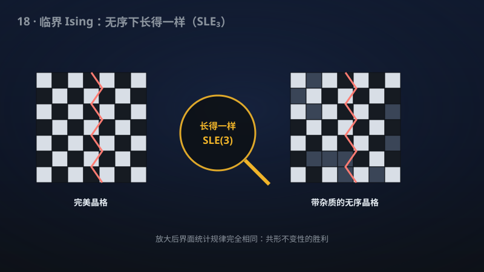

# 18 · 含微扰与无序的 Ising 模型的共形普适性

> 从理想磁铁到有瑕疵的真实材料：临界Ising模型的共形不变性在微扰和无序下依然成立。

**领域**：物理学、能源、数学之美 ｜ **数学分支**：概率与统计力学 ｜ **原文**：[openai/math Family 218](https://github.com/openai/math)

---

## 🌱 小白版：这是什么问题？

想象一块磁铁。在某个特定的温度（**居里点**）附近，磁铁处在"有序"和"无序"的交界：微观小磁针的排列图案不断涨落，放大看、缩小看都长得差不多——物理学家把这种"细节不重要、只看大尺度花纹"的现象叫**普适性**，还猜这些花纹的边界是某种随机曲线（SLE(3)），把图案拉伸扭曲都不改变统计规律（**共形不变性**）。Ising 模型是描述磁铁的最简数学模型：每个格点上一个朝上/朝下的小磁针，只跟邻居闹别扭。

Smirnov 等人对"完美无瑕"的正方晶格证明了上述图像（Smirnov 因此获 2010 年菲尔兹奖）。但真实材料总有杂质和缺陷：原子间距不均匀、杂质原子乱入、相互作用不止邻居——图案会不会就此走样？物理直觉说"不会"（普适性嘛），但数学上，"加一点点微扰，标度极限还一不一样"是个极硬的问题：微扰会破坏模型的**可解性**（Onsager 精确解、离散全纯性这些神兵利器全都失效），而此前所有严格结果都站在可解性的肩膀上。该手稿宣称：只要微扰和无序**足够弱**，临界点的自旋与能量极限不变，磁畴的界面依然收敛到 SLE(3)——普适性比想象中更"皮实"，从理想晶格第一次真正迈向了真实材料。

**生活例子**：① 烧开水：水在 100°C 附近剧烈翻腾，气泡有大有小、放大缩小看都差不多（临界乳光现象）——这就是"普适性"的日常版：你不需要知道每个水分子的细节，就能预言气泡大小的统计规律；该手稿问的是"水里掺一点点杂质，这个规律还成立吗"，回答是"成立"。② 早高峰的堵车：车流密度接近临界时，拥堵波纹自相似——交警不需要数清每辆车的位置，就能用普适的标度律预测拥堵的蔓延；真实路况总有"无序"（路况、车况各异），但临界规律依然稳健——这正是"无序下的普适性"的交通版。

## 🎓 专业版：数学上到底说了什么？

**Ising 模型**：正方晶格 $\mathbb{Z}^2$ 上自旋 $\sigma_x=\pm 1$，Hamiltonian $H=-J\sum_{\langle x,y\rangle}\sigma_x\sigma_y$（$J>0$ 铁磁）。Onsager（1944）求得临界点 $\beta_c=\frac12\ln(1+\sqrt2)$（零场）。临界时自旋关联 $\langle\sigma_0\sigma_x\rangle\sim |x|^{-1/4}$，磁畴界面（domain wall）的标度极限猜想为 **chordal SLE(3)**——Schramm–Loewner 演化，参数 $\kappa=3$，由 Chelkak–Smirnov（2008–2010）对理想晶格严格证明。

该手稿的三层数学断言：

1. **多自旋微扰**：加**弱、有限程、方对称、偶**的多自旋相互作用（"偶"指 Hamiltonian 在整体自旋翻转 $\sigma\to -\sigma$ 下不变，保持 $\mathbb{Z}_2$ 对称性），**临界体自旋与能量极限保持不变**——即 $n$ 点关联函数的标度极限与未微扰模型一致；
2. **轮廓相互作用**：弱方对称的轮廓（contour）相互作用下，界面依然收敛到 **chordal SLE(3)**；
3. **淬火键无序**：对**充分弱**的独立同分布（iid）键无序——耦合常数 $J_{xy}$ 为 iid 随机变量，服从**任意固定**的有界、非退化、零均值（扰动部分）分布——临界自旋界面在**环境上依概率**收敛到同一 SLE(3) 分布。"淬火"（quenched）指无序先被冻结、再对自旋取热平均；"依概率"指关于无序环境的测度依概率收敛（弱于对几乎所有环境成立）。

## 🔬 这项成果做了什么？

该手稿宣称证明（以下转述官方摘要，不添加新手稿断言）：

- **弱有限程方对称偶多自旋微扰**：正方晶格 Ising 模型的这类微扰**保持临界体自旋与能量极限**；
- **弱方对称轮廓相互作用**：同样给出 **chordal SLE(3)** 界面极限；
- **充分弱的 iid 键无序**（任意固定有界非退化零均值律）：临界自旋界面在环境上**依概率**收敛到**同一分布**（即未微扰模型的 SLE(3) 极限）。

手稿摘要未披露具体证明路线。

## 📜 时间线

- 1920：Lenz 提出该模型，作为博士论文题目交给学生 Ising——"每个原子是个小磁针"。
- 1925：Ising 求解一维情形，发现**没有**相变——模型差点因此被判死刑（"连相变都没有，算什么磁铁模型"）。
- 1944：Onsager 精确求解二维零场 Ising 模型，给出临界温度与比热的对数发散——统计物理史上最伟大的精确解之一，模型就此封神。
- 1984：Belavin–Polyakov–Zamolodchikov 建立二维**共形场论**，预言临界 Ising 的共形不变性——物理学家的"标准答案"就此写下。
- 1999–2000：Schramm 引入 **SLE**（Schramm–Loewner 演化），给"随机共形曲线"第一个严格数学定义。
- 2001：Smirnov 证明临界渗流的共形不变性（Cardy 公式）——"Smirnov 机器"第一次开动。
- 2008–2010：Chelkak–Smirnov 证明临界 Ising 界面收敛到 SLE(3)（发表于 *Annals of Mathematics* 2010）；Smirnov 获 **2010 年菲尔兹奖**。
- 该手稿：宣称把普适性从"理想晶格"推进到"弱微扰 + 弱淬火无序"——真实材料的第一步。

## 💡 核心思想

**普适性**是统计物理最深刻的信条：临界现象的大尺度行为只取决于对称性与维度，与微观细节无关。数学上，这句话的严格版本是"**标度极限相同**"——把晶格间距 $\delta\to 0$，关联函数、界面曲线的极限分布与微观模型的细节无关。Ising 模型的普适性之所以此前只在"理想晶格"上被证明，是因为所有证明都依赖**可解性**：Onsager 的精确解、Smirnov 的**离散全纯 observable**（fermionic observable 在临界点满足离散 Cauchy–Riemann 方程）——这些都是"上帝赏饭吃"的精确结构，加一点微扰就碎。

微扰下的普适性为什么难？直觉上，重整化群（RG）说：弱微扰是"**无关**"的——在 RG 流下，微扰耦合常数越流越小，大尺度下被洗掉。但把 RG 直觉变成严格证明，需要控制**所有尺度**上的误差累积：微扰在每个尺度上都捣一点乱，你要证明这些乱子在 $\delta\to 0$ 时不聚成灾难。这正是构造性场论（如 Glimm–Jaffe 学派）几十年如一日打磨的技术：**多尺度分析 + 簇展开**。该手稿的"弱有限程方对称偶多自旋微扰"设定——"偶"保持 $\mathbb{Z}_2$ 对称性（否则临界点直接漂移，问题变质）、"方对称"保持晶格对称性、"弱"保证 RG 流向正确方向——每一个形容词都是 RG 直觉的严格化身。

**无序**则是另一重难关，背后站着 **Harris 判据**（1974）：无序是否改变临界行为，取决于比热临界指数 $\alpha$ 的符号——$\alpha>0$ 时无序是"相关"的（会改变普适类），$\alpha<0$ 时"无关"。二维 Ising 的 $\alpha=0$（比热对数发散），恰好是**边缘情形**——Harris 判据不给出答案，是无序问题中最微妙、最难的一档。该手稿宣称：充分弱的 iid 键无序下，界面极限**依概率**仍是 SLE(3)——即无序是"边缘无关"的。注意"依概率收敛"而非"对几乎所有环境成立"：淬火无序下，环境本身是随机的，结论只能以环境的测度来表述——这是无序系统严格结果的典型形态，也暗示了证明中必然有精细的"好环境 vs 坏环境"分解。

而 **SLE(3)** 作为"同一分布"的压轴，意味着：微扰和无序没有改变界面的**共形不变性**——随机曲线的统计规律在共形映射下依然不变。这是普适性最强的形态：不只是临界指数相同，连整条随机曲线的分布都相同。

## 🧗 难在哪？

难在"可解性的拐杖被抽掉了"。Chelkak–Smirnov 证明理想晶格 Ising 界面收敛到 SLE(3)，核心是 Smirnov 的离散全纯 observable：在临界点，这个 clever 构造的复值函数满足**离散 Cauchy–Riemann 方程**，从而推出界面的鞅性质与共形不变性。但离散全纯性是**精确可解**的馈赠——加一个多自旋微扰，Cauchy–Riemann 方程就不再精确成立；加淬火无序，每个环境的方程都不一样。所有"一步到位"的神兵利器全部失效。

此前的突围尝试大多走**微扰场论**路线：把微扰 Ising 模型写成"自由费米子 + 弱相互作用"，用构造性重整化群证明临界行为不变（如 Giuliani–Mastropietro–Toninelli 等人对能量关联的工作）。但这条路此前只能处理**关联函数**（自旋、能量），够不着**界面曲线**的收敛——而 SLE(3) 正是关于界面的命题。从"关联函数普适"到"界面分布普适"，中间隔着对随机曲线 tightness、鞅刻画、Loewner 驱动函数收敛的全套 SLE 机器，而这套机器的每一个齿轮此前都咬在可解性上。

无序的边缘性（$\alpha=0$）则是雪上加霜：相关无序（$\alpha>0$，如三维 Ising）有 Harris 判据指路，无关无序（$\alpha<0$）有标准 RG 论证，唯独边缘情形需要** case-by-case 的精细分析**——对数修正随时可能冒出来捣乱。该手稿宣称在"任意固定有界非退化零均值律"的无序下结论成立（"任意"二字分量极重：它意味着证明不依赖无序分布的任何特殊结构），若属实，是对边缘无序问题的一次正面强攻。

## 🚀 有什么用？

- **临界现象严格化的里程碑**：普适性是统计物理的基石信条，但严格证明此前几乎全部依赖可解性；含微扰/无序的普适性证明，是"从可解走向不可解"的关键一步，为一大类真实模型的严格理论开路。
- **真实磁性材料的定量预言**：实际磁性材料、合金都有杂质与无序；"弱无序不改变临界行为"的严格结论，有望为材料临界指数的测量与标度分析提供数学背书（间接意义——直接的材料设计仍需实验）。
- **蒙特卡洛模拟的理论保证**：临界 Ising 模型的数值模拟（Wolff 算法等）广泛用于统计物理与机器学习（玻尔兹曼机）；普适性的严格化为"模拟理想模型足以代表真实材料"这一常用假设提供了部分理论支撑。
- **量子临界现象的类比**：经典临界现象的严格结果，常为量子相变（如量子 Ising 链、横场 Ising 模型）的研究提供概念模板与技术启发。
- **无序系统理论的方法论**："边缘无序"的处理技术若被验证，有望迁移到 Anderson 局域化、自旋玻璃等更难的无序问题——Harris 判据的边缘情形是整个无序统计物理的硬骨头区。
- **概率论与物理的联姻典范**：从 Onsager 1944 到 Smirnov 2010 再到本篇，Ising 模型是"物理直觉 → 严格数学"转化最成功的故事之一；每一步都同时是概率论（SLE、随机曲线）的方法论突破。

## 🔗 相关篇目

- [19 · 拟传递图上的临界渗流（Benjamini–Schramm 猜想）](19-213-percolation.md)：渗流是 Smirnov 证明共形不变性的第一个战场（2001），与 Ising 同属"临界随机几何"家族。
- [20 · XY 模型的 BKT 相变：临界标度与普适性的严格证明](20-216-bkt-universality.md)：另一种普适性（BKT 相变）的严格化——对照阅读可体会"普适性"在不同模型中的不同面相。
- [21 · 稀释自旋玻璃的 Mézard–Parisi 公式](21-221-spin-glass.md)：无序系统的另一座高峰——"稀释"（diluted）本身就是一种无序，与本篇的键无序主题直接呼应。
- [11 · Bloch 定律、晶格修正与球面磁化律](11-271-heisenberg-bloch.md)：磁性模型的严格结果家族——从低温磁化律到临界普适性，Ising/Heisenberg 磁学大一统的一块拼图。

## 📖 延伸阅读

- Onsager, "Crystal statistics. I. A two-dimensional model with an order-disorder transition," *Phys. Rev.* 65 (1944)：二维 Ising 精确解的原始论文，统计物理史上最伟大的精确解之一。
- McCoy–Wu《The Two-Dimensional Ising Model》(Harvard University Press, 1973)：Ising 模型精确结果的圣经级专著。
- Baxter《Exactly Solved Models in Statistical Mechanics》(Academic Press, 1982)：可解模型的百科全书，理解"可解性"边界的必读。
- Smirnov, "Conformal invariance in random cluster models. I.," *Proc. ICM 2010*：菲尔兹奖工作的综述，SLE 与共形不变性 probabilistic 进路的最佳入门。

---

> **内容说明**：本文基于 [openai/math](https://github.com/openai/math)（Family 218）官方摘要的转述与中文解读。原成果由 AI 模型产出，官方标注验证程度不一、部分尚未形式化，此处转述不代表数学界共识；引用请以[原文](https://github.com/openai/math)为准。
