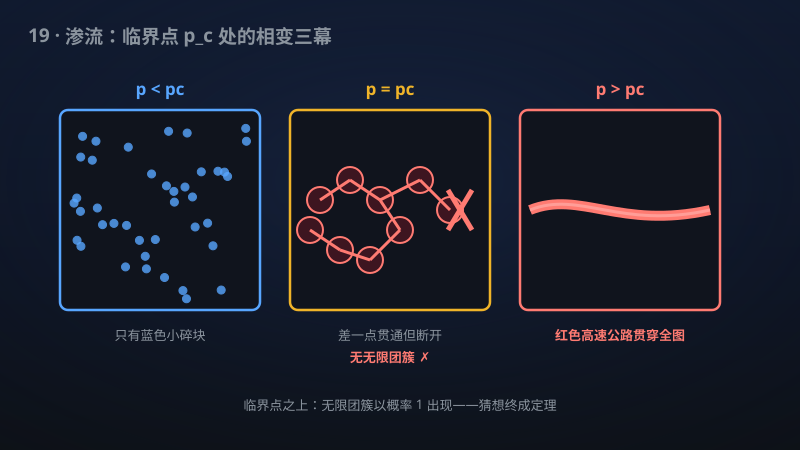

# 19 · 拟传递图上的临界渗流（Benjamini–Schramm 猜想）

> 渗流理论 30 年猜想被拿下：临界点上任何"长得差不多"的无限图都没有无限连通块。

**领域**：统计物理、物理学、能源 ｜ **数学分支**：概率与统计力学 ｜ **原文**：[openai/math Family 213](https://github.com/openai/math)

---

## 🌱 小白版：这是什么问题？

想象一张无限大的渔网，每根网线以概率 p 随机"断裂"。p 很小时，网碎成无数小片；p 很大时，几乎整张网连成一片。中间存在一个神奇的"临界概率"pc——恰好是"碎"与"整"的分界线。

问题来了：在分界线 pc 上，到底有没有一片无限大的连通网？这个问题并不显然。想象你正好站在悬崖边缘：往前半步是深渊，往后半步是平地——而你脚下的那条线本身，属于哪一边？

对规则的方格网，数学家早已知道答案是"没有"：临界点上只有大大小小的有限碎块，再大也大不到无穷。但 1996 年，Benjamini 和 Schramm 把问题推广到了"拟传递图"——所有"从局部看长得差不多"的无限图。方格网是，蜂窝网是，各种晶体结构是，甚至双曲平面上的铺砌也是。他们的猜想是：在临界点上，这些图同样没有无限团簇。

再举个生活例子：想象疫情在人群中传播。每个人以概率 p 把病毒传给密接者，p 很小时疫情自然熄灭，p 很大时席卷全城，中间有个临界传播率。猜想说的是：恰好站在临界传播率上时，疫情"几乎必然"不会无限蔓延——它总会在某处断掉。这就是"临界即碎"的直觉。

该手稿宣称证明：只要 pc<1，对一切无限连通、局部有限的拟传递图，临界渗流几乎必然没有无限团簇。特别地，三维整数格点 ℤ³ 的键渗流与点渗流在临界点也没有无限团簇——这正是此前 30 年无人能攻克的情形。

## 🎓 专业版：数学上到底说了什么？

设 G = (V, E) 为无限连通、局部有限的拟传递图（quasi-transitive：其自同构群在顶点集上的轨道有限，即"从局部看只有有限多种样子"）。考虑伯努利键渗流：每条边以概率 p 独立保留、以概率 1−p 删除，记所得随机子图为 G[p]。

定义临界概率

pc(G) = inf{ p ∈ [0,1] : G[p] 几乎必然含有无限团簇 }。

一个基本事实是：当 p < pc 时几乎必然没有无限团簇，当 p > pc 时几乎必然有（且由 Burton–Keane 定理至多一个）无限团簇。临界点 p = pc 本身的行为则微妙得多：它可能是"连续"的（临界无无限团簇），也可能是"不连续"的（临界已有无限团簇）。

Benjamini–Schramm 猜想（1996）断言：若 pc(G) < 1，则在 p = pc(G) 处，G[pc] 几乎必然没有无限团簇。其中 pc < 1 的条件排除了树等"一碰就碎"的平凡情形（例如正则树上 pc < 1 但临界行为完全不同，猜想的表述需要该条件来保证问题非平凡）。

该手稿宣称证明了这一猜想的完整形式：对每个满足 pc < 1 的无限连通局部有限拟传递图，临界键渗流几乎必然没有无限团簇。作为推论，该结论对 ℤ³ 上的最近邻键渗流与点渗流同样成立——即在这两种三维格点渗流模型中，临界点处几乎必然不存在无限团簇。

## 🔬 这项成果做了什么？

严格依据官方摘要，该手稿（Family 213，共 2 篇手稿）做了以下两件事：

1. **解决了 Benjamini–Schramm 临界性猜想**：对每一个满足 pc < 1 的无限连通、局部有限拟传递图，证明了在临界概率处的键渗流几乎必然没有无限团簇。这是猜想自 1996 年提出以来第一个"全覆盖"的证明——此前所有结果都只覆盖图的某个子类。
2. **ℤ³ 上的键渗流与点渗流**：该 family 同样确立了下述结论——ℤ³ 上的最近邻键渗流和点渗流，在各自的临界概率处几乎必然没有无限团簇。

需要说明的是：手稿摘要未披露具体证明路线。

## 📜 时间线：

- 1957：Broadbent 与 Hammersley 提出渗流模型，最初动机是模拟流体在多孔介质中的随机蔓延。
- 1980：Kesten 证明 pc(ℤ²) = 1/2，二维格点临界概率的精确值第一次被严格确定。
- 1989：Burton 与 Keane 证明无限团簇至多只有一个（唯一性定理），奠定了"超临界相有一片汪洋"的基本图像。
- 1996：Benjamini 与 Schramm 发表 "Percolation beyond ℤ^d"（Electron. Commun. Probab.），把渗流研究从格点推广到拟传递图，并提出临界无无限团簇的猜想。
- 1999：Benjamini、Lyons、Peres 与 Schramm 解决非顺从（non-amenable）单模情形，猜想的第一块版图被拿下。
- 2016：Hutchcroft 把结论推广到指数体积增长的拟传递图，又一类图被覆盖。
- 2024：据称 Kozma 与 Nitzan 把猜想约化为若干关联不等式，为最终证明铺设了"最后几块砖"。
- 2026（据手稿摘要）：Family 213 的 2 篇手稿宣称对一切满足 pc<1 的拟传递图完成证明，并覆盖 ℤ³ 的键渗流与点渗流。

## 💡 核心思想：

**临界点为什么难？** 渗流的超临界相（p > pc）有"0-1 律"和唯一性定理撑腰，次临界相（p < pc）有指数衰减的关联，两边都有趁手的工具。唯独临界点 p = pc 是"三不管地带"：关联长度发散，没有指数衰减可用；无限团簇"几乎"出现又"几乎"不出现，任何粗糙的估计都会在临界点失效。历史上几乎所有渗流难题——从 ℤ² 的 Cardy 公式到高维的平均场行为——难点都在临界点。

**为什么拟传递图这么顽固？** ℤ^d 有平移对称性和"方盒子"几何，证明可以用尺度变换、重整化一层层往上走。但一般的拟传递图可能长得千奇百怪：顺从的（如某些晶体）、非顺从的（如双曲铺砌）、多项式增长的、指数增长的……没有统一的几何脚手架。此前 30 年的进展，本质上是"按图的几何类型逐个击破"：非顺从的用等周不等式，指数增长的用体积估计。剩下的硬骨头是顺从但非格点的图——它们"胖得不够快"，体积估计失效，又"对称得不够多"，格点方法用不上。

**"临界即碎"的直觉是什么？** 物理直觉是：在临界点，系统处于"最大纠结"状态，大团簇比比皆是，但只要概率再大一点点就会连成一片——这意味着在临界点，大团簇之间必然还隔着"薄弱环节"。如果临界点真有一个无限团簇，那它必然是"勉强"无限的、对微扰极度敏感的。 Burton–Keane 型的唯一性论证加上某种"临界稳定性"分析，可以把这种"勉强无限"导出矛盾。Kozma–Nitzan（2024）把猜想约化为关联不等式，据称正是把"薄弱环节"的直觉变成了可验证的不等式，而该手稿的工作就是把这些不等式逐一证明。

**ℤ³ 为什么是皇冠上的明珠？** ℤ³ 的临界渗流是整个领域最著名的开放问题之一：二维有共形不变性的强大工具，高维（d ≥ 11 或三角格点 d ≥ 7）有 lace expansion 的平均场理论，唯独三维卡在中间——不上不下，既没有共形对称，也够不着平均场。该手稿把 ℤ³ 的键渗流与点渗流一并拿下，意味着三维临界渗流"无无限团簇"这一基本定性事实第一次有了严格证明。

## 🧗 难在哪？

Benjamini 与 Schramm 在 1996 年的奠基论文 "Percolation beyond ℤ^d" 中系统提出拟传递图上的渗流研究，并留下临界性猜想。此后 30 年，进展是"挤牙膏式"的：

- **1999 年**，Benjamini、Lyons、Peres、Schramm 解决了**非顺从单模**情形。非顺从图有线性等周不等式，"边界很大"，这给了证明一个抓手——但顺从图没有这个抓手。
- **2016 年**，Hutchcroft 推广到**指数增长**图。指数增长意味着体积膨胀得快，大团簇"无处可逃"，可以用体积论证锁死。但多项式增长的顺从图（如各种奇怪的晶体）依然不在覆盖范围内。
- **2024 年**，据称 Kozma 与 Nitzan 把猜想**约化为若干关联不等式**——相当于把"证明猜想"转化成了"验证几个具体的关联估计"，让问题从"无从下手"变成了"有清单可查"。

此前最好的结果始终是"分类讨论式"的：每类图用每类图的方法，没有统一框架。而一般的拟传递图——尤其顺从但非格点的情形——30 年无人能碰。该手稿是第一个"全覆盖"的证明：不再按几何类型逐个击破，而是给出对一切满足 pc<1 的拟传递图都成立的论证。

## 🚀 有什么用？

**已落地的现实影响：**

- **统计物理的基石**：渗流是相变的"最小模型"。临界点无无限团簇是连续相变理论的基本定性事实——它告诉我们临界现象是"关联发散但不断裂"的微妙状态。该手稿把它从猜想变成定理（以手稿摘要为准），为整个普适类理论补上了地基。
- **流行病与网络传播**：SIR 流行病模型与键渗流有经典对应（感染概率 ↔ 边的保留概率）。"临界即碎"意味着：当传播率恰好处于临界阈值时，大规模爆发几乎必然不会发生。这为公共卫生中的"临界阈值"概念提供了普适的数学背书。
- **材料与能源设计**：多孔介质中的流体输运、电池电极的导电网络、复合材料的逾渗阈值设计，都直接建模为图上的渗流。临界点行为的精确刻画指导工程师设计"临界配比"——比如导电填料加多少能让复合材料刚好导电，又不浪费材料。

**潜在价值（推测口吻）：**

- **三维临界现象的严格化**：ℤ³ 临界渗流"无无限团簇"的严格证明，有望成为三维临界指数、标度关系严格化的第一块垫脚石——三维 Ising、ℤ³ 渗流的临界指数至今没有严格值，任何严格的定性结果都可能撬动定量进展。
- **随机图与网络鲁棒性**：真实网络（电网、互联网、社交网络）常被建模为拟传递或近似拟传递的图。"临界即碎"的普适保证可能为网络级联失效的临界预警提供理论参照。
- **算法设计**：渗流阈值与随机算法的相变（如随机 SAT 的可满足性阈值）同源。对临界行为更精确的数学理解，有望帮助设计在"难例临界区"表现更好的启发式算法。
- **数学之美**：一个 30 年的猜想被完整解决，本身就是概率论的里程碑——它可能启发人们去问：其他的"临界猜想"（如各种模型的临界连续性）是否也有统一证明？

---

## 🔗 相关篇目：

- [18 · 含微扰与无序的 Ising 模型的共形普适性](18-218-ising-universality.md)
- [20 · XY 模型的 BKT 相变：临界标度与普适性的严格证明](20-216-bkt-universality.md)
- [21 · 稀释自旋玻璃的 Mézard–Parisi 公式](21-221-spin-glass.md)

## 📖 延伸阅读：

- Grimmett《Percolation》（Springer，1999，第二版）：渗流理论的标准教材，从 ℤ^d 的基本理论讲到临界现象。
- Bollobás–Riordan《Percolation》（Cambridge，2006）：更现代的视角，包含随机图与渗流的交叉内容。
- Benjamini–Schramm "Percolation beyond ℤ^d"（1996，Electron. Commun. Probab.）：提出拟传递图渗流纲领与临界性猜想的奠基论文。
- Werner《Percolation et modèle d'Ising》（法语，2009）：面向研究生的临界渗流讲义，二维情形讲得极透。

---

> **内容说明**：本文基于 [openai/math](https://github.com/openai/math)（Family 213）官方摘要的转述与中文解读。原成果由 AI 模型产出，官方标注验证程度不一、部分尚未形式化，此处转述不代表数学界共识；引用请以[原文](https://github.com/openai/math)为准。
