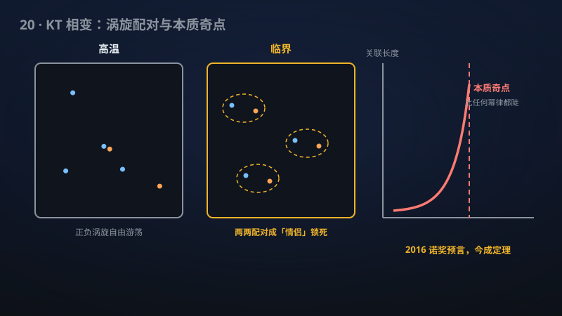

# 20 · XY 模型的 BKT 相变：临界标度与普适性的严格证明

> 2016 诺贝尔物理学奖的 BKT 相变理论：临界关联与"本质奇点"首次被严格证明。

**领域**：量子物理、统计物理、物理学 ｜ **数学分支**：概率与统计力学 ｜ **原文**：[openai/math Family 216](https://github.com/openai/math)

---

## 🌱 小白版：这是什么问题？

想象一层薄薄的"磁性薄膜"，上面每个原子像个小指南针。高温时指南针乱指；降到"临界温度"时，它们突然"抱团"形成有序图案。但二维薄膜有个怪事：它不会像三维磁铁那样真正"冻住"，而是经历"拓扑相变"——涡旋（像水面小漩涡）两两配对锁死，系统悄悄变了性质，却没有任何"序参量"跳变。这就是 BKT 相变（Berezinskii 1971、Kosterlitz–Thouless 1973 预言，2016 年诺贝尔物理学奖）。物理学家 50 年来靠"重整化群"算出一堆精确预言：关联函数按 r^{−1/4}(log r)^{1/8} 衰减，关联长度以"本质奇点"发散。该手稿第一次用严格数学证明了这些预言，并证明离散高斯高度场在整个粗糙相收敛到高斯场。

## 🎓 专业版：数学上到底说了什么？

对正方格子最近邻余弦 XY 模型，该手稿证明：临界轴关联 C_{βc}(r) ∼ A r^{−1/4}(log r)^{1/8}，且关联长度满足 BKT 本质奇点 √(βc−β)·log ξ(β) → B（A,B>0，自由边界热力学极限）。对含最近邻的有限平方对称相互作用，离散高斯高度在整个粗糙相（含阈值）沿几何环面尺寸收敛到高斯场。临界中心磁化与自旋场结论保留其所述的高度、重整化与场输入假设。

## 🔬 这项成果做了什么？

该手稿对正方格子最近邻余弦 XY 模型证明了临界轴关联的精确渐近 C_{βc}(r) ∼ A r^{−1/4}(log r)^{1/8}，以及 BKT 本质奇点 √(βc−β) log ξ(β) → B（A,B>0，自由盒热力学极限）。对含最近邻的有限平方对称相互作用，离散高斯高度在整个粗糙相（含阈值）沿几何环面尺寸收敛到高斯场。该 family 共 6 篇手稿。

## 🧗 难在哪？

BKT 相变由 Berezinskii（1971）与 Kosterlitz–Thouless（1973）预言，2016 年授予 Thouless、Kosterlitz、Haldane 诺贝尔物理学奖（"拓扑相变与拓扑物相"）。物理上，重整化群预言了 r^{−1/4} 与本质奇点等精确指数，但 50 年来数学上只有部分结果（如 1980 年代初 Fröhlich–Spencer 证明 BKT 相的存在性）；临界点的精确关联渐近与本质奇点的严格证明一直是数学物理的圣杯。该手稿第一次把物理学家的"标准答案"变成定理。

## 🚀 有什么用？

- **量子物理/物理学**：BKT 普适类描述超导薄膜、超流体氦膜、冷原子气体的相变；严格证明为实验拟合的标度律提供了"数学担保"。
- **能源**：高温超导、超导薄膜器件的工作温区设计依赖对 BKT 相变的定量理解。
- **统计物理**：XY 模型是统计力学的"果蝇"，其临界行为的严格化是整个领域的里程碑。
- **计算机科学**：蒙特卡洛模拟的临界慢化、团簇算法的理论分析需要精确的临界指数。

---

> **内容说明**：本文基于 [openai/math](https://github.com/openai/math)（Family 216）官方摘要的转述与中文解读。原成果由 AI 模型产出，官方标注验证程度不一、部分尚未形式化，此处转述不代表数学界共识；引用请以[原文](https://github.com/openai/math)为准。
