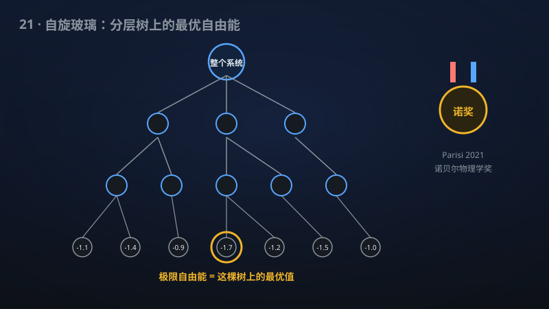

# 21 · 稀释自旋玻璃的 Mézard–Parisi 公式

> 2021 诺贝尔物理学奖的自旋玻璃理论：稀释模型的自由能公式被严格证明。

**领域**：统计物理、计算机科学、量子物理 ｜ **数学分支**：概率与统计力学 ｜ **原文**：[openai/math Family 221](https://github.com/openai/math)

---

## 🌱 小白版：这是什么问题？

想象一盒"闹别扭的磁铁"：每个小磁铁想跟邻居反着排，但邻居的邻居又有别的想法——谁也没法让所有"邻里关系"都满意，这就是"自旋玻璃"。它的"自由能"（系统有多"纠结"）极难计算。1980 年代，Mézard 和 Parisi 提出"分层空腔公式"：用一棵"层级树"描述解的组织结构，自由能等于在这棵树上做"变分"取最优值。Parisi 因此获 2021 年诺贝尔物理学奖。但严格证明只在"完全图"模型（SK 模型，Talagrand 2006）上完成；更常见的"稀释"模型（每个粒子只跟少数邻居作用，如 Viana–Bray 模型、随机满足性问题）一直缺严格证明。该手稿在极弱假设下（仅需一阶矩可积）证明了稀释模型的公式：极限自由能等于有限深层级试探律的下确界。

## 🎓 专业版：数学上到底说了什么？

对满足 Panchenko–Talagrand 分解与正性假设的 Poisson 稀释偶数 Ising 模型（仅需一阶矩可积），该手稿证明 Mézard–Parisi 分层空腔公式：极限自由能等于有限深分层试探律（hierarchical trial laws）上的下确界。覆盖 Viana–Bray 模型、对称稀释偶自旋模型与加权软偶数 K-SAT。

## 🔬 这项成果做了什么？

该手稿证明了 Poisson 稀释偶数 Ising 模型的 Mézard–Parisi 分层空腔公式：在 Panchenko–Talagrand 分解与正性假设、仅一阶矩可积的条件下，极限自由能等于有限深分层试探律上的下确界。覆盖 Viana–Bray 模型、对称稀释偶自旋模型与加权软偶 K 可满足性问题。该 family 共 1 篇手稿。

## 🧗 难在哪？

Parisi 的复本对称破缺理论（1979 年起）获 2021 年诺贝尔物理学奖。数学上，SK（完全图）模型的 Parisi 公式由 Guerra 的插值与 Talagrand（2006）的严格证明解决，Panchenko 发展了后续理论。但"稀释"模型（随机图上的自旋玻璃，更接近真实材料与计算问题）因缺乏 SK 模型的高斯结构，严格化难得多；Viana–Bray 模型（1985）提出 40 年来，其自由能的变分公式一直是数学物理的开放问题。该手稿用极弱的可积性假设拿下它。

## 🚀 有什么用？

- **计算机科学**：稀释自旋玻璃就是随机约束满足问题（K-SAT、图着色）的物理模型；自由能公式直接对应"随机实例的可满足性阈值"，指导 SAT 求解器与近似算法设计。
- **能源/材料**：自旋玻璃描述无序磁性合金、结构玻璃；自由能的变分刻画帮助预测材料的低温行为。
- **量子物理**：空腔方法与量子退火、神经网络的统计物理理论同源，严格化结果可迁移。
- **数学之美**：诺奖级物理直觉的严格化。

---

> **内容说明**：本文基于 [openai/math](https://github.com/openai/math)（Family 221）官方摘要的转述与中文解读。原成果由 AI 模型产出，官方标注验证程度不一、部分尚未形式化，此处转述不代表数学界共识；引用请以[原文](https://github.com/openai/math)为准。
