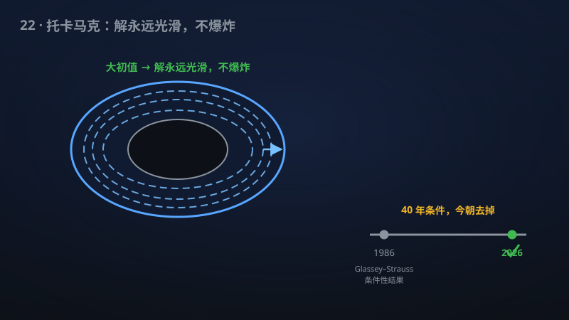

# 22 · 相对论 Vlasov–Maxwell 的整体光滑性

> 等离子体数学的"圣杯"问题被攻克：三维相对论等离子体在大初值下永远光滑，不会"爆炸"。

**领域**：能源、物理学 ｜ **数学分支**：偏微分方程 ｜ **原文**：[openai/math Family 362](https://github.com/openai/math)

---

## 🌱 小白版：这是什么问题？

等离子体是"物质的第四态"——太阳、闪电、聚变反应堆里的燃料都是等离子体：带电粒子在电磁场中飞来飞去。描述它的方程叫 Vlasov–Maxwell：粒子怎么飞由电磁场决定，电磁场又由粒子的分布产生，两者互相纠缠。四十年来数学家最怕的是：方程的解会不会在某个时刻"爆炸"（出现无穷大、失去光滑性）？1986 年 Glassey 和 Strauss 证明：只要粒子的速度不冲向光速，解就不会爆炸——但"速度会不会冲向光速"本身正是没人能回答的！这项成果宣称：对三维单物种相对论 Vlasov–Maxwell 系统，任意大的光滑初值（粒子密度紧支、电磁场有限能量）都存在唯一的整体光滑解——"只要速度不爆炸"这个前提条件被彻底拿掉了。

## 🎓 专业版：数学上到底说了什么？

证明三维单物种相对论 Vlasov–Maxwell 系统的大初值整体存在唯一性。光滑容许初值可以任意，只要粒子密度紧支、电磁场有限能量且各阶导数有界；解在每个有限时间区间上保持光滑。

## 🔬 这项成果做了什么？

该手稿证明了三维单物种相对论 Vlasov–Maxwell 系统的大初值整体存在唯一性。光滑容许初值可以任意，只要粒子密度是紧支的、电磁场具有有限能量且各阶导数有界；解在每个有限时间区间上保持光滑。

## 🧗 难在哪？

1986 年 Glassey–Strauss 证明了著名的条件性定理：只要分布函数在动量变量中的支集保持有界，C¹ 解就不会产生奇点——把问题归约为"动量支集是否会无界增长"，而这正是四十年无人能解决的核心。此后进展均为条件性改进（Pallard 等放宽矩条件、Luk–Strain 给出新的延拓判据）或小初值/高维（d ≥ 4）结果；DiPerna–Lions 的整体弱解存在但不知唯一。三维大初值光滑解的整体存在性是等离子体数学中公认的杰出公开问题。

## 🚀 有什么用？

- **能源（聚变）**：托卡马克、惯性约束聚变都依赖等离子体行为的精确预测；整体光滑性是数值模拟长期可信的数学根基。
- **航天与天体物理**：太阳风、磁层等离子体的建模；粒子加速器中束流动力学的理论保障。
- **通信**：电离层等离子体影响无线电波传播；空间天气预警的模型基础。
- **物理学**：相对论动理学方程的数学理论里程碑；为 Vlasov–Poisson、Einstein–Vlasov 等相关系统的研究提供新工具。

---

> **内容说明**：本文基于 [openai/math](https://github.com/openai/math)（Family 362）官方摘要的转述与中文解读。原成果由 AI 模型产出，官方标注验证程度不一、部分尚未形式化，此处转述不代表数学界共识；引用请以[原文](https://github.com/openai/math)为准。
