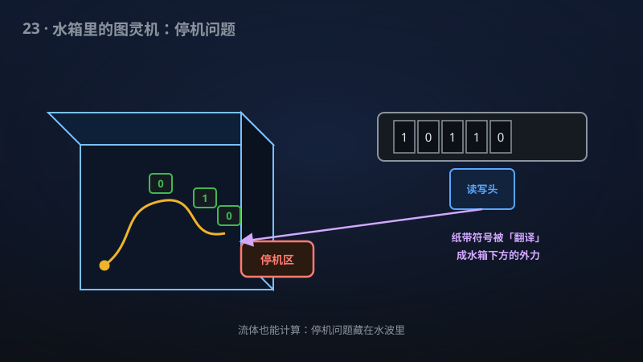

# 23 · 受迫 Navier–Stokes 流中的通用计算

> 粘性流体也能当计算机：一杯"水"在外力驱动下可以运行任意程序，停机问题就藏在流体粒子的轨迹里。

**领域**：计算机科学、物理学、数学之美 ｜ **数学分支**：偏微分方程 ｜ **原文**：[openai/math Family 376](https://github.com/openai/math)

---

## 🌱 小白版：这是什么问题？

纳维-斯托克斯（Navier–Stokes）方程描述水的流动，是克雷数学研究所百万美元悬赏的**千禧难题**之一：光滑的初始水流，会不会在有限时间内"爆炸"（出现无穷大的速度）？一百多年来没人知道。

2016 年，菲尔兹奖得主陶哲轩提出一个"疯狂"的想法：**能不能让流体"运行程序"？** 逻辑是这样的：如果流体能模拟通用计算机，那就可以"编程"让它把能量越聚越集中、越转越快——最终"爆炸"。这样，千禧难题就转化为一个**计算机科学**问题：流体能不能计算？

2021 年，Cardona 等人证明了"**无粘性**"的欧拉流体可以当计算机（发表在 PNAS 上）。但真实的水有**粘性**——粘性像"摩擦力"，会抹平一切精细结构。直觉上，粘性应该"杀死"计算：你精心编码的信息，会被粘性耗散抹成一团浆糊。所以"**粘性流体**能否计算"一直是个更难、更开放的问题。

这项成果宣称：在**固定的平坦三维区域**里，从**静止**出发、施加**光滑外力**，粘性不可压缩流可以执行**通用计算**——编译器把图灵机和输入"翻译"成外力的控制程序，**当且仅当**图灵机停机时，一个标记粒子恰好到达指定区域。换句话说：**停机问题就藏在水流粒子的轨迹里**。

## 🎓 专业版：数学上到底说了什么？

该手稿宣称在**固定的平坦三维区域**（fixed flat three-dimensional domain）上：

- 构造从**静止**（从零初值）出发的**粘性不可压缩** Navier–Stokes 流；
- 在**光滑外部强迫**（smooth external forcing，即光滑外力项）驱动下执行**通用计算**；
- 存在一个**可终止的编译器**（terminating compiler）：把任意图灵机 M 和输入 w **转化**为外力 f(t,x) 的**有限程序**（finite program）；
- **正确性**：当且仅当图灵机 M 在输入 w 上**停机**时，一个**指定粒子**（designated particle，即某个流体质点的轨迹）的轨迹到达一个**固定区域**；
- **粘性固定、为正且可计算**（fixed, positive and computable）——不是"粘性趋于零"的极限情形，而是真实的正粘性。

"可终止的编译器"是关键细节：编译过程本身必须停机——否则"用不停机的编译器编译停机问题"就是作弊。

手稿摘要未披露构造的具体路线（比如如何用外力编码图灵机的状态转移、如何抵抗粘性耗散）。

## 🔬 这项成果做了什么？

严格依据官方摘要，该手稿包含以下断言（分点列出）：

1. 在**固定的平坦三维区域**上构造从**静止**出发的粘性不可压缩流；
2. 该流在**光滑外部强迫**下执行**通用计算**；
3. 一个**可终止的编译器**把图灵机和输入转化为外力的**有限程序**；
4. **当且仅当**该图灵机停机时，一个**指定粒子到达固定区域**——即流体粒子的长期行为**编码**了停机问题；
5. 粘性**固定、为正且可计算**。

## 📜 时间线

- 1990：Cristopher Moore 在《Physical Review Letters》发表"Undecidability and unpredictability in dynamical systems"——首次系统提出"动力系统能否计算"，证明某些光滑动力系统可以模拟图灵机；
- 2000：克雷数学研究所把"Navier–Stokes 存在性与光滑性"列为七大千禧难题之一，悬赏百万美元；
- 2016：陶哲轩发表《Finite time blowup for an averaged Navier-Stokes equation》，证明"**平均化**"的 Navier–Stokes 方程可以有限时间爆破，并提出"**流体计算**"纲领：用通用计算攻击真正的爆破问题（Quanta Magazine 专题报道）；
- 2021：Cardona–Miranda–Peralta-Salas–Presas 在 **PNAS** 上构造三维球面上的**图灵完备定常欧拉流**（无粘情形）——"理想流体可以当计算机"；
- 2021–2025：后续出现定常 Navier–Stokes 解的图灵完备性工作（稳态、粘性，但"定常"意味着不随时间演化，物理上较不自然）；
- 本手稿：宣称在物理上**最自然**的设定下实现通用计算——**平坦区域**（非弯曲流形）、**固定正粘性**（非无粘极限）、**外力驱动**、**从静止启动**（非定常、随时间演化）。

## 💡 核心思想

"流体计算"的核心思想是**把逻辑门"雕刻"进流场**。图灵机由"状态 + 纸带 + 读写头"组成；要模拟它，需要在流体中实现：**存储**（粒子的位置编码纸带符号）、**逻辑门**（流场的特定构型实现 AND/OR/NOT）、**时钟**（周期性驱动推进计算步骤）。Cardona 等人在无粘欧拉流中的做法是：利用**定常流**的流线拓扑——精心设计的定常流场中，一条流线的"打结"方式可以编码计算步骤（这背后是接触几何与 Reeb 流的深刻理论）。

粘性为什么是"天敌"？Navier–Stokes 方程比 Euler 方程多了一项 **νΔu**（粘性耗散）。这一项是**抛物型**的，有"磨光"效应：任何精细的流场结构都会随时间被抹平。Cardona 的构造依赖**精细的拓扑结构**（打结的流线）——在粘性下，这些结构会"融化"。所以"粘性流体能否计算"本质上在问：**计算所需的精细结构，能否在耗散的侵蚀下存活足够久**（至少存活到计算完成）？

该手稿的设定给出了巧妙的回答：**用外力"续命"**。光滑外力 f(t,x) 像一只"上帝之手"，持续地把被粘性抹平的结构"重新雕刻"出来——而外力的程序本身是由编译器从图灵机**有限生成**的。从静止出发则保证了"初始条件不作弊"：所有的计算结构都来自外力的驱动，而外力又来自图灵机的编译——**信息只从"程序"流入，不从"初值"流入**。

"当且仅当停机时粒子到达固定区域"这个判据，把**不可判定性**直接注入流体力学：问"这个粒子最终会不会到达那个区域？"等价于问"这台图灵机停不停机？"——而后者是**不可判定**的。于是，粘性流体粒子的长期行为是**逻辑上不可判定**的。

## 🧗 难在哪？

四层难度，一层比一层本质：

第一，**粘性耗散 vs 精细结构**。如上所述，这是本质障碍。无粘情形的构造（Cardona 2021）完全无法平移——那些依赖的拓扑精细结构在 ν > 0 时会被磨光。必须设计某种"**耗散鲁棒**"的编码：信息不能藏在会被抹平的精细尺度里。

第二，**时间依赖性**。此前的粘性结果（定常 Navier–Stokes 的图灵完备性）用的是**定常解**——流场不随时间变化，相当于"把程序刻在石头上"。本手稿要求**从静止出发、随时间演化**——程序必须在**动力学过程**中被执行和维持。这难得多：你不仅要"刻好"逻辑门，还要让它们在流体运动中**活**下来。

第三，**编译器的可终止性**。把"图灵机+输入"翻译成"外力程序"这个过程本身必须可终止——否则整个构造就是循环论证（用不可判定的过程去"证明"不可判定性）。这要求编码方案是**构造性**的、**一致**的：对**一切**图灵机和输入，编译器都能在有限步内输出外力程序。

第四，**"当且仅当"的精确性**。编码必须**可靠**：图灵机不停机时，粒子**永远**不到达指定区域——不能"误报"。在粘性耗散+数值误差的物理现实中（尽管这里是数学构造），保证"永不误报"需要对外力程序的**全局控制**，而 Navier–Stokes 解的长期行为本身就是千禧难题级别的未知——这是一个"**用未知去编码未知**"的惊人壮举。

## 🚀 有什么用？

- **千禧难题（潜在·纲领性）**：为 Tao 2016 年的"流体计算攻击爆破"纲领提供**新弹药**。逻辑链条是：若粘性流体能执行通用计算 → 或许能"编程"出一个自我复制的能量集中机制 → 导致有限时间爆破 → 解决百万美元悬赏问题。这条路依然漫长，但本手稿（若成立）证明了第一步在物理自然的设定下走得通。
- **计算理论（理论价值）**：计算与连续物理的深刻连接。"模拟计算"（analog computation）的物理实现：图灵机是离散的，流体是连续的——这个构造是"离散计算嵌入连续物理"的又一个里程碑（继 Moore 1990 的动力系统、Cardona 2021 的欧拉流之后）。
- **不可判定性进入流体力学（理论价值）**：流体粒子轨迹的长期行为是**不可判定**的——这比"混沌"（初值敏感）更深刻。混沌说的是"算不准"（需要无穷精度），不可判定说的是"**原则上**没有算法能回答"。这是对"流体可预测性"的哲学级打击。
- **湍流理论（潜在·新视角）**：湍流的"不可预测性"传统上归因于混沌（正 Lyapunov 指数）。本手稿提示了另一种可能：**逻辑不可判定性**——某些流体行为之所以不可预测，不是因为初值敏感，而是因为它在做"不可判定的计算"。这可能为湍流建模提供全新视角。
- **"流体计算机"的概念萌芽（远期潜在）**：虽然离实用还差十万八千里，但"用水流做通用计算"的概念本身是新型计算范式的种子——就像 1940 年代人们看真空管计算机。微流控芯片（lab-on-a-chip）上的"流体逻辑门"已有雏形，远期或有交叉。
- **数学之美（已落地为"知识"）**："一杯水可以运行任意程序"——这个意象本身就有巨大的科普与教育价值。它让千禧难题从"抽象的 PDE"变成了"看得见的水流"，是向公众讲述"数学与计算"的绝佳故事。

## 🔗 相关篇目

- [22 · 相对论 Vlasov–Maxwell 的整体光滑性](../docs/22-362-vlasov-maxwell.md)——同样是流体/等离子体 PDE：这边证明"永远光滑"，那边证明"可以计算"，一静一动
- [01 · 唯一游戏猜想与最优近似阈值](../docs/01-102-unique-games.md)——同样涉及计算理论的硬核（NP-难度），图灵机是共同语言
- [05 · 随机与量子查询复杂度的最优四次方分离](../docs/05-284-query-separation.md)——同样是"计算的极限"主题

## 📖 延伸阅读

- Tao, "Finite time blowup for an averaged Navier-Stokes equation", arXiv:1402.0290（流体计算纲领的起点）
- Cardona–Miranda–Peralta-Salas–Presas, "Constructing Turing complete Euler flows on the 3-sphere", PNAS 2021（无粘流体的图灵完备性）
- Moore, "Undecidability and unpredictability in dynamical systems", Phys. Rev. Lett. 1990（动力系统计算的开创性论文）
- Fefferman, "Existence and smoothness of the Navier-Stokes equation", Clay Mathematics Institute 千禧问题官方描述
- Robinson–Rodrigo–Sadowski《The Three-Dimensional Navier–Stokes Equations》, Cambridge 2016（NS 方程的标准教材）

---

> **内容说明**：本文基于 [openai/math](https://github.com/openai/math)（Family 376）官方摘要的转述与中文解读。原成果由 AI 模型产出，官方标注验证程度不一、部分尚未形式化，此处转述不代表数学界共识；引用请以[原文](https://github.com/openai/math)为准。
