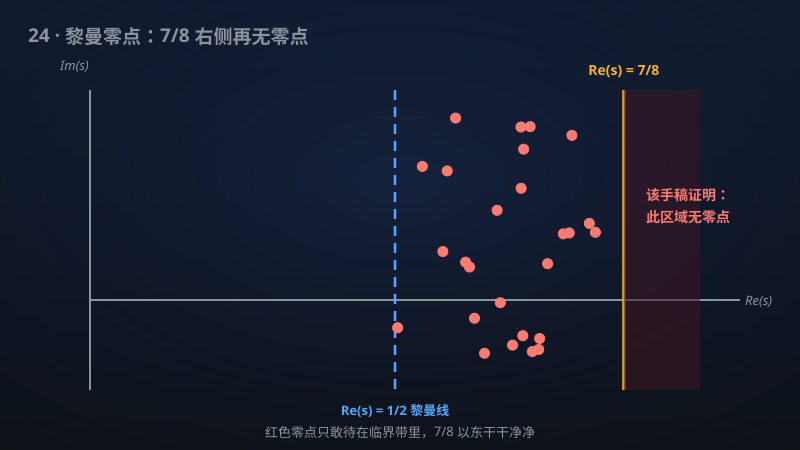

# 24 · 准黎曼假设（Re(s) > 7/8 零点自由）

> 黎曼猜想的"弱版本"被拿下：所有狄利克雷 L 函数在 Re(s)>7/8 无零点。

**领域**：密码学、计算机科学、数学之美 ｜ **数学分支**：数论 ｜ **原文**：[openai/math Family 003](https://github.com/openai/math)

---

## 🌱 小白版：这是什么问题？

想象你是一位侦探，奉命确认一片广阔的海域里有没有"海怪"出没。黎曼猜想（1859）断言：所有海怪都只藏在一条又深又窄的海沟里——复平面上那条著名的临界线 Re(s) = 1/2。一百六十多年来，人类派出了无数"潜水艇"（数值计算验证了前数万亿个零点都在沟里），却始终拿不出"海怪绝不在别处"的铁证。

"准黎曼假设"是一条更务实的退路：我们不强求说清海怪的确切藏身地，只要求划出一大片"安全浅水区"——从海面（Re(s) = 1）往下直到 7/8 的深度，担保这里一只海怪也没有。该手稿证明的正是这个：对包括 ζ(s) 在内的**所有**狄利克雷 L 函数，Re(s) > 7/8 的半平面里一个零点都没有；ℚ(√−3) 上的 Hecke L 函数也一样干净。另一篇 companion 手稿还用完全不同的方法证明了稍弱一点的版本：Re(s) > 11/12 无零点。

举两个生活例子帮你感受它的分量。第一个：快递柜取件。黎曼猜想相当于精确断言"你的包裹在第 3 排第 5 格"；准黎曼假设则是担保"包裹一定在 1–7 号柜，8 号之后的柜子不用找了"——范围依然很大，但"不用找"的区域是第一次被真正划出来的。第二个：医院体检的"排除法"。医生不一定立刻查出病灶在哪，但只要能证明"心、肝、脾、肺这一大片器官都没问题"，诊断就已经向前迈了一大步。零点自由区域就是这样一张"排除报告"。

为什么数学家如此在乎这张"排除报告"？因为素数的分布规律全写在这些零点的位置里。素数定理告诉我们"不超过 x 的素数个数 π(x) 约为 x / log x"，但"约为"背后藏着误差，而误差的大小直接由零点离直线 Re(s) = 1 有多远决定。零点自由区越大，误差项就被压得越小——好比天气预报的误差从"±3 度"收紧到"±0.5 度"。该手稿第一次给出了一个**固定的、不随高度变化**的零点自由半平面，相当于把天气预报的精度标准一次性写进了"宪法"，而不是"今天有效、明天再看"。

## 🎓 专业版：数学上到底说了什么？

设 χ 为模 q 的狄利克雷特征，L(s, χ) = ∑_{n≥1} χ(n) n^{−s}（Re(s) > 1）为相应的狄利克雷 L 函数，经解析延拓成为整个复平面（χ 为主特征时在 s = 1 有单极点，即黎曼 ζ 函数）上的亚纯函数。它满足函数方程，把 s 与 1 − s 联系起来；除"平凡零点"（负偶数/特征决定的负整数点）外，其余"非平凡零点"全部落在临界带 0 < Re(s) < 1 内。广义黎曼猜想（GRH）断言它们全在临界线 Re(s) = 1/2 上。

该手稿证明的无条件定理是：**对一切狄利克雷特征 χ，L(s, χ) 在半平面 Re(s) > 7/8 内没有零点**——无论特征的模 q 有多大、无论虚部 t 有多高，结论一致成立。同样结论对 ℚ(√−3) 上的所有有限阶 Hecke L 函数成立（ℚ(√−3) 是类数为 1 的虚二次域，其整数环是唯一分解整环，这是该域上的 L 函数理论特别干净的原因之一）。另有一篇 companion 手稿用**完全不同的证明方法**得到零点自由半平面 Re(s) > 11/12——两种独立路线通向相近的结论，互相印证。

换成解析数论的行话：这是第一个对**一切**狄利克雷 L 函数一致成立的、形如 Re(s) > σ（σ < 1 为绝对常数）的零点自由半平面。此前的经典结果给出的都是随虚部 t 衰减的区域，如 Re(s) > 1 − c/log|t|，当 |t| 固定时几乎不提供信息。

## 🔬 这项成果做了什么？

严格依据官方摘要，该手稿（family 共 3 篇手稿）证明了以下结论：

- **准黎曼假设得证**：每一个狄利克雷 L 函数——包括黎曼 ζ(s) 自身——在半平面 Re(s) > 7/8 内无零点。
- **Hecke 情形同步成立**：ℚ(√−3) 上的每一个有限阶 Hecke L 函数，在同一半平面 Re(s) > 7/8 内同样无零点。
- **独立的第二证明**：一篇 companion 手稿用不同的证明方法，给出了零点自由半平面 Re(s) > 11/12（稍弱于 7/8，但路线独立）。

手稿摘要未披露具体证明路线。

## 📜 时间线：

- 1859：Riemann 发表《关于小于给定数值的素数个数》，首次把素数分布与 ζ(s) 的零点位置挂钩，并猜测非平凡零点全在 Re(s) = 1/2 上（一句话：黎曼猜想诞生）。
- 1896：Hadamard 与 de la Vallée Poussin 各自独立证明素数定理，关键一步正是证明 ζ(s) 在 Re(s) = 1 上无零点（一句话：零点自由思想首次结出大果）。
- 1896：de la Vallée Poussin 给出经典零点自由区域 Re(s) > 1 − c/log|t|，成为此后近一个世纪的标杆（一句话：第一个定量零点自由区）。
- 1958：Vinogradov 与 Korobov 各自改进零点自由区域，把分母 log|t| 改进为 (log|t|)^{2/3}(log log|t|)^{1/3} 量级（一句话：经典区域的终极形态）。
- 1965：Bombieri–Vinogradov 定理证明算术级数中素数分布的"平均版"广义黎曼猜想，成为解析数论应用最广的无条件工具之一（一句话：平均分布的胜利）。
- 20 世纪 80 年代起：Odlyzko 等人用超级计算机数值验证了数以亿计的 ζ 零点全部位于临界线上，支持但无法替代证明（一句话：数值证据堆积如山）。
- 该手稿：首次证明对一切狄利克雷 L 函数一致成立的固定零点自由半平面 Re(s) > 7/8，companion 手稿另给 Re(s) > 11/12 的独立证明（一句话：准黎曼假设被拿下）。

## 💡 核心思想：

要理解这项成果的思想，先要理解"零点自由区域"这个概念在解析数论中的位置。ζ(s) 的非平凡零点 ρ = β + iγ 可以看成素数分布这首"乐曲"的泛音频率：显式公式（explicit formula）告诉我们，ψ(x) − x（即素数计数函数的偏差）可以写成对所有零点求和的"傅里叶级数"，每一项的量级约为 x^{β}/|γ|。零点的实部 β 越靠近 1，对应的"泛音"衰减得越慢，素数分布的误差就越大。所谓"零点自由区域"，就是给这些泛音的"响度"划一条上限——离直线 Re(s) = 1 越远的禁区越大，误差项就被压得越小。

经典方法（de la Vallée Poussin 路线）的核心是一个初等不等式 3 + 4cosθ + cos2θ ≥ 0，由此导出对 ζ(σ + it) 的 3-4-1 型估计。它能推出零点不能太靠近 1，但"多靠近"取决于虚部 t：t 越大，允许的禁区反而以 1/log|t| 的速度变窄。这就是为什么经典区域永远给不出"固定半平面"——它在低处（t 固定）几乎是哑的。

真正的拦路虎是 **Landau–Siegel 零点**：对实特征的 L(s, χ)，可能存在一个非常靠近 1 的实零点。它若存在，会让一大批定理的误差项恶化，也是广义黎曼猜想最顽固的经典障碍。任何想得到"对一切特征一致成立"的固定零点自由半平面的尝试，都必须正面处理这个幽灵——要么排除它，要么绕开它。

直觉上，7/8 这个数字意味着：在"泛音"最重要的低频段（虚部不太高的区域），数学家第一次证明了"没有响亮的泛音"。素数分布的误差项因此从经典的 exp(−c√log x) 量级，被压缩到 x^{7/8} 乘以对数因子的多项式量级。这不是渐进常数的修修补补，而是误差形态的根本改变。

## 🧗 难在哪？

黎曼假设自 1859 年提出以来，被公认为数学中最难的问题之一，也是克雷研究所千禧年七大难题中悬赏 100 万美元的一题。此前人类在"无条件零点自由区"上的全部家当，可以概括为一句话：**从未有人得到过固定的半平面**。

de la Vallée Poussin（1896）的区域 Re(s) > 1 − c/log|t| 听起来离 1 很近，但它有个致命弱点：当 |t| 不大时，这个区域几乎退化成"Re(s) > 1 附近"——而 Re(s) = 1 上无零点早在 1896 年就已知了。换句话说，经典区域的真正信息全在"虚部很大"的高处。Vinogradov–Korobov（1958）把这个区域推到了人类方法的极限，但形态依然是"随 t 衰减"的，没有人能把它"拍扁"成一个与 t 无关的常数 σ < 1。

另一条路是"平均结果"：Bombieri–Vinogradov 定理（1965）说，对**大多数**模 q，算术级数中的素数分布好比 GRH 成立。但"大多数"不等于"每一个"，应用中恰恰需要对**一切**特征一致成立的结论——比如涉及特定模的密码学估计，就不能指望"平均好"。

此外还有零点密度估计 N(σ, T)（统计临界带内实部 ≥ σ 的零点个数）这条侧翼战线：它能给出"零点很少靠近 1"，但"很少"不等于"没有"，始终差着从定量到定性的最后一跃。

该手稿的 7/8 之所以是"百年量级突破"，正因为它跨过了这道墙：第一个对一切狄利克雷 L 函数成立的、与虚部无关的固定零点自由半平面。而 companion 手稿用**不同方法**得到 11/12，更说明这不是某条特殊技巧的侥幸——两条独立路线同时抵达了同一片新大陆。

## 🚀 有什么用？

**已落地的现实影响**（一旦证明被确认，立即生效的数学后果）：

- **素数定理误差项的质变**：经典的零点自由区给出 ψ(x) = x + O(x·exp(−c√log x))；而 Re(s) > 7/8 的固定半平面直接推出 ψ(x) = x + O(x^{7/8}·(log x)^A) 量级的误差。这是从"次多项式"到"多项式"的形态跨越，所有依赖素数定理误差的定量结果自动升级。
- **算术级数中的素数分布**：对一切模 q 一致的零点自由区，意味着形如"等差数列 a mod q 中素数个数"的估计获得统一的强误差项——这是解析数论中最常用的工具箱之一。
- **素数间隙上界**：零点自由区域直接控制"相邻素数最大能隔多远"。7/8 的半平面有望把"区间 [x, x + x^θ] 内必有素数"中的指数 θ 压到更小（经典结果 θ ≈ 0.525 附近），这是"Legendre 猜想"（n² 与 (n+1)² 之间必有素数）方向上的硬进展。
- **计算数论的确定性算法**：AKS 素性测试等多项式时间算法的复杂度分析依赖解析数论的定量估计；更强的零点自由区可能带来更紧的运行时间上界。

**潜在价值**（需要进一步工作或转化的方向）：

- **密码学（潜在）**：RSA 密钥生成需要在大区间内快速找到素数，其效率分析依赖"区间内素数密度"的下界估计。更紧的零点自由区有望给出更强的理论保证，但从定理到工程实现还有距离——目前的密码学实践更多依赖启发式假设而非无条件定理。
- **量子物理与随机矩阵（潜在）**：Montgomery–Odlyzko 猜想把 ζ 零点的间距统计与量子混沌系统的能级统计（GUE 系综）对应起来。零点分布理论的任何实质进展，都可能反哺量子谱统计的研究，反之亦然。
- **迈向 GRH 的方法论（潜在）**：7/8 的证明路线若能被理解、提炼，有望启发对更 general 的 L 函数（如椭圆曲线 L 函数、自守 L 函数）建立类似的固定零点自由区，甚至为最终的黎曼猜想提供新的武器库。
- **数学之美**：一百六十多年来，人类第一次在"无零点"这件事上从"随高度衰减"走到了"固定半平面"——这是解析数论史上值得单开一章的里程碑。

## 🔗 相关篇目：

- [25 · π 的无理指数恰为 2](25-017-pi-irrationality.md)——同样是"把一个经典常数的最优估计一举拿下"的故事
- [26 · 完整 BSD 公式（低 Selmer 余秩情形）](26-002-bsd-formula.md)——L 函数的另一面：零点在 s = 1 处的"阶数"编码椭圆曲线的算术
- [29 · Erdős 倒数和猜想与拟多项式 Szemerédi 界](29-159-erdos-conjecture.md)——解析数论工具在组合数论中的深刻应用

## 📖 延伸阅读：

- H. Davenport《Multiplicative Number Theory》（1967，第三版 2000，一句话介绍：解析数论的经典教材，狄利克雷 L 函数与零点自由区域的标准入门参考）
- H. Iwaniec、E. Kowalski《Analytic Number Theory》（2004，一句话介绍：现代解析数论的"大部头"，系统覆盖零点密度估计、大筛法与自守 L 函数）
- H. M. Edwards《Riemann's Zeta Function》（1974，一句话介绍：面向数学爱好者的黎曼猜想史话与 ζ 函数导论，历史细节丰富）
- E. C. Titchmarsh《The Theory of the Riemann Zeta-function》（1951，第二版 1986 由 Heath-Brown 修订，一句话介绍：ζ 函数理论的奠基性专著，零点理论的"源头活水"）

---

> **内容说明**：本文基于 [openai/math](https://github.com/openai/math)（Family 003）官方摘要的转述与中文解读。原成果由 AI 模型产出，官方标注验证程度不一、部分尚未形式化，此处转述不代表数学界共识；引用请以[原文](https://github.com/openai/math)为准。
