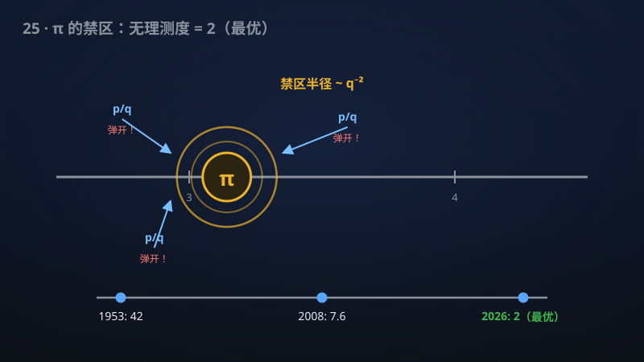

# 25 · π 的无理指数恰为 2

> π 的"无理程度"被精确锁定为 2——人类追了 70 年的最优答案。

**领域**：计算机科学、数学之美 ｜ **数学分支**：数论 ｜ **原文**：[openai/math Family 017](https://github.com/openai/math)

---

## 🌱 小白版：这是什么问题？

无理数是"永远写不完、也不循环"的小数。但同样是无理数，有的容易被分数逼近，有的很难——π 属于很难的那种。"无理指数"就是衡量"有多难"的尺子：指数越小，说明这个数越"倔强"，分数越难靠近它。数学家早就猜 π 的无理指数是 2（理论最小值，几乎所有数都是 2），但证明它难如登天：1953 年 Mahler 只证到不超过 42，之后 70 年人类一点点啃到 7.1。该手稿一举证明它"恰好等于 2"——这是最优的、不可能再改进的答案。顺带还解决了一个"网红级数" Flint–Hills 级数 ∑1/(n³sin²n) 的收敛问题：正因为 π 足够"倔强"，这个级数必然收敛。

## 🎓 专业版：数学上到底说了什么？

对无理数 α，定义无理指数 μ(α) = inf{μ : ∀ε>0，|α − p/q| ≥ q^{−μ−ε} 对所有充分大的分母 q 成立}。该手稿证明 μ(π) = 2，即：∀ε>0，当 q 充分大时，|π − p/q| ≥ q^{−2−ε}。作为推论，Flint–Hills 级数 ∑_{n≥1} 1/(n³ sin²n)（角度取弧度）收敛。

## 🔬 这项成果做了什么？

该手稿证明 π 的无理指数恰为 2：对任意 ε>0 和所有充分大的分母 q，每个有理数 p/q 都满足 |π − p/q| ≥ q^{−2−ε}。该手稿还证明了 Flint–Hills 级数 ∑_{n≥1} 1/(n³ sin²n) 收敛（角度取弧度）。该 family 共 1 篇手稿。

## 🧗 难在哪？

μ(π) 的上界之争持续了 70 年：Mahler（1953）42 → Mignotte（1974）20.6 → Chudnovsky（1982）14.65 → Hata（1993）13.398 → Salikhov（2008）7.6063 → Zeilberger–Zudilin（2019）7.1032。每次进步都依赖更精巧的丢番图逼近构造，而 2 是理论下界（Roth 定理告诉我们代数数的指数恰为 2；π 是超越数，但猜测它取最小值 2）。从 7.1 一步跳到最优的 2，是方法论上的质变，而非渐进改进。

## 🚀 有什么用？

- **计算机科学**：高精度数值计算、任意精度算术库需要知道"π 能被有理数逼近到什么程度"来做误差分析；μ(π)=2 给出最紧的理论保证。
- **物理学**：π 出现在一切波动、旋转与信号处理中；丢番图逼近的最优常数直接影响数值算法的设计与误差界。
- **数学之美**：一个初中生都听过的常数，它的"无理程度"被精确锁定——这是丢番图逼近领域的终极答案之一。

---

> **内容说明**：本文基于 [openai/math](https://github.com/openai/math)（Family 017）官方摘要的转述与中文解读。原成果由 AI 模型产出，官方标注验证程度不一、部分尚未形式化，此处转述不代表数学界共识；引用请以[原文](https://github.com/openai/math)为准。
