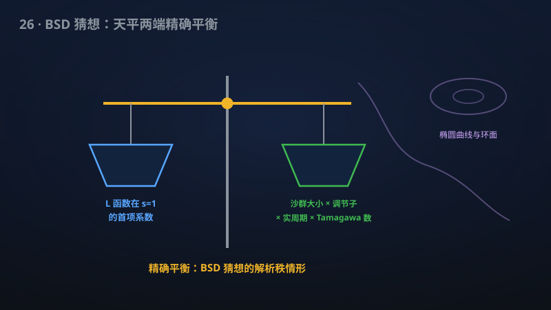

# 26 · 完整 BSD 公式（低 Selmer 余秩情形）

> 千禧年七大难题 BSD 猜想：该手稿对一大类椭圆曲线证明了完整的首项公式。

**领域**：密码学、计算机科学、数学之美 ｜ **数学分支**：数论 ｜ **原文**：[openai/math Family 002](https://github.com/openai/math)

---

## 🌱 小白版：这是什么问题？

想象每条椭圆曲线都是一座"数论大厦"。BSD 猜想说：大厦的"内部结构"——它有多少个有理点（坐标都是分数的点）——完全由它的"体检报告"决定。这份体检报告就是它的 L 函数在 s = 1 处的行为：报告越"异常"（L 函数在 s = 1 的零点阶数越高），大厦里的"房间"（独立的有理点）就越多。1960 年代初，Birch 和 Swinnerton-Dyer 用剑桥大学早期的 EDSAC 计算机算了成百上千条曲线，发现了这个神秘的对应，从此它成为数论中最著名的猜想之一，还被克雷研究所列为千禧年七大难题、悬赏 100 万美元。

猜想的完整版本不只说"房间数 = 异常程度"，还给出一张精确到小数点的"结算单"——**首项公式**：L 函数在 s = 1 的首项系数，等于一串精细零件的乘积：Tate–Shafarevich 群（Ш）的大小、regulator（衡量有理点"个头"的行列式）、实周期（曲线实图像的"周长"）、Tamagawa 数（坏约化处的局部修正因子），再除以挠点群大小的平方。每一个零件都难算，其中 Ш 群更是臭名昭著：它由那些"在每个局部（实数、p 进数）都有解、但整体偏偏无解"的幽灵方程组成，连它是不是总是有限的都没人知道。

该手稿证明的是：只要曲线满足一个温和的条件——存在某个素数 q，使得它的"全 q-幂 Selmer 群"的余秩（corank）为 0 或 1——那么**整个首项公式成立，包括最难的 Ш 群有限性**。Selmer 群可以粗糙地理解为"Ш 群的可计算影子"：它把难算的 Ш 包在一个能用计算机算出来的群里；余秩为 0 或 1 意味着这个影子很"薄"，幽灵无处藏身。再配合手稿 006（Goldfeld 猜想）的密度结果，该手稿的覆盖面被推到"每条椭圆曲线的二次扭转中，密度为一的子集"——也就是"几乎全部"。

举两个生活例子。第一个：医生看血常规。BSD 猜想就像一位神医，声称"只看你的血液化验单（L 函数），就能断定你身体里有多少颗独立的'结石'（有理点）"，而首项公式更进一步，连每颗结石的"重量"（regulator）和"杂质含量"（Ш）都算出来了。第二个：听声辨车。老司机不用拆发动机，听一脚油门的声音就知道哪儿有毛病——L 函数就是椭圆曲线的"发动机声"，BSD 说这声音里编码了整台发动机的结构。该手稿相当于证明：对一大类"车型"，听声辨病不仅定性准确，连零件的精确尺寸都能报出来。

## 🎓 专业版：数学上到底说了什么？

设 E/ℚ 为定义在有理数域上的椭圆曲线。Mordell–Weil 定理断言 E(ℚ) ≅ ℤ^r × E(ℚ)_{tors}，其中 r ≥ 0 为**代数秩**（Mordell–Weil 秩），挠子群 E(ℚ)_{tors} 有限（Mazur 定理完全分类了它可能的 15 种群结构）。由模性定理（Wiles 等），E 的 Hasse–Weil L 函数 L(E, s) 可解析延拓到整个复平面并满足函数方程；记**解析秩** r_{an} = ord_{s=1} L(E, s)。

BSD 猜想断言：(i) **秩等式** r = r_{an}；(ii) **完整首项公式**

L^{(r)}(E,1)/r! = |Ш(E/ℚ)| · Reg(E/ℚ) · Ω_E · ∏_p c_p / |E(ℚ)_{tors}|²，

其中 Ш(E/ℚ) 为 Tate–Shafarevich 群（主齐性空间的局部-整体障碍群），Reg(E/ℚ) 为 Néron–Tate 典范高度配对在 Mordell–Weil 基上的行列式（regulator），Ω_E 为 Néron 微分在 E(ℝ) 上积分的实周期，c_p 为每处坏约化素数 p 的 Tamagawa 数（E(ℚ_p)/E_0(ℚ_p) 的阶），分母为挠子群阶的平方。公式右端每一项都是精细算术不变量，而 Ш 的有限性本身就是未解决的猜想。

Selmer 群的角色由正合列 0 → E(ℚ)/qE(ℚ) → Sel_q(E/ℚ) → Ш(E/ℚ)[q] → 0 刻画：Selmer 群是"可计算的上界"，它同时装着真实的有理点信息和 Ш 的 q-挠"幽灵部分"。**全 q-幂 Selmer 群** Sel_{q^∞} = ∪_n Sel_{q^n} 是 ℤ_q-模；它的**余秩**（corank）指其中 (ℚ_q/ℤ_q)^{⊕c} 部分的 c，即"无限 q-可除部分"的秩。corank 为 0 或 1 是极强的刚性条件：它迫使 Selmer 群"几乎"就等于 E(ℚ) 本身，留给 Ш 幽灵的空间被压缩到最小。

该手稿的定理：在此 corank 0 或 1 的假设下，对 E/ℚ，上述完整首项公式成立，**且** Ш(E/ℚ) 有限（后者是公式中 |Ш| 一项有意义的前提）。

## 🔬 这项成果做了什么？

严格依据官方摘要，该手稿（family 共 3 篇手稿）证明了以下结论：

- **低 Selmer 余秩蕴含完整 BSD**：对每条 ℚ 上的椭圆曲线，只要存在某个素数 q，使得它的全 q-幂 Selmer 群的余秩（corank）为 0 或 1，则该曲线的**完整 BSD 首项公式**成立。
- **Tate–Shafarevich 群有限性**：上述结论**包括** Ш(E/ℚ) 的有限性——这是整个公式中最难的部分，也是此前从未在如此广泛的曲线类上得到的东西。
- **密度为一的二次扭转**：与结果 006（Goldfeld 猜想：二次扭转中解析秩 0 和 1 各占密度 1/2）结合，该手稿给出：每条 ℚ 上椭圆曲线的二次扭转中，一个**密度为一**的子集满足完整 BSD 公式。

手稿摘要未披露具体证明路线。

## 📜 时间线：

- 1960 年代初：Birch 与 Swinnerton-Dyer 在剑桥用 EDSAC 计算机做大量数值实验，发现 L(E,1) 的行为与有理点个数相关，提出 BSD 猜想（1965 年论文 "Notes on elliptic curves (II)" 系统阐述）（一句话：从计算机实验中诞生的猜想）。
- 1977：Coates–Wiles 证明解析秩 0 情形的 BSD（对有复乘的椭圆曲线），BSD 第一个实质性定理（一句话：秩 0 的第一块拼图）。
- 1979：Goldfeld 提出猜想：每条椭圆曲线的二次扭转中，解析秩 0 和 1 各占密度 1/2（即结果 006）（一句话："一半一半"的密度预言）。
- 1986：Gross–Zagier 证明 Heegner 点公式：解析秩 1 时 Heegner 点的高度等于 L'(E,1) 的精确倍数（一句话：秩 1 的解析钥匙）。
- 1988–1990：Kolyvagin 发展 Euler 系方法，证明解析秩 0 或 1 蕴含代数秩相等且 Ш 有限——此前人类最好的一般性结果（一句话：秩等式与 Ш 有限性的里程碑）。
- 2000：克雷数学研究所把 BSD 列为千禧年七大难题之一，悬赏 100 万美元（一句话：官方认证的"世纪难题"）。
- 2014：Skinner–Urban 证明 GL(2) 的岩泽主猜想，为 BSD 的 p-部分（公式在每个素数 p 处的精确形式）奠定基础（一句话：p 进世界的决定性进展）。
- 该手稿：在"全 q-幂 Selmer 群余秩 0 或 1"的温和条件下证明**完整首项公式**（含 Ш 有限性），并与 006 结合覆盖密度为一的二次扭转（一句话：从"秩等式"到"精确到常数的公式"）。

## 💡 核心思想：

BSD 猜想的哲学可以用一句话概括：**解析不变量编码代数不变量**。它的"祖师爷"是 Dirichlet 类数公式：ζ_K(s) 在 s = 1 的留子 = 2^{r_1}(2π)^{r_2} · h_K · R_K / (w_K√|d_K|)，左边是纯解析的留数，右边是类数 h_K、regulator R_K 等纯代数的量。BSD 是把这套哲学从"数域"搬到"椭圆曲线"的宏大升级：L(E,s) 在 s = 1 的零点阶数对应秩，首项系数对应那一串精细不变量的乘积。

理解该手稿的关键，是理解 **Selmer 群为什么是"可计算的影子"**。直接计算 Ш(E/ℚ) 是不可能的——它的元素是"处处局部可解、整体无解"的曲线，连有限性都未知。但 Selmer 群 Sel_q 可以通过有限步的局部计算（解同余方程、算 Hilbert 符号）**真正算出来**。正合列 0 → E(ℚ)/qE(ℚ) → Sel_q → Ш[q] → 0 告诉我们：Selmer 群 = 真实有理点信息 + Ш 的 q-挠幽灵。做 q-下降法（descent）就是不断缩小 Selmer 群、逼近真相的过程。

**余秩（corank）0 或 1** 的条件妙在"刚性"：全 q-幂 Selmer 群作为 ℤ_q-模，若其无限可除部分只有 0 或 1 个 (ℚ_q/ℤ_q) 拷贝，则 Selmer 群的"自由度"极低。直观上，这意味着下降法几乎没有遇到"幽灵"的余地——Ш 的 q-主部分被迫有限，而有限性一旦在某个 q 处成立，结合 Kolyvagin 型 Euler 系的论证框架，就能把"秩等式 + Ш 有限"升级为"精确到每个局部常数的首项公式"。用体检的比喻说：corank 0/1 相当于"血液化验单干净到没有一处可疑指标"，医生才敢下精确到毫克的诊断书。

而与 006 的结合是点睛之笔：Goldfeld 猜想说二次扭转中秩 0 和 1 各占一半密度——而秩 0/1 正是 Selmer 条件最容易满足的情形（Kolyvagin 的机器本来就是为秩 0/1 设计的）。于是"低 Selmer 余秩"这个看似技术性的条件，在二次扭转族中变成了"几乎处处成立"的性质，单个曲线的定理就此升级为"密度为一"的族定理。

## 🧗 难在哪？

BSD 猜想难，难在三个层层加码的关卡，而该手稿一口气过了全部三关。

**第一关：秩等式。** 即便只是证明"有理点的个数 = L 函数零点的阶数"，人类也只在解析秩 0 或 1 的情形做到了（Gross–Zagier 1986 + Kolyvagin 1988–1990），而且 Kolyvagin 的 Euler 系方法本质上是为低秩量身定做的。高秩情形至今没有任何一般性定理。

**第二关：Ш 的有限性。** 这是 BSD 猜想中最臭名昭著的 open problem 之一：Tate–Shafarevich 群是否总是有限，连一个反例或证明都没有。Kolyvagin 在秩 0/1 时证明了它有限，但那是 1990 年的事了，此后 30 多年，Ш 的有限性在更一般的情形下纹丝不动。该手稿在低 Selmer 余秩条件下拿下 Ш 有限性，是这一方向 30 多年来的首次实质推进。

**第三关：精确到常数的首项公式。** 秩等式只说"两边个数相等"，首项公式却要求等式两边的**每一个常数**都精确吻合：regulator（依赖典范高度的精细计算）、实周期 Ω_E、每个坏素数处的 Tamagawa 数 c_p、挠子群的大小。此前，完整首项公式只在极特殊的曲线族（如某些 CM 曲线、某些 Heegner 点相关的族）上成立。从"秩等式"到"完整公式"，中间隔着对所有素数 p 的局部不变量的统一控制——这正是 Skinner–Urban（2014）岩泽主猜想工作的意义所在：它给出了 BSD p-部分的理论框架，而该手稿很可能正是在这样的框架下，把低 Selmer 余秩的刚性转化为了对所有局部因子的精确掌控。

三关全过，还要加上"与 006 结合得到密度为一"——这意味着证明不仅对单个曲线有效，还必须**在二次扭转族中一致地**成立。这是从"定理"到"族定理"的飞跃，也是它被称为"千禧年难题级别的一大片完整结果"的原因。

## 🚀 有什么用？

**已落地的现实影响**（一旦证明被确认，立即生效的数学后果）：

- **计算数论的"可读性"革命**：BSD 首项公式把"难算的代数不变量"（如 |Ш|、regulator）与"可算的解析量"（L 函数的首项系数，可数值计算）用等式连起来。对满足 Selmer 条件的曲线，这意味着关键算术不变量原则上可以从解析数据中"读出"——SageMath、PARI/GP、Magma 等计算代数系统的椭圆曲线功能获得了新的理论地基。
- **LMFDB 等数据库的理论支撑**：LMFDB 收录了数十万条椭圆曲线的数值 BSD 数据（解析秩、Ш 的猜测阶等）。完整首项公式在广泛曲线类上的证明，让这些数值验证从"实验观察"升级为"定理推论"，数据库的可信度与理论价值同步提升。
- **Ш 群有限性的首次大规模确认**：此前 Ш 有限性只在秩 0/1 的经典框架下成立；该手稿把它推广到由 Selmer 条件定义的广泛曲线类——这是算术几何中"局部-整体原则"方向 30 多年来最硬的进展之一。
- **二次扭转族的"几乎全部"覆盖**：与 006 结合后，"密度为一的二次扭转满足完整 BSD"意味着：任取一条椭圆曲线，它的无穷多个二次扭转兄弟中，"几乎所有"都满足精确到常数的 BSD 公式——这是人类第一次对千禧年难题拿下"一大片"而非"零散几点"的完整结果。

**潜在价值**（需要进一步工作或转化的方向）：

- **椭圆曲线密码学（潜在）**：ECC（TLS、比特币都在用）的安全性依赖椭圆曲线有理点群的结构。BSD 公式连接解析与代数两端，有望为"曲线选取"（如何挑选群结构好的曲线）和"安全评估"提供更深的理论工具。不过目前 ECC 的安全主要依赖离散对数难题的计算复杂性，BSD 的直接应用还有距离。
- **高秩 BSD 的跳板（潜在）**：低 Selmer 余秩的情形被拿下后，自然的问题是：能否把方法推向更高的余秩？这有望成为通往"完整 BSD 猜想"的阶梯——尽管每一步都可能需要全新的思想。
- **其他千禧年难题的方法论（潜在）**：BSD 是"解析 ↔ 代数"对应的典范。若其证明中发展了新的 Euler 系技术或岩泽理论工具，有可能迁移到 Bloch–Kato 猜想等更一般的"特殊值公式"问题上。
- **数学之美**：解析与代数——数学中两座最巍峨的大陆——之间第一次架起了一座"精确到常数"的桥，而且这座桥宽到覆盖"几乎全部二次扭转"。这是值得写进数学史的一章。

## 🔗 相关篇目：

- [24 · 准黎曼假设（Re(s) > 7/8 零点自由）](24-003-quasi-riemann.md)——L 函数的另一面：BSD 关心 L 函数在 s = 1 的零点"阶数"，24 号关心 ζ 与狄利克雷 L 函数在 Re(s) > 7/8 的"无零点"
- [27 · CM 阿贝尔簇的霍奇猜想、K3 曲面与 Kuga–Satake](27-032-hodge-conjecture.md)——算术几何的另一座高峰：霍奇猜想同样是千禧年七大难题之一，同样追问"代数"与"解析/拓扑"不变量的对应

## 📖 延伸阅读：

- J. Silverman《The Arithmetic of Elliptic Curves》（1986，第二版 2009，一句话介绍：椭圆曲线算术的标准教材，Mordell–Weil 定理与 Selmer 群的权威入门）
- J. Silverman《Advanced Topics in the Arithmetic of Elliptic Curves》（1994，一句话介绍：进阶专著，系统介绍 BSD 猜想、Gross–Zagier 公式与 Kolyvagin 的 Euler 系）
- B. Birch、P. Swinnerton-Dyer《Notes on elliptic curves (II)》（1965，发表于 Journal für die reine und angewandte Mathematik，一句话介绍：BSD 猜想的奠基性原始论文，数值实验如何催生千禧年难题的现场记录）
- A. Wiles《The Birch and Swinnerton-Dyer Conjecture》（收录于 Clay 数学研究所千禧年问题官方文集，一句话介绍：千禧年难题的官方陈述，由证明费马大定理的 Wiles 亲自撰写的问题描述与背景综述）

---

> **内容说明**：本文基于 [openai/math](https://github.com/openai/math)（Family 002）官方摘要的转述与中文解读。原成果由 AI 模型产出，官方标注验证程度不一、部分尚未形式化，此处转述不代表数学界共识；引用请以[原文](https://github.com/openai/math)为准。
