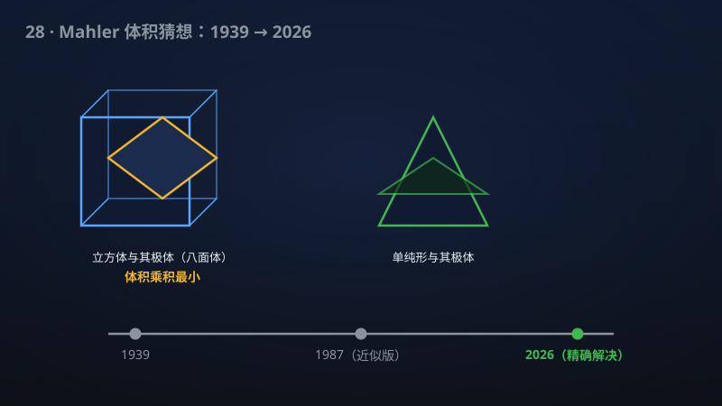

# 28 · Mahler 猜想：体积乘积的极小形状

> 87 年未解的 Mahler 猜想被拿下：凸体与其极体的"体积乘积"最小形状找到了。

**领域**：物理学、计算机科学、数学之美 ｜ **数学分支**：凸几何与度量几何 ｜ **原文**：[openai/math Family 087](https://github.com/openai/math)

---

## 🌱 小白版：这是什么问题？

想象你在吹气球，但有个怪规则：每吹出一个"凸"的气球（数学家叫它**凸体**），就必须按"对偶"规则再吹一个**影子气球**（**极体**）：原气球越胖，影子越瘦；原气球有个尖角，影子就在对应方向鼓出去。1939 年，数学家 Mahler 问了一个听起来像脑筋急转弯的问题：两个气球的体积乘起来，最小能到多少？他猜答案藏在最"有棱角"的形状里：对称情形是"方块"（立方体）及其亲戚们，非对称情形是"金字塔"（单纯形）——越圆、越光滑，乘积反而越大。

举两个生活例子。**例一：快递纸箱。** 同样装东西，方方正正的纸箱和它的"影子箱"体积乘积最小；换成圆柱形快递盒，乘积就变大了——Mahler 猜想说的正是这种"棱角省体积"的直觉。**例二：城市街区。** 曼哈顿那种横平竖直的方块街区（对称凸体），和它对偶的"可达范围"乘积最小；而放射状的圆形广场，乘积更大。

这个问题难在哪？1987 年 Bourgain 和 Milman 只证明了"差一个常数"的近似版本，之后近 40 年毫无寸进。该手稿彻底终结了它：对称与非对称情形在每个维数都被解决，最小形状正是 Mahler 猜的那些，所有取等情形完全分类；还证明了相应的函数版不等式，并附赠一个辛几何的漂亮推论——2n 维对称极积的 Gromov 宽度恒为 4。

## 🎓 专业版：数学上到底说了什么？

设 K ⊂ ℝⁿ 为凸体（紧凸集，内部非空），**极体**定义为 K° = { y ∈ ℝⁿ: ⟨x, y⟩ ≤ 1 对一切 x ∈ K 成立}。**Mahler 体积** v(K) = volₙ(K)·volₙ(K°) 是仿射不变量：对可逆线性变换 T，有 v(TK) = v(K)。

- **对称 Mahler 猜想**：若 K = −K（关于原点对称），则 v(K) ≥ 4ⁿ/n!。该手稿证明最小值确由 **Hanner 多胞体**取到——Hanner 多胞体由区间经 ℓ₁/ℓ∞ 直积迭代生成，是一族 0-对称多胞体，包括立方体及其极体（交叉多胞体）等；所有取等情形被完全分类。具体数值上：n=2 时下界为 4²/2! = 8（正是 Mahler 1939 年证得的二维结果），n=3 时为 4³/3! = 32/3（Iriyeh–Shibata 2020 的结果）；非对称情形 n=2 时下界为 3³/(2!)² = 27/4。
- **非对称 Mahler 猜想**：对一般凸体，v(K) ≥ (n+1)^{n+1}/(n!)²，最小值由**单纯形**（及其极体、仿射像）取到；取等情形同样完全分类。
- 作为对照的上界是 **Blaschke–Santaló 不等式**（Santaló，1949）：v(K) ≤ vol(Bⁿ)²，欧氏球取等——光滑的球取上界，有棱角的多胞体取下界，形状的两极各得其所。
- **函数版 Mahler 不等式**：对偶 log-凹函数 f: ℝⁿ → [0, ∞)，有 ∫f · ∫f° ≥ 4ⁿ，其中极函数 f°(y) = inf_x e^{−⟨x,y⟩}/f(x)；该手稿证明相应的尖锐函数式不等式成立。几何情形是 f 取凸体示性函数时的特例。
- **辛几何推论**：n ≥ 2 时，每个 2n 维对称极积 K × K°（配标准辛形式）的 **Gromov 宽度**为 4，即其中能辛嵌入的最大球由 πr² ≤ 4 决定，宽度与 K 的具体形状无关。

## 🔬 这项成果做了什么？

严格基于官方摘要，该手稿证明了以下结论：

- **对称几何 Mahler 猜想**：在每个维数下解决，Hanner 多胞体是体积乘积的最小化子，所有等号情形完全分类。
- **非对称几何 Mahler 猜想**：在每个维数下解决，单纯形是体积乘积的最小化子，所有等号情形完全分类。
- **函数式 Mahler 不等式**：相应的尖锐函数版 Mahler 不等式成立。
- **辛宽度推论**：对 n ≥ 2，每个 2n 维对称极积 K × K° 的 Gromov 宽度为 4。
- 该 family 共 3 篇手稿。

手稿摘要未披露具体证明路线。

## 📜 时间线：

- 1939：Mahler 在论文 "Ein Minimalproblem für konvexe Polygone" 中提出猜想，并证明二维情形。
- 1949：Santaló 证明 Blaschke–Santaló 不等式，给出体积乘积的**上界**（球取等）。
- 1956：Hanner 研究 Hanner 多胞体——后来被证实为对称情形的极小形状。
- 1980：Saint-Raymond 解决无条件凸体（unconditional bodies）情形。
- 1985：Gromov 证明非挤压定理，开创辛容量理论。
- 1987：Bourgain–Milman 证明逆 Santaló 不等式：Mahler 体积有只差一个绝对常数的下界。
- 2008：Kuperberg 把该绝对常数优化到 1/2。
- 2020：Iriyeh–Shibata 在 Duke Math. J. 169(6):1077–1134 证明三维对称情形：|K||K°| ≥ 32/3，等号当且仅当 K 或 K° 为平行六面体。

## 💡 核心思想：

**仿射不变性决定了"极小形状必是极端的"。** Mahler 体积在仿射变换下不变，所以问题只与"形状"有关，与大小、位置、倾斜无关。这意味着极小值如果存在，一定在"形状空间"的边界上取得——而边界上住着的，恰恰是最多棱角、最不光滑的多胞体。这就解释了为什么球（最光滑）取的是上界（Santaló），而立方体、单纯形（棱角分明）取下界。

**"不光滑"正是 87 年僵持的根源。** 传统变分法靠"光滑扰动"找极小值：假设极小形状光滑，写 Euler–Lagrange 方程求解。但 Mahler 猜想的极小形状天生就是多胞体——处处是棱角，根本不可微，变分法无从下手。这就像要用微积分找一座金字塔的最低点：工具和对象的"光滑度"对不上。此前的所有进展（Bourgain–Milman 的常数界、特殊凸体类）都是绕开这个根本困难的迂回。

**函数化：给几何问题造一个"插值空间"。** 几何 Mahler 猜想是函数式不等式的特例（取 f 为凸体的示性函数）。把 0-1 函数放宽为一般的 log-凹函数，问题就从离散的"形状"世界进入连续的"函数"世界——在那里，变分、归纳、解析工具有了用武之地。官方摘要把"尖锐的函数式 Mahler 不等式"与几何版本并列提出，暗示这条"先函数、后几何"的路线可能是证明的骨架。

**辛几何的意外之喜：刚性。** 对称 Mahler 猜想与辛几何中的 Viterbo 猜想在凸情形据称等价（Artstein-Avidan–Karasev–Ostrover 的工作）。而"Gromov 宽度恒为 4"是一个**刚性**现象：无论 K 长成什么样，K × K° 的辛容量都一模一样。这说明体积乘积的极小问题背后，藏着辛几何的深层刚性——形状可以千变万化，容量岿然不动。

**为什么"完全分类取等情形"比证明不等式更难？** 证明 v(K) ≥ cₙ 只需要找到下界；但分类取等需要回答：**恰好**达到下界的 K 长什么样？对称情形的答案不是唯一的"立方体"，而是整个 Hanner 多胞体族——一个随维数指数增长的大家族。刻画这个家族的完整边界，需要对极小化子的组合结构有精细到"一个顶点都不差"的理解，这比单纯的不等式估计难了一个量级，也是此前所有部分结果都未能触及的。

## 🧗 难在哪？

Mahler 猜想由数论学家 Kurt Mahler 于 1939 年提出，他本人只解决了二维情形。此后近 90 年，高维的精确最小值无人能碰：连三维对称情形都要等到 2020 年，才由 Iriyeh–Shibata 在 Duke Math. J. 169(6):1077–1134 解决（|K||K°| ≥ 32/3，等号当且仅当 K 或 K° 为平行六面体）——三维已如此艰难，更高维可想而知。

此前最好的一般性结果是 Bourgain–Milman（1987）的"逆 Santaló 不等式"：体积乘积有下界，但差了一个绝对常数；Kuperberg（2008）用精巧的积分几何方法把常数优化到 1/2，但仍不是精确值。其余进展都局限在特殊凸体类：无条件凸体（Saint-Raymond，1980）、zonotope 等——每一类都需要量身定做的方法，无法推广。

根本困难在于猜测的极小形状（多胞体）极其"不光滑"，传统变分法难以锁定；而对称情形的极小化子甚至不是唯一的（整个 Hanner 多胞体族），"完全分类所有取等情形"比单纯证明不等式又难了一个量级。该手稿一次性解决对称与非对称、任意维数、取等分类、函数版本，并附带辛宽度推论，是凸几何几十年未见的"全垒打"。

## 🚀 有什么用？

- **凸几何与渐近几何分析**：87 年猜想的终结本身就是学科史事件；等号的完整分类（Hanner 多胞体族、单纯形）为高维凸体的极值理论画上了句号，此后任何相关工作都将以此为基准。
- **辛几何**：Gromov 宽度恒为 4 给出了一大类辛流形（对称极积）容量的精确值，为哈密顿系统的"辛嵌入"问题提供了 concrete 的基准例子。
- **凸优化与算法复杂度**：体积乘积刻画了范数几何的"不对称程度"；极值形状的精确刻画有望用于优化算法的最坏情形分析，乃至算法复杂度下界的构造。
- **机器学习理论**：高维凸体的体积计算、均匀采样是理论计算机科学的经典问题；极值几何的澄清可能为采样算法的混合时间分析提供新的极值例子。
- **量子信息**：相空间的凸几何与量子不确定性原理的几何形式相关；辛容量与量子信道容量之间存在形式上的类比，宽度为 4 的刚性结果可能在其中找到回响。
- **泛函分析与高维概率**：函数式 Mahler 不等式是 log-凹函数世界的尖锐不等式，有望在浓度不等式、等周问题中找到应用。
- **【潜在】格理论与格密码**：凸体与其极体的体积关系，是格理论中"对偶格"估计的几何源头；Mahler 体积的精确极值有望为格基约化算法的分析提供新的极值基准。
- **数学之美**：87 年猜想的终结，等号分类的完整性堪称"凸几何的句号"。

## 🔗 相关篇目：

- [25 · π 的无理指数恰为 2](25-017-pi-irrationality.md)——Mahler 本人是丢番图逼近与无理指数研究的先驱；两篇同属"用精细估计刻画数的几何"的传统。
- [02 · 矩阵乘法指数 ≤ 9/4](02-107-matrix-multiplication.md)——凸几何是凸优化的基石，而凸优化正是矩阵乘法等代数算法复杂度分析的常用工具。

## 📖 延伸阅读：

- Schneider《Convex Bodies: The Brunn–Minkowski Theory》（2014 第二版，凸几何领域的"圣经"级专著）
- Artstein-Avidan–Giannopoulos–Milman《Asymptotic Geometric Analysis, Part I》（2015，高维凸几何的现代视角）
- Gromov《Pseudo-holomorphic curves in symplectic manifolds》（1985，开创辛容量理论的奠基性论文，非挤压定理的出处）

---

> **内容说明**：本文基于 [openai/math](https://github.com/openai/math)（Family 087）官方摘要的转述与中文解读。原成果由 AI 模型产出，官方标注验证程度不一、部分尚未形式化，此处转述不代表数学界共识；引用请以[原文](https://github.com/openai/math)为准。
