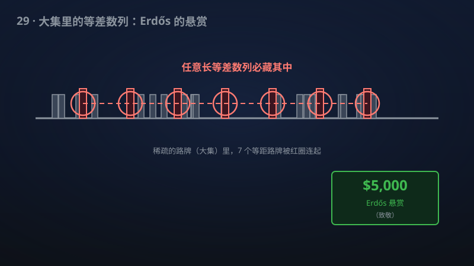

# 29 · Erdős 倒数和猜想与拟多项式 Szemerédi 界

> Erdős 悬赏 5000 美元的猜想被证明：倒数发散的整数集必含任意长等差数列。

**领域**：计算机科学、密码学、数学之美 ｜ **数学分支**：组合数学 ｜ **原文**：[openai/math Family 159](https://github.com/openai/math)

---

## 🌱 小白版：这是什么问题？

想象一条无限长的"整数公路"：1, 2, 3, 4……你要在上面立路牌。Erdős 问：如果路牌"足够多"——多到它们的倒数 1/n 加起来发散到无穷（数学家把这种集合叫**大集**）——那么这些路牌里，是不是一定藏着任意长的**等差数列**？比如 5, 11, 17, 23 就是公差为 6 的 4 项等差数列。

举两个例子。**例一：全体素数。** 欧拉在 1737 年就证明素数倒数和发散，所以素数是个大集；2004 年 Green–Tao 定理证明素数里有任意长等差数列——这正是 Erdős 猜想的一个特例，而该手稿把结论推广到了**所有**大集，Green–Tao 从此成为它的一条推论。**例二：一个挑数游戏。** 从 1 到 100 里挑数，规则是不能出现 3 项等差数列（比如同时挑了 4、7、10 就算犯规）。你最多能挑多少个？手稿给出的"拟多项式"界说：能挑的数量不到 N 的一个微小比例——比 N 本身小得多，但又比任何多项式倒数衰减得慢，卡在中间一个奇妙的位置。

Erdős 在 1976 年为这个问题悬赏 3000 美元（如今涨到 5000 美元）。该手稿不仅证明了猜想本身，还给出了定量版本：{1,…,N} 中不含 k 项等差数列的子集，大小至多 C_k·N·exp[−c_k(log N)^{ε_k}]——"拟多项式"界，比之前最好的界强得多，是加性组合学十年来的最大跨越。

## 🎓 专业版：数学上到底说了什么？

设 A ⊂ ℕ⁺。若 ∑_{n∈A} 1/n = ∞，称 A 为**大集**（large set）。**非常值 k 项等差数列**指形如 a, a+d, …, a+(k−1)d 的 k 元组，其中公差 d ≠ 0。

该手稿证明 **Erdős 倒数和猜想**：每个大集都包含任意有限长的非常值等差数列。

定量版本：对每个固定的 k ≥ 3，{1,…,N} 的任意无非常值 k 项等差数列的子集，其大小至多为

| A | ≤ C_k · N · exp[ −c_k (log N)^{ε_k}]，

其中 C_k, c_k, ε_k > 0 是仅依赖于 k 的常数。衰减因子 exp[−(log N)^{ε_k}] 被称为**拟多项式**型的：它比任何多项式倒数 N^{−δ}（δ > 0）衰减得慢，又比任何对数倒数 (log N)^{−A} 衰减得快——恰好卡在多项式与对数之间。注意"对每个固定 k"这一限定是本质的：常数随 k 增长而恶化，关于 k 一致的界仍是开放问题。该界对一切固定的 k ≥ 3 同时成立，是此前从未达到过的统一强度。

与此前最佳界的对比：Roth 的 k=3 情形经 Bloom–Sisask（2020）改进到 N/(log N)^{1+c}，再经 Kelley–Meka（2023）取得突破；但 k ≥ 4 的 Szemerédi 界长期停滞在远弱得多的水平。该手稿一步跨到对一切 k ≥ 3 成立的拟多项式界。

## 🔬 这项成果做了什么？

严格基于官方摘要，该手稿证明了以下结论：

- **主定理（Erdős 倒数和猜想）**：每个倒数和发散的正整数集都包含任意有限长的等差数列。
- **定量版本**：对每个固定 k ≥ 3，{1,…,N} 中不含非常值 k 项等差数列的子集大小至多为 C_k N exp[−c_k (log N)^{ε_k}]，其中 C_k, c_k, ε_k > 0 是仅依赖 k 的常数。
- 该 family 共 1 篇手稿。

手稿摘要未披露具体证明路线。

## 📜 时间线：

- 1936：Erdős–Turán 提出猜想：正密度整数集是否含任意长等差数列。
- 1946：Behrend 构造出很大的无 3 项等差数列集——上界构造的经典例子，说明"避开等差数列"可以做得相当大。
- 1953：Roth 解决 3 项情形（Roth 定理），开创傅里叶方法在加性组合中的应用。
- 1975：Szemerédi 完全证明 Erdős–Turán 猜想（Szemerédi 定理），2012 年获阿贝尔奖。
- 1976：Erdős 在演讲中提出更强的"大集"版本并悬赏 3000 美元（现为 5000 美元）。
- 2001：Gowers 给出 Szemerédi 定理的第一个有效定量界（1998 年获菲尔兹奖），但界是 tower 型的，极弱。
- 2004：Green–Tao 证明素数含任意长等差数列——Erdős 猜想的一个特例。
- 2020/2023：Bloom–Sisask 与 Kelley–Meka 相继在 Roth 数（k=3）问题上取得突破，但 k ≥ 4 的界长期停滞。

## 💡 核心思想：

**"大集"比"正密度"难得多。** Szemerédi 定理要求集合有正密度（比如占 1%），而大集可以稀疏到密度趋于 0——素数的密度只有约 1/log N，倒数和却发散。大集可以"伪装"得非常均匀，让传统的傅里叶方法抓不住把柄。这就是为什么 Green–Tao 定理（素数情形）已经需要动用遍历论与高阶傅里叶分析的重型武器，而一般的"大集"猜想又比它难得多。

**经典策略的升级版：密度增量。** Roth 在 1953 年的策略是"密度增量法"：如果集合 A 在整体上不够密，那就找一个等差子数列，使得 A 在其中相对更密，然后聚焦过去、重复论证。对大集而言，关键的第一步是**二进分解**：倒数和发散意味着，必有某个二进块 [2^j, 2^{j+1}) 上的倒数和足够大——在这个块里，集合的相对密度就变得可观了。于是"大集"问题被转化为"在某个区间里相对较密的集合"的问题，而后者正是 Szemerédi 型定理的舒适区。

**拟多项式界意味着"损失很小"。** 密度增量每迭代一步都要付出代价：区间的长度缩水、密度的增量打折。此前 Gowers 的 tower 型界正是因为每一步的损失太大，迭代 k 次后损失叠成了"指数的指数……"。而拟多项式界 exp[−(log N)^ε] 表明，每一步的损失被控制在了 (log N) 的幂次量级——这是一种极其精细的控制，说明证明中找到了一种远比前人高效的增量机制。

**为什么 k ≥ 4 特别难？** k=3 只需要经典傅里叶分析；k ≥ 4 需要**高阶傅里叶分析**（Gowers 范数），复杂度随 k 爆炸式增长。此前 k ≥ 4 的 Szemerédi 界停滞多年，正是因为高阶情形的"结构 vs 随机"二分法难以定量化。该手稿对一切 k ≥ 3 给出统一的拟多项式界，意味着高阶障碍被系统性地克服了。

**从"拟多项式"到"多项式"还有多远？** 拟多项式界 exp[−(log N)^ε] 并非终点：人们猜测真正的界可能是多项式型的 N^{1−c}。Behrend 在 1946 年的构造说明，无 3 项等差数列的集合可以大到约 N·exp(−c√log N) 的量级——这是下界构造的天花板。因此，新的拟多项式上界与 Behrend 下界之间仍有一段空隙，"多项式界"依然是开放目标。该手稿的意义在于，它第一次把上界推进到了与下界"同一量级家族"（都是 exp(−(log N) 的幂次）)，剩下的路虽然还长，但不再是鸿沟。

## 🧗 难在哪？

Erdős–Turán 猜想（1936）问"正密度集是否含任意长等差数列"，Roth（1952/1953）解决 3 项情形，Szemerédi（1975）完全解决并获 2012 年阿贝尔奖，Furstenberg（1977）给出遍历论证明（开辟了新领域，但不给显式界），Gowers（2001）给出第一个有效定量界（1998 年获菲尔兹奖）。Erdős 在 1976 年的演讲中提出更强的"大集"版本并悬赏 3000 美元（现为 5000 美元）。

但此后近 50 年，连"**大集必含 3 项等差数列**"都是开放的（Sanders 的结果最接近）；定量界方面，Gowers 的 tower 型界弱到几乎无法使用，k ≥ 4 的 Szemerédi 界长期停滞。Bloom–Sisask（2020）把 Roth 界改进到 N/(log N)^{1+c}，Kelley–Meka（2023）在 Roth 数问题上取得突破——但这些都只解决 k=3 的上界问题，离"大集"的猜想还差得很远。值得一提的是，Furstenberg 的遍历论证明（1977）虽然漂亮，却给不出任何显式界——"存在"与"有多大"之间隔着一条鸿沟，这正是定量版本价值连城的原因。该手稿一步跨到"对一切 k ≥ 3 的拟多项式界"，是加性组合学十年来的最大跨越。

## 🚀 有什么用？

- **加性组合学**：终结近 50 年的悬赏猜想；Green–Tao 定理（2004）从此成为它的一条推论，数论与组合学的版图被重新绘制。
- **理论计算机科学**：Szemerédi 型定量界直接决定"在数据中寻找等差模式"的算法复杂度上界；拟多项式界有望把一批组合搜索算法的复杂度分析推进一大步。
- **性质测试**：判定一个长序列是否"伪随机"，常常归结为检测其中是否含有异常多的等差结构；更强的定量界意味着更灵敏的测试判据。
- **密码学**：伪随机数发生器的"不可预测性"分析常归结为组合数论中的均匀分布问题；大集上的结构定理为这类分析提供了新的工具。
- **遍历论与动力系统**：经由 Furstenberg 对应原理，组合数论的定量界往往对应着遍历定理的收敛速度；拟多项式界有望在动力系统一侧产生回响。
- **数据科学**：在时间序列、基因序列中寻找隐藏的等差/周期模式是常见需求；更紧的界为这类"找模式"问题的理论保证打下基础。
- **【潜在】加法数论**："倒数发散蕴含任意长等差数列"这一"大集必有结构"的哲学，有望推广到多项式取值集、素数变体等更精细的数论集合，催生一批新的组合数论定理。
- **【潜在】理论计算机科学的"去随机化"**：许多随机算法的去随机化依赖组合数论中的伪随机对象构造；更强的 Szemerédi 定量界有望改进这类构造的参数，让"用更少随机性办更多事"成为可能。
- **数学之美**：一个悬赏近 50 年、奖金 5000 美元的猜想终结，且 Green–Tao 定理成为其推论——这是数论与组合学的"大一统"时刻。

## 🔗 相关篇目：

- [24 · 准黎曼假设（Re(s) > 7/8 零点自由）](24-003-quasi-riemann.md)——解析数论：素数分布与黎曼 ζ 函数零点，而 Erdős 猜想中的"大集"典型例子正是素数。
- [25 · π 的无理指数恰为 2](25-017-pi-irrationality.md)——同属数论：丢番图逼近与加性组合在方法上渊源深厚（Roth 本人就是丢番图逼近大师）。
- [01 · 唯一游戏猜想（Unique Games Conjecture）与最优近似阈值](01-102-unique-games.md)——理论计算机科学：傅里叶分析同时是加性组合与硬度 of approximation 的核心工具。

## 📖 延伸阅读：

- Tao–Vu《Additive Combinatorics》（2006，加性组合学的标准教材，Roth 定理与 Szemerédi 定理的系统讲授）
- Graham–Rothschild–Spencer《Ramsey Theory》（1990 第二版，拉姆齐理论的经典专著）
- Nathanson《Additive Number Theory: Inverse Problems and the Geometry of Sumsets》（1996，加性数论的代表性著作）

---

> **内容说明**：本文基于 [openai/math](https://github.com/openai/math)（Family 159）官方摘要的转述与中文解读。原成果由 AI 模型产出，官方标注验证程度不一、部分尚未形式化，此处转述不代表数学界共识；引用请以[原文](https://github.com/openai/math)为准。
