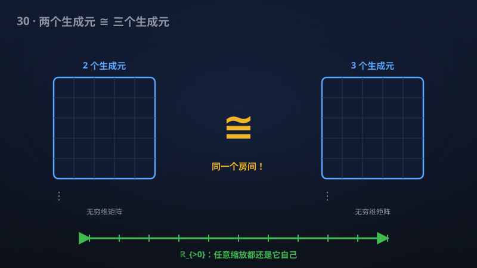

# 30 · 自由群因子的同构问题

> 算子代数 80 年悬案终结：自由群因子 L(F₂) 与 L(F₃) 被证明同构。

**领域**：量子物理、数学之美 ｜ **数学分支**：算子代数 ｜ **原文**：[openai/math Family 287](https://github.com/openai/math)

---

## 🌱 小白版：这是什么问题？

冯·诺依曼在 1930–40 年代发明"算子代数"，是给量子力学打造的"数学房子"。其中有一类最神秘的"房间"叫 II₁ 因子——可以想成"无穷维的矩阵代数"。由"自由群"（最"自由"的群，没有任何附加关系）盖出来的房间叫"自由群因子"L(Fₙ)，n 是生成元个数。直觉上，2 个生成元和 3 个生成元盖出的"房间"应该不一样吧？但近 80 年来没人能证明它们"不一样"——也证不出"一样"。该手稿证明：L(F₂) ≅ L(F₃)，进而所有内插自由群因子（包括 L(F_∞)）都彼此同构；它们的公共因子的"基本群"（衡量"缩放对称性"的不变量）是全体正实数 ℝ_{>0}。相当于宣布：这些看似不同的"房间"，其实是同一间。

## 🎓 专业版：数学上到底说了什么？

该手稿解决自由群因子同构问题：L(𝔽₂) ≅ L(𝔽₃)，从而所有内插自由群因子（包括 L(𝔽_∞)）彼此同构；其公共因子的基本群为 ℝ_{>0}（即对一切 t>0，放大 M_t ≅ M）。

## 🔬 这项成果做了什么？

该手稿解决了自由群因子同构问题：证明 L(𝔽₂) ≅ L(𝔽₃)，从而所有内插自由群因子（包括 L(𝔽_∞)）都同构；它们的公共因子的基本群为 ℝ_{>0}。该 family 共 1 篇手稿。

## 🧗 难在哪？

Murray 与冯·诺依曼在 1936–1943 年的 "On Rings of Operators" 系列论文中创立算子代数并提出因子分类；自由群因子的同构问题自此悬置近 80 年。此前进展：Voiculescu 在 1990 年代用自由概率论证明自由群因子没有 Cartan 子代数；Ozawa–Popa（2007）证明其"强 solidity"；但"不同秩是否同构"这一根本问题纹丝不动——它是算子代数领域公认的头号开放问题之一。该手稿给出的答案是"全部同构"，终结了这一二分问题。

## 🚀 有什么用？

- **量子物理**：冯·诺依曼代数是量子力学的数学语言；II₁ 因子的分类是"量子对称性"分类的核心，自由群因子的统一极大简化了这幅图景。
- **计算机科学**：自由概率论与随机矩阵、大维数据分析相关；因子分类的澄清为相关应用扫清理论障碍。
- **数学之美**：80 年悬案的终结本身就是数学史事件；"看似不同实则同一"的结论极具美学冲击力。

---

> **内容说明**：本文基于 [openai/math](https://github.com/openai/math)（Family 287）官方摘要的转述与中文解读。原成果由 AI 模型产出，官方标注验证程度不一、部分尚未形式化，此处转述不代表数学界共识；引用请以[原文](https://github.com/openai/math)为准。
